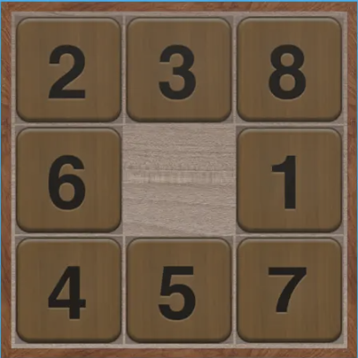

Everyone's familiar with the classic 8 Puzzle game:

*Slide tiles into the blank space until the numbers run 1 through 8 in order, with the blank in the top left.*

Does the textbook hierarchy of state space search algorithms actually behave
the way the textbooks claim on a problem small enough to inspect by hand?
That's what I wanted to find out here. The Eight Puzzle is the canonical toy. A 3x3
grid with eight numbered tiles and a single blank, and the goal is to slide
tiles into ascending order with the blank in the top left. The reachable
state space has size 181,440, which is exactly half of 9! because tile slides
preserve permutation parity.

$$|S| = \frac{9!}{2} = 181{,}440$$

So do random, breadth first, depth first, greedy best first, and A* search
separate clearly on this problem, and how much of the separation comes from
the algorithm versus the heuristic you give it?

The problem is that the state space, while finite, is large enough that
uninformed search wastes most of its work on configurations no human solver
would ever consider. A blind frontier expansion at depth 18 still has roughly
200 million candidates if you ignore cycle detection, starting from the board above.

$$N(d) \leq 4^d, \qquad d = 18 \;\Longrightarrow\; N \approx 2.0 \times 10^8$$

Even after pruning cycles the count stays in the tens of thousands on the harder
boards. Any algorithm that does not somehow weight the search toward
goal-like states is going to spend almost all of its budget visiting
irrelevant ones. That is the case for heuristic search. The flip side is
that a poorly chosen heuristic can make things worse than no heuristic at
all, by confidently steering the search down a corridor that does not lead
to the goal.

It's a bit hard to explain the exact code implementation, so contact me if you want a more detailed explanation and I'd be happy to talk about it. The gist is this:

The dataset is three text files of starting configurations, grouped by the
optimal solution length: 5_moves.txt, 18_moves.txt, and 27_moves.txt. Each
file has ten boards encoded as a permutation of the digits 0 through 8,
where 0 is the blank. The optimal length is the labeled difficulty. The 5
move set is for sanity checks. The 18 move set is the regime where
uninformed search is on the edge of feasible. The 27 move set is past it.

The first thing you have to decide is how to represent a board. I went with
a 2D list of integers and tracked the blank position explicitly as
`(blank_r, blank_c)` so I never have to scan for it.

$$\mathbf{B}: \{0, 1, 2\} \times \{0, 1, 2\} \to \{0, 1, \ldots, 8\}, \quad \text{bijective}$$

The constructor takes a 9 character digit string and fills the grid row by
row.

$$\mathbf{B}(r, c) = \text{int}\!\left(\text{digitstr}[\,3r + c\,]\right)$$

Tracking the blank position is not strictly necessary but it converts
every move from \\(O(n)\\) to \\(O(1)\\), and over millions of generated
successors that is a huge benefit.

A move slides the blank in one of four directions. Internally I shift the
blank coordinate, check it stays inside the grid, and if so swap the blank
with the tile that was there:

$$
\begin{aligned}
(r', c') &= (r, c) + d \\
\text{tiles}[r][c], \, \text{tiles}[r'][c'] &= \text{tiles}[r'][c'], \, \text{tiles}[r][c]
\end{aligned}
$$

where \\(d \in \{(-1, 0), (1, 0), (0, -1), (0, 1)\}\\) for up, down, left,
right. If the new coordinates are off the grid, the move is rejected.

$$\text{valid}(r', c') \iff 0 \leq r' \leq 2 \;\wedge\; 0 \leq c' \leq 2$$

A State wraps a Board with three extra fields: a predecessor pointer, the
move that produced this state, and the depth in the search tree.

$$s = (\mathbf{B}, \, \text{pred}, \, m, \, g), \qquad g(s) = \begin{cases} 0 & \text{pred} = \varnothing \\ g(\text{pred}) + 1 & \text{otherwise} \end{cases}$$

The predecessor pointer is what lets me reconstruct the move sequence at
the end without storing the full path inside the state. It also lets me
detect cycles easily by walking back up the chain and checking for board
equality.

$$\text{cycle}(s) \iff \exists \, s' \in \text{ancestors}(s) : \, s'.\mathbf{B} = s.\mathbf{B}$$

This matters because without cycle detection, even BFS will waste time
re-expanding the same configurations.

Successor generation tries all four directions on a copy of the board,
keeps the moves that succeed, and wraps each into a new State with the
predecessor set to self.

$$\text{succ}(s) = \left\{\, (\text{apply}(s, m), \, s, \, m, \, g(s) + 1) \,:\, m \in M, \; \text{valid}(s, m) \,\right\}$$

The branching factor is at most four, typically two or three after cycle
pruning.

$$1 \leq \big|\,\text{succ}(s) \setminus \{s' : \text{cycle}(s')\}\,\big| \leq 3$$

The search abstraction is a Searcher base class with a list of untested
states, a depth limit, and a tested counter. The contract is that
find_solution pops a state via next_state, checks goal, generates
successors otherwise, and adds them subject to a should_add filter that
enforces the depth limit and rejects cycle creators.

$$\text{should\_add}(s) \iff \big(\, g(s) \leq L \;\vee\; L = -1 \,\big) \,\wedge\, \neg\,\text{cycle}(s)$$

Subclasses override next_state to implement different orderings: random
pick for the base class, FIFO for BFS, LIFO for DFS, and a priority-max
pick for the informed searchers.

$$\text{next\_state} \in \begin{cases} \text{Uniform}(F) & \text{Random} \\ \arg\min_{s \in F} \, t_{\text{enq}}(s) & \text{BFS} \\ \arg\max_{s \in F} \, t_{\text{enq}}(s) & \text{DFS} \\ \arg\max_{s \in F} \, \text{priority}(s) & \text{Greedy, A*} \end{cases}$$

There is a real argument for just running BFS and calling it done, because
BFS is complete and optimal for unit-cost step problems, and the Eight
Puzzle is one.

$$T_{\text{BFS}} = O(b^d), \qquad \text{return } s^* \;\text{with}\; g(s^*) = \min_{s \in \text{Goals}} g(s)$$

The question is whether you can do better in states tested without giving
up optimality. That is what informed search is supposed to deliver. An
admissible heuristic should let A* prune the frontier without ever closing
off the optimal path.

$$h \text{ admissible} \iff \forall \, s \in S: \; h(s) \leq h^*(s)$$

The heuristics I implemented are non standard and worth describing. h0 returns 0, which makes A* behave like uniform cost search. h1
returns `state.num_moves`, which is the g cost and not a heuristic in the
usual sense. h2 returns `num_moves` plus the Manhattan distance of the
blank from the origin (0, 0).

$$h_0(s) = 0, \qquad h_1(s) = g(s), \qquad h_2(s) = g(s) + |\text{blank}_r(s)| + |\text{blank}_c(s)|$$

Neither h1 nor h2 estimates the distance from the current state to the
goal in the way a textbook heuristic would. I left them in because the
experiments they enable still illustrate the point: any monotone signal
that grows with depth or distance from a fixed reference biases the
search, and the bias either helps or hurts depending on whether the
signal correlates with proximity to the goal.

One thing to be upfront about: h1 and h2 are not admissible. Both include
g, the number of moves already made, and that can easily be larger than the
number of moves left to the goal. So the textbook optimality guarantee for
A* does not formally apply to them. As you'll see below, A* with h2 still
returns optimal solutions here, but for a different reason.

The Greedy searcher computes priority as

$$\text{priority}(s) = -\left( \, \text{misplaced}(s) + h(s) \, \right)$$

with h treated as zero unless the heuristic is h2, in which case it is
added.

$$\text{misplaced}(s) = \sum_{r=0}^{2}\sum_{c=0}^{2} \mathbf{1}\!\left[\mathbf{B}(r,c) \neq 0 \;\wedge\; \mathbf{B}(r,c) \neq \mathbf{G}(r,c)\right]$$

The negation is there because I take max over priorities to pick the next
state. Misplaced tile count, defined as the number of tiles not in their
goal position, ends up doing basically everything Greedy. It is a real
heuristic in the textbook sense, and Greedy with misplaced tile count
finds solutions quickly but rarely optimally.

The A* searcher computes priority as

$$\text{priority}(s) = -\left( \, h(s) + \text{num\_moves}(s) \, \right)$$

which is the negated f-cost from the textbook formula \\(f = g + h\\), if
you read num_moves as g and h as the heuristic.

$$f(s) = g(s) + h(s), \qquad g(s) = \text{num\_moves}(s)$$

The catch is that with h1 the h term is itself num_moves, so f effectively
doubles g and the search degenerates into BFS with a strange tiebreaker.

$$f_{h_1}(s) = g(s) + h_1(s) = 2 \, g(s)$$

With h2 things improve, because the blank distance term breaks ties
in a way that prefers states whose blank is closer to the top left corner,
which is where the goal puts it. That correlates with progress on every
board, since the blank has to end up there.

$$f_{h_2}(s) = 2 \, g(s) + |\text{blank}_r(s)| + |\text{blank}_c(s)|$$

Notice that 2g goes up by 2 with every move, while the blank term only ranges
from 0 to 4. So A* with h2 still mostly expands states in order of depth,
like BFS, with the blank position deciding the order within and between
neighboring depths. Dividing f by 2 doesn't change the order, and gives
\\(g(s) + (\lvert \text{blank}\_r(s) \rvert + \lvert \text{blank}\_c(s) \rvert) / 2\\). The blank needs at
least as many moves as its distance from the corner, so half that distance
is an admissible heuristic. That is why it keeps finding optimal solutions
even though h2 itself isn't admissible.

Now to the results:

On 5_moves.txt every algorithm solves every puzzle. The interesting
numbers are states tested. BFS expands on the order of a hundred to a few
hundred states per puzzle. DFS with no depth limit can dive deep and
tested counts are either small or huge depending on the seed. Greedy with
misplaced tiles finishes in tens of states. A* with h2 finishes in similar
territory. At this difficulty the algorithms are indistinguishable from a
solving perspective.

On 18_moves.txt the separation between algorithms appears. BFS finishes but the expanded
frontier crosses 100,000 states on the harder boards. DFS with a depth
limit of 20 sometimes returns a 20 move solution and sometimes runs out of
frontier without finding one. Greedy with the misplaced tile count finds
solutions quickly but they are bad: 92, 56, 66, 186, 194, 96 moves on the
puzzles it solves, against an optimal of 18.

$$\bar{g}_{\text{Greedy}} = \frac{92 + 56 + 66 + 186 + 194 + 96}{6} = 115, \qquad g^* = 18, \qquad \frac{\bar{g}}{g^*} \approx 6.4$$

That is what greedy looks like. It commits to the first frontier expansion
that scores well and then meanders.

A* with h2 gives the best results of the bunch. On the six
boards it solves within a reasonable interrupt threshold, every solution
is exactly 18 moves, and the states tested counts are 34413, 32283, 46097,
32009, 39396, 33053.

$$\bar{N}_{\text{tested}}^{A^*, h_2} = \frac{34413 + 32283 + 46097 + 32009 + 39396 + 33053}{6} \approx 36{,}209$$

Compare to the BFS frontier on the same problem and A* tests fewer states
on average. More importantly, every solution it returns is optimal, which
Greedy never guarantees.

$$\forall \, i \in \text{solved}: \; g_{A^*, h_2}(s_i^*) = g^*(s_i)$$

The four boards it does not solve are ones where I ran out of patience and
interrupted the search rather than ones where the algorithm failed in
principle.

The 27_moves.txt file is past the point where any of these algorithms
reach a solution in a reasonable wall clock time in my implementation,
which only checks a state's own ancestors for cycles and so expands the
same boards many times over. With a set of every board already visited,
even BFS never tests more than 181,440 states. If I wanted to push the difficulty further I
would replace h2 with the sum of Manhattan distances of every tile from
its goal position, which is admissible and well known to be effective on
this problem.

$$h_{\text{MD}}(s) = \sum_{i=1}^{8} \big| r_i(s) - r_i^* \big| + \big| c_i(s) - c_i^* \big|$$

The algorithm comparison mostly generalizes. BFS is optimal but computationally expensive. DFS is computationally inexpensive but
unreliable without an extremely good depth limit. Greedy is fast but lossy
on solution quality. A* with an admissible heuristic is the one that
guarantees optimality while searching less than BFS, and it pays for
that with sensitivity to the heuristic.

$$h \leq h^* \;\Longrightarrow\; \text{A*\;optimal}$$

The "searching less" part needs a caveat. If the heuristic is also
consistent (it never drops by more than 1 across a single move), A* never
expands more states than uniform cost search, ties aside. That isn't a
guarantee for every heuristic, but it does cover my h2 runs, since half the
blank's distance changes by at most 1/2 with each move, so it is consistent
as well as admissible.

The 8-puzzle is small enough that you can see all four behaviors on a
single laptop in a few minutes of runtime.

The A* with h2 numbers on 18_moves.txt make informed search look like an
obvious win. On the boards it didn't
finish in the same file, the blank's position is a weak signal of the true
distance to the goal, so A* with h2 has to test nearly as many states as
BFS, and I stopped those runs before they finished.

$$h(s) \text{ small} \;\not\!\Longrightarrow\; h^*(s) \text{ small}$$

Replacing the heuristic with sum of Manhattan distances might
close the gap. It might be something I look into as an extension to this in the future.

The natural extensions from here are obvious. Implement the standard
admissible heuristics inside A* (misplaced tiles without the g term,
total Manhattan distance, linear conflict). Add iterative
deepening A*, which trades memory for some redundant work and can solve 27
move boards on a laptop. Move from the 8-puzzle to the 15-puzzle, where
the state space jumps from 181K to roughly \\(10^{13}\\) and uninformed
search is no longer an option at all.

$$|S_{15}| = \frac{16!}{2} \approx 1.05 \times 10^{13}$$

The result of this exercise is that the algorithm hierarchy mostly
behaves as expected, and that the heuristic matters as much as the
algorithm. Even a weak heuristic like h2 was enough to beat BFS in the 18
move regime, but not enough to push to 27. That needs a set of visited boards, or a
heuristic that actually estimates distance to the goal.
