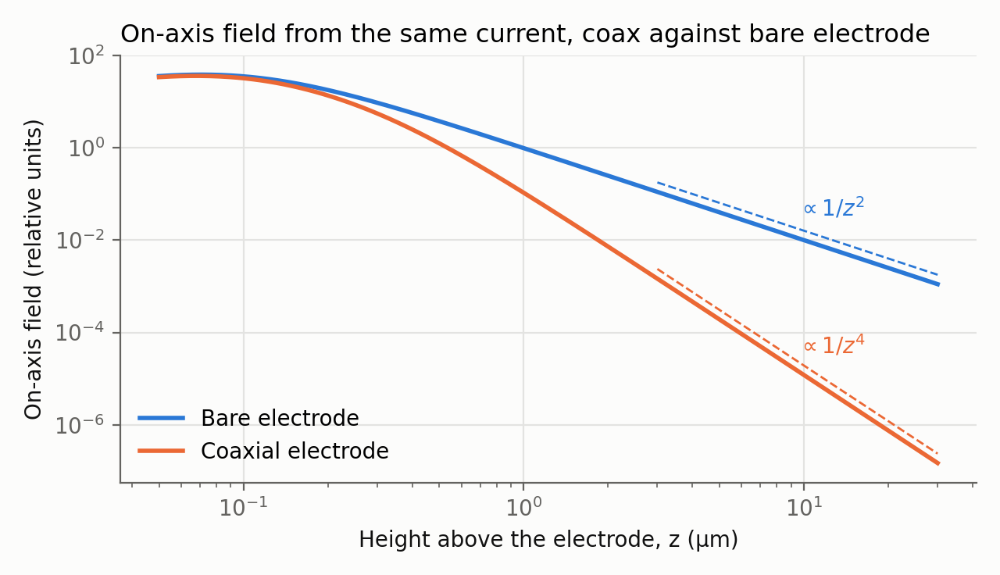

When I was at Boston College, part of my research involved building nanoscale coaxial
electrode arrays. We grew stem cells around these arrays and applied a current in solution to
see how it affected the way the cells differentiated. At the time I mostly thought about the
fabrication side of it. Only later did I work out why a coaxial electrode keeps its field to itself, which is the property the whole idea depends on. To stimulate one cell and leave the cell next to it alone, the field has to fall off quickly with distance, and the coaxial geometry makes it fall off much faster than a bare electrode does. This post is the math
behind that.

The numbers below are round values I picked, not the dimensions or results of any particular device. The point is the
structure of the solution, which doesn't depend much on the exact sizes.

Start with the equation that governs the problem. The
electrodes sit in a conducting electrolyte, roughly physiological saline, and current flows
through it. Charge conservation says \\(\nabla \cdot \mathbf{J} + \partial\_t \rho = 0\\), and in
an ohmic medium \\(\mathbf{J} = \sigma \mathbf{E}\\). Combining with Gauss's law,
\\(\nabla \cdot \mathbf{E} = \rho / \varepsilon\\), any free charge density in the bulk obeys

\\[\partial\_t \rho = -\frac{\sigma}{\varepsilon} \rho \quad \Longrightarrow \quad \rho(t) = \rho(0) \, e^{-t / \tau}, \qquad \tau = \frac{\varepsilon}{\sigma}\\]

For saline, \\(\varepsilon \approx 80 \varepsilon\_0\\) and \\(\sigma \approx 1.5\\) S/m, which gives
\\(\tau \approx 0.5\\) ns. So for anything slower than about a gigahertz, which covers almost every stimulation protocol you would use on cells, the bulk is charge neutral, the problem is
quasi-static, and with \\(\mathbf{E} = -\nabla \phi\\) and uniform \\(\sigma\\),

\\[\nabla \cdot (\sigma \nabla \phi) = 0 \quad \Longrightarrow \quad \nabla^2 \phi = 0\\]

The only place this breaks down is within a Debye length of a surface, where the ions arrange
themselves into a double layer. For a 1:1 electrolyte at concentration \\(c\\),

\\[\lambda\_D = \sqrt{\frac{\varepsilon k\_B T}{2 N\_A c \, e^2}}\\]

which for 150 mM saline is about 0.8 nm. That is two orders of magnitude smaller than anything
else in the problem, so I'll treat the double layer as part of the electrode interface and solve
Laplace's equation everywhere else.

The simplest case is the ideal coax: an inner conductor of radius \\(a\\) held at potential
\\(V\\), a grounded outer conductor of radius \\(b\\), infinitely long, with the space between them
filled with a uniform medium. In cylindrical coordinates the Laplacian is

\\[\nabla^2 \phi = \frac{1}{r} \frac{\partial}{\partial r} \left( r \frac{\partial \phi}{\partial r} \right) + \frac{1}{r^2} \frac{\partial^2 \phi}{\partial \theta^2} + \frac{\partial^2 \phi}{\partial z^2}\\]

and by symmetry \\(\phi\\) depends only on \\(r\\). The equation collapses to
\\((r \phi\')\' = 0\\), and integrating twice,

\\[r \frac{d \phi}{d r} = A \quad \Longrightarrow \quad \phi(r) = A \ln r + B\\]

The boundary conditions give two equations, \\(A \ln a + B = V\\) and \\(A \ln b + B = 0\\).
Subtracting, \\(A = -V / \ln(b / a)\\), and then \\(B = V \ln b / \ln(b / a)\\), so

\\[\phi(r) = V \, \frac{\ln(b / r)}{\ln(b / a)}, \qquad \mathbf{E} = -\frac{d \phi}{d r} \, \hat{\mathbf{r}} = \frac{V}{r \ln(b / a)} \, \hat{\mathbf{r}}, \qquad a < r < b\\]

If the gap is filled with electrolyte, the radial current per unit length is

\\[I\' = 2 \pi r \, \sigma E\_r = 2 \pi r \, \sigma \, \frac{V}{r \ln(b / a)} = \frac{2 \pi \sigma V}{\ln(b / a)}\\]

The \\(r\\) cancels, which it has to, since every bit of current that leaves the inner conductor
crosses every cylinder between the two conductors. Dividing by \\(V\\), the conductance per unit
length is \\(G\' = 2 \pi \sigma / \ln(b / a)\\).

Outside the shield the answer is even simpler. Take a cylindrical surface of radius \\(r > b\\) and
length \\(L\\). The inner conductor carries charge \\(+\lambda\\) per unit length and the outer
conductor carries \\(-\lambda\\), and by symmetry the field on that surface is radial and has the
same magnitude everywhere on it. Gauss's law reads

\\[\oint \mathbf{E} \cdot d\mathbf{A} = 2 \pi r L \, E\_r = \frac{(+\lambda - \lambda) L}{\varepsilon} = 0\\]

so \\(E\_r = 0\\) for all \\(r > b\\). Combined with
\\(\phi(b) = 0\\) and the uniqueness theorem for Laplace's equation, \\(\phi \equiv 0\\) outside.
In the ideal coax, the field outside the shield is exactly zero.

A real electrode has an open end, though, and that end is where the cell sits. So the question splits into two parts: what
happens just inside the opening, and what happens in the electrolyte outside it.

The inside is simpler, and it shows the same mechanism that controls the outside.
Suppose the annulus is open at \\(z = 0\\) and extends down to \\(z \to -\infty\\). Far from the
opening, the solution has to approach the logarithmic profile. So write

\\[\phi(r, z) = V \, \frac{\ln(b / r)}{\ln(b / a)} + \psi(r, z)\\]

where \\(\psi\\) is the correction due to the opening. Since the log term already satisfies both
boundary conditions and Laplace's equation, \\(\psi\\) satisfies Laplace's equation with
\\(\psi(a, z) = \psi(b, z) = 0\\). Separating variables with \\(\psi = R(r) Z(z)\\) and dividing
through by \\(R Z\\),

\\[\frac{1}{r R} \frac{d}{d r} \left( r \frac{d R}{d r} \right) + \frac{1}{Z} \frac{d^2 Z}{d z^2} = 0\\]

The first term depends only on \\(r\\) and the second only on \\(z\\), so each has to be a
constant. Calling it \\(-k^2\\) for the radial part gives \\(Z\'\' = k^2 Z\\), so \\(Z = e^{\pm k z}\\),
and multiplying the radial part through by \\(r^2 R\\) gives Bessel's equation of order zero,

\\[r^2 R\'\' + r R\' + k^2 r^2 R = 0\\]

The sign of the separation constant isn't arbitrary. If I had picked \\(+k^2\\), the radial
solutions would be the modified Bessel functions \\(I\_0\\) and \\(K\_0\\), which have no zeros and so
can't vanish at both \\(r = a\\) and \\(r = b\\). The two Dirichlet walls force oscillation in
\\(r\\), and that in turn forces exponential behavior in \\(z\\). The general solution is a
combination of \\(J\_0(k r)\\) and \\(Y\_0(k r)\\),

and the combination that vanishes at \\(r = a\\) is the cross product

\\[R\_k(r) = J\_0(k r) \, Y\_0(k a) - Y\_0(k r) \, J\_0(k a)\\]

Requiring \\(R\_k(b) = 0\\) gives the eigenvalue condition

\\[J\_0(k b) \, Y\_0(k a) - Y\_0(k b) \, J\_0(k a) = 0\\]

which has a discrete set of roots \\(k\_1 < k\_2 < \cdots\\). This is a Sturm-Liouville problem
with weight \\(r\\), so the eigenfunctions are orthogonal,

\\[\int\_a^b R\_{k\_m}(r) \, R\_{k\_n}(r) \, r \, dr = 0, \qquad m \neq n\\]

and the correction is a sum of modes that decay into the cable:

\\[\psi(r, z) = \sum\_{n=1}^{\infty} c\_n \, R\_{k\_n}(r) \, e^{k\_n z}, \qquad z < 0\\]

where I kept only \\(e^{+k\_n z}\\), since \\(e^{-k\_n z}\\) would blow up as \\(z \to -\infty\\). The
\\(c\_n\\) are fixed by whatever the potential is at the opening: multiplying by
\\(R\_{k\_m}(r) \, r\\), integrating over the gap, and using orthogonality picks out one coefficient at
a time,

\\[c\_m = \frac{\int\_a^b \psi(r, 0) \, R\_{k\_m}(r) \, r \, dr}{\int\_a^b R\_{k\_m}(r)^2 \, r \, dr}\\]

To find the roots, use the large argument forms of the Bessel functions,

\\[J\_0(x) \approx \sqrt{\frac{2}{\pi x}} \cos\left( x - \frac{\pi}{4} \right), \qquad Y\_0(x) \approx \sqrt{\frac{2}{\pi x}} \sin\left( x - \frac{\pi}{4} \right)\\]

Substituting into the eigenvalue condition and writing \\(\alpha = k a - \pi / 4\\) and
\\(\beta = k b - \pi / 4\\),

\\[J\_0(k b) Y\_0(k a) - Y\_0(k b) J\_0(k a) \approx \frac{2}{\pi k \sqrt{a b}} \big( \cos \beta \sin \alpha - \sin \beta \cos \alpha \big) = \frac{2}{\pi k \sqrt{a b}} \sin(\alpha - \beta) = -\frac{2 \sin\big( k (b - a) \big)}{\pi k \sqrt{a b}}\\]

which vanishes when \\(k (b - a) = n \pi\\), so \\(k\_n \approx n \pi / (b - a)\\). The approximation
needs \\(k a\\) to be large, which for the low modes means the gap has to be thin compared with the
radius. With \\(a = 100\\) nm and \\(b = 300\\) nm the gap isn't thin,
but the approximation still lands close: the first root is \\(k\_1 \approx 15.5\\) per micron against
\\(\pi / (b - a) \approx 15.7\\). Every mode decays at least as fast as \\(e^{k\_1 z}\\), so whatever
disturbance the opening creates is gone within a depth of about \\(1 / k\_1 \approx 65\\) nm.

In general, a structure of width \\(w\\) can't support potential variations along its length on scales longer than about \\(w / \pi\\), because the walls suppress long wavelengths. The same idea explains the outside problem.

Outside, the coax ends flush with an insulating substrate at \\(z = 0\\) and the electrolyte fills
\\(z > 0\\). Now the boundary conditions are mixed: on the metal the potential is fixed, and on the
insulator no current can cross, so \\(\partial \phi / \partial z = 0\\). It's easier to reformulate
in terms of the current density \\(s(r)\\) leaving the plane into the electrolyte,

\\[J\_z(r, 0) = -\sigma \left. \frac{\partial \phi}{\partial z} \right\vert \_{z = 0} = s(r)\\]

with \\(s = 0\\) on the insulator. The Green's function for this Neumann problem comes from the
method of images. A point source of current \\(I\\) in an infinite medium spreads out radially,
so the current density at distance \\(\rho\\) is \\(I / (4 \pi \rho^2)\\), the field is
\\(I / (4 \pi \sigma \rho^2)\\), and the potential is \\(\phi = I / (4 \pi \sigma \rho)\\). Now put a
source at height \\(z\'\\) above the plane and an identical image at \\(-z\'\\):

\\[\phi = \frac{I}{4 \pi \sigma} \left[ \frac{1}{\sqrt{\rho\_\perp^2 + (z - z\')^2}} + \frac{1}{\sqrt{\rho\_\perp^2 + (z + z\')^2}} \right]\\]

where \\(\rho\_\perp\\) is the horizontal distance. Differentiating with respect to \\(z\\) and setting
\\(z = 0\\), the two terms give \\(+z\'\\) and \\(-z\'\\) in the numerator over the same denominator, so
\\(\partial\_z \phi = 0\\) on the plane, which is exactly the insulating condition. Letting
\\(z\' \to 0\\), the source and its image merge, and the effective source is doubled:

\\[G(\mathbf{x}, \mathbf{x}\') = \frac{1}{2 \pi \sigma \, \lvert \mathbf{x} - \mathbf{x}\' \rvert}, \qquad \phi(\mathbf{x}) = \frac{1}{2 \pi \sigma} \int\_{z\' = 0} \frac{s(\mathbf{x}\')}{\lvert \mathbf{x} - \mathbf{x}\' \rvert} \, dA\'\\]

First consider an unshielded electrode, since that's the comparison to make. Take a bare disk electrode of radius \\(a\\) in the insulating plane, with the return
electrode far away. This is a classic result in electrochemistry: the problem can be solved
exactly in oblate spheroidal coordinates, and the potential is

\\[\phi(r, z) = \frac{2 V}{\pi} \arcsin\left( \frac{2 a}{\sqrt{(r - a)^2 + z^2} + \sqrt{(r + a)^2 + z^2}} \right)\\]

The current density on the disk is

\\[s(r) = \frac{2 \sigma V}{\pi \sqrt{a^2 - r^2}}\\]

which is singular at the edge, so the current crowds toward the rim. The singularity is
integrable, and the total current is

\\[I = \int\_0^a s(r) \, 2 \pi r \, dr = 4 \sigma V \int\_0^a \frac{r \, dr}{\sqrt{a^2 - r^2}} = 4 \sigma V \Big[ -\sqrt{a^2 - r^2} \Big]\_0^a = 4 \sigma V a\\]

so the access resistance is \\(V / I = 1 / (4 \sigma a)\\), which for a 100 nm disk in saline is
\\(1 / (4 \times 1.5 \times 10^{-7}) \approx 1.7\\) MΩ. Far from the disk, the argument of the arcsine
is small. With \\(R^2 = r^2 + z^2\\), both square roots are approximately \\(R\\), so the argument is
about \\(a / R\\), and \\(\arcsin x \approx x\\) gives

\\[\phi \approx \frac{2 V a}{\pi R} = \frac{I}{2 \pi \sigma R}, \qquad \lvert \mathbf{E} \rvert \approx \frac{I}{2 \pi \sigma R^2}\\]

using \\(V = I / (4 \sigma a)\\). That's exactly the doubled point source from the Green's function,
as it should be, since from far away the disk looks like a point.

That \\(1 / R^2\\) tail is the problem. All the current that leaves the disk has to go somewhere
far away, so it spreads out through the whole dish, and every cell in the neighborhood sees some
of it.

The coax changes exactly one thing: the current that leaves the inner conductor comes back
through the outer conductor, right next to it. Current conservation now says

\\[\int\_{z = 0} s(\mathbf{x}\') \, dA\' = 0\\]

and that single fact changes the far field completely. To see how, expand the Green's function in
Legendre polynomials. For \\(R = \lvert \mathbf{x} \rvert > r\' = \lvert \mathbf{x}\' \rvert\\),

\\[\frac{1}{\lvert \mathbf{x} - \mathbf{x}\' \rvert} = \sum\_{\ell = 0}^{\infty} \frac{r\'^{\ell}}{R^{\ell + 1}} \, P\_\ell(\cos \gamma)\\]

where \\(\gamma\\) is the angle between \\(\mathbf{x}\\) and \\(\mathbf{x}\'\\). To deal with
\\(\gamma\\), use the addition theorem for spherical harmonics. With \\(\mathbf{x}\\) at angles
\\((\theta, \varphi)\\) and \\(\mathbf{x}\'\\) at \\((\theta\', \varphi\')\\),

\\[P\_\ell(\cos \gamma) = \frac{4 \pi}{2 \ell + 1} \sum\_{m = -\ell}^{\ell} Y\_{\ell m}^{\ast}(\theta\', \varphi\') \, Y\_{\ell m}(\theta, \varphi)\\]

Since the source is axially symmetric, integrating over the source plane includes an integral over
\\(\varphi\'\\) with nothing else depending on it. Each \\(Y\_{\ell m}\\) carries a factor
\\(e^{i m \varphi\'}\\), which integrates to zero unless \\(m = 0\\). Only the \\(m = 0\\) term survives,
and since \\(Y\_{\ell 0} = \sqrt{(2 \ell + 1) / 4 \pi} \, P\_\ell(\cos \theta)\\), the azimuthal average
is

\\[\frac{1}{2 \pi} \int\_0^{2 \pi} P\_\ell(\cos \gamma) \, d \varphi\' = P\_\ell(\cos \theta) \, P\_\ell(\cos \theta\')\\]

Every source point lies in the plane, at \\(\theta\' = \pi / 2\\), so
\\(P\_\ell(\cos \theta\') = P\_\ell(0)\\). So

\\[\phi(R, \theta) = \frac{1}{2 \pi \sigma} \sum\_{\ell = 0}^{\infty} P\_\ell(0) \, \frac{M\_\ell}{R^{\ell + 1}} \, P\_\ell(\cos \theta), \qquad M\_\ell = \int s(r\') \, r\'^{\ell} \, dA\'\\]

Taking the terms one at a time, the \\(\ell = 0\\) term is the monopole, and its coefficient is
\\(M\_0 = \int s \, dA = 0\\) by current conservation. The \\(\ell = 1\\) term is the dipole, and it
vanishes for a different reason: \\(P\_1(0) = 0\\). In fact \\(P\_\ell(0) = 0\\) for every odd
\\(\ell\\), because Legendre polynomials have definite parity, \\(P\_\ell(-x) = (-1)^\ell P\_\ell(x)\\),
and an odd function vanishes at the origin. This is the image method showing up again. A dipole
pointing out of an insulating plane, say \\(+q\\) at height \\(d\\) and \\(-q\\) on the plane, has
images \\(+q\\) at \\(-d\\) and \\(-q\\) on the plane, and the combination is \\(+q, -2q, +q\\) along a
line, which is a quadrupole. So the first surviving term is \\(\ell = 2\\), with
\\(P\_2(x) = \tfrac{1}{2}(3 x^2 - 1)\\) and \\(P\_2(0) = -1/2\\). Plugging in, and using
\\(dA\' = 2 \pi r\' \, dr\'\\) for the axially symmetric source,

\\[\phi(R, \theta) \approx -\frac{M\_2}{4 \pi \sigma} \, \frac{P\_2(\cos \theta)}{R^3}, \qquad M\_2 = 2 \pi \int\_0^\infty s(r) \, r^3 \, dr\\]

The coax's far field is a quadrupole. Writing \\(K = -M\_2 / (4 \pi \sigma)\\) and
\\(P\_2(\cos \theta) = \tfrac{1}{2}(3 \cos^2 \theta - 1)\\), so that
\\(\phi = K P\_2(\cos \theta) / R^3\\) and
\\(\partial\_\theta P\_2(\cos \theta) = -3 \sin \theta \cos \theta\\), the field components are

\\[E\_R = -\frac{\partial \phi}{\partial R} = \frac{3 K \, P\_2(\cos \theta)}{R^4}, \qquad E\_\theta = -\frac{1}{R} \frac{\partial \phi}{\partial \theta} = \frac{3 K \sin \theta \cos \theta}{R^4}\\]

so

\\[\lvert \mathbf{E} \rvert = \frac{3 \lvert K \rvert}{R^4} \sqrt{P\_2(\cos \theta)^2 + \sin^2 \theta \cos^2 \theta}\\]

The field falls as \\(1 / R^4\\), compared with \\(1 / R^2\\) for the bare disk. That difference of two powers of distance is why the geometry works.

To put a number on \\(M\_2\\), model the source as a thin ring of outgoing current at radius
\\(a\\) and a thin ring of returning current at radius \\(b\\):

\\[s(r) = \frac{I}{2 \pi a} \, \delta(r - a) - \frac{I}{2 \pi b} \, \delta(r - b)\\]

The normalization is chosen so that each ring carries total current \\(I\\): integrating the first
term against \\(2 \pi r \, dr\\) gives \\(2 \pi a \cdot I / (2 \pi a) = I\\). The moments are then

\\[M\_0 = 2 \pi \left[ a \cdot \frac{I}{2 \pi a} - b \cdot \frac{I}{2 \pi b} \right] = I - I = 0, \qquad M\_2 = 2 \pi \left[ a^3 \cdot \frac{I}{2 \pi a} - b^3 \cdot \frac{I}{2 \pi b} \right] = I \, (a^2 - b^2)\\]

The real current distribution is concentrated near the edges because of the same kind of
singularity as the bare disk, so the rings are a reasonable caricature, with \\(a\\) and \\(b\\)
read as effective radii. The far field is

\\[\phi(R, \theta) \approx \frac{I \, (b^2 - a^2)}{4 \pi \sigma} \, \frac{P\_2(\cos \theta)}{R^3}\\]

The strength of the quadrupole scales with \\(b^2 - a^2\\), the area between the conductors. Halving the size of the coax cuts its far field by a factor of four.

A second way to see this connects back to the inside problem. Because the setup is axially symmetric, the natural tool is the Hankel
transform. Any solution of Laplace's equation in \\(z > 0\\) that decays at infinity can be written
as

\\[\phi(r, z) = \int\_0^\infty A(k) \, J\_0(k r) \, e^{-k z} \, dk\\]

You can check that each term solves Laplace's equation: \\(J\_0(k r)\\) satisfies the radial part
with eigenvalue \\(-k^2\\), and \\(e^{-k z}\\) contributes \\(+k^2\\), so they cancel. This is the same
separation as inside the annulus, with the opposite choice of which direction decays and no walls to
make \\(k\\) discrete. Each term is a single radial wavenumber \\(k\\), and it decays away from the
plane as \\(e^{-k z}\\). Applying the boundary condition at \\(z = 0\\),

\\[-\sigma \left. \frac{\partial \phi}{\partial z} \right\vert \_{z = 0} = \sigma \int\_0^\infty A(k) \, J\_0(k r) \, k \, dk = s(r)\\]

The Hankel transform of order zero is the pair

\\[F(k) = \int\_0^\infty f(r) \, J\_0(k r) \, r \, dr, \qquad f(r) = \int\_0^\infty F(k) \, J\_0(k r) \, k \, dk\\]

and the boundary condition says that \\(\sigma A(k)\\) is exactly the Hankel transform of \\(s\\). So,
with \\(\hat{s}(k) = \int\_0^\infty s(r) \, J\_0(k r) \, r \, dr\\),

\\[A(k) = \frac{\hat{s}(k)}{\sigma}, \qquad \phi(r, z) = \frac{1}{\sigma} \int\_0^\infty \hat{s}(k) \, J\_0(k r) \, e^{-k z} \, dk\\]

Short wavelengths, large \\(k\\), die off almost immediately. Far from the plane, only the
smallest \\(k\\) survive, so the far field is controlled entirely by the behavior of
\\(\hat{s}(k)\\) as \\(k \to 0\\). The power series of the Bessel function is

\\[J\_0(x) = \sum\_{j = 0}^{\infty} \frac{(-1)^j}{(j!)^2} \left( \frac{x}{2} \right)^{2 j} = 1 - \frac{x^2}{4} + \frac{x^4}{64} - \cdots\\]

so substituting into \\(\hat{s}\\) and integrating term by term,

\\[\hat{s}(k) = \int\_0^\infty s(r) \, r \, dr - \frac{k^2}{4} \int\_0^\infty s(r) \, r^3 \, dr + O(k^4) = \frac{1}{2 \pi} \left( M\_0 - \frac{k^2}{4} M\_2 + O(k^4) \right)\\]

since \\(M\_0 = 2 \pi \int s \, r \, dr\\) and \\(M\_2 = 2 \pi \int s \, r^3 \, dr\\).

For the bare disk, \\(M\_0 = I \neq 0\\), and the spectrum has a nonzero value at \\(k = 0\\). The coax has \\(M\_0 = 0\\), so its spectrum starts at order \\(k^2\\). On the axis this turns into
powers of distance directly, since \\(\int\_0^\infty k^n e^{-k z} \, dk = n! / z^{n + 1}\\):

\\[\phi(0, z) \approx \frac{1}{\sigma} \int\_0^\infty \left( -\frac{k^2 M\_2}{8 \pi} \right) e^{-k z} \, dk = -\frac{M\_2}{8 \pi \sigma} \cdot \frac{2!}{z^3} = -\frac{M\_2}{4 \pi \sigma z^3}\\]

using \\(J\_0(0) = 1\\) on the axis.

which matches the multipole result with \\(P\_2(1) = 1\\). Each extra power of \\(k\\) at the bottom
of the spectrum buys an extra power of \\(1 / z\\) in the decay. So the shield's job, stated in
Fourier terms, is to remove the long wavelengths from the source, exactly the way the walls
removed them inside the annulus.

The ring model also has an exact solution on the axis. The delta functions make the Hankel
transform immediate,

\\[\hat{s}(k) = \frac{I}{2 \pi a} J\_0(k a) \, a - \frac{I}{2 \pi b} J\_0(k b) \, b = \frac{I}{2 \pi} \left[ J\_0(k a) - J\_0(k b) \right]\\]

and the remaining integral is a standard one,

\\[\int\_0^\infty J\_0(k c) \, e^{-k z} \, dk = \frac{1}{\sqrt{c^2 + z^2}}\\]

To prove it, use the integral representation
\\(J\_0(x) = \frac{1}{\pi} \int\_0^\pi e^{i x \cos \alpha} \, d\alpha\\) and swap the order of
integration. The \\(k\\) integral is now elementary,

\\[\int\_0^\infty e^{-k z} e^{i k c \cos \alpha} \, dk = \frac{1}{z - i c \cos \alpha}\\]

and what's left is

\\[\frac{1}{\pi} \int\_0^\pi \frac{d\alpha}{z - i c \cos \alpha} = \frac{1}{\sqrt{z^2 - (i c)^2}} = \frac{1}{\sqrt{z^2 + c^2}}\\]

using \\(\int\_0^\pi d\alpha / (A + B \cos \alpha) = \pi / \sqrt{A^2 - B^2}\\) with \\(A = z\\) and
\\(B = -i c\\). With \\(r = 0\\) in the general formula,

\\[\phi(0, z) = \frac{I}{2 \pi \sigma} \left[ \frac{1}{\sqrt{a^2 + z^2}} - \frac{1}{\sqrt{b^2 + z^2}} \right], \qquad E\_z(0, z) = \frac{I}{2 \pi \sigma} \left[ \frac{z}{(a^2 + z^2)^{3/2}} - \frac{z}{(b^2 + z^2)^{3/2}} \right]\\]

The first term alone is what the ring at \\(a\\) would produce with no return path, and the second
term is the return path cancelling it. For \\(z \gg b\\), expand each term with the binomial
series,

\\[\frac{1}{\sqrt{c^2 + z^2}} = \frac{1}{z} \left( 1 + \frac{c^2}{z^2} \right)^{-1/2} = \frac{1}{z} - \frac{c^2}{2 z^3} + \frac{3 c^4}{8 z^5} - \cdots\\]

The \\(1 / z\\) terms cancel between the two rings, which is current conservation, and what is left
is

\\[\phi(0, z) \approx \frac{I}{2 \pi \sigma} \cdot \frac{b^2 - a^2}{2 z^3} = \frac{I (b^2 - a^2)}{4 \pi \sigma z^3}\\]

which is the quadrupole formula with \\(M\_2 = I (a^2 - b^2)\\) and \\(P\_2(1) = 1\\). I checked the multipole formula against this exact
expression numerically, and against the exact off-axis surface potential (which reduces to
complete elliptic integrals), and they agree to within about a percent once
\\(R\\) is more than about ten times \\(b\\), and much better than that further out.

For a numerical example, take \\(a = 100\\) nm, \\(b = 300\\) nm, and compare the field on the axis
from the coax with the field from the same current leaving a bare electrode. Using the exact
on-axis expressions:

| Height above electrode | Coax field / bare field |
|---|---|
| 0.5 μm | 0.33 |
| 1 μm | 0.11 |
| 3 μm | 0.013 |
| 15 μm | 0.00053 |

Far away the ratio follows the multipole prediction. With \\(\lvert K \rvert = I (b^2 - a^2) / (4 \pi \sigma)\\),
the quadrupole field on the axis (\\(\theta = 0\\), where \\(P\_2 = 1\\) and \\(\sin \theta = 0\\)) is
\\(3 \lvert K \rvert / z^4\\). Along the surface (\\(\theta = \pi / 2\\), where \\(P\_2 = -1/2\\) and
\\(\cos \theta = 0\\)) it's \\(3 \lvert K \rvert / (2 R^4)\\). Dividing each by the bare electrode's
\\(I / (2 \pi \sigma R^2)\\),

\\[\frac{\lvert \mathbf{E}\_{\text{coax}} \rvert}{\lvert \mathbf{E}\_{\text{bare}} \rvert} \approx \frac{3 I (b^2 - a^2)}{4 \pi \sigma z^4} \cdot \frac{2 \pi \sigma z^2}{I} = \frac{3}{2} \, \frac{b^2 - a^2}{z^2} \;\; \text{on the axis}, \qquad \frac{3}{4} \, \frac{b^2 - a^2}{R^2} \;\; \text{along the surface}\\]

At \\(z = 15\\) μm the on-axis formula gives
\\(1.5 \times (0.09 - 0.01) / 225 \approx 5.3 \times 10^{-4}\\), matching the last row of the table.

At the 15 μm scale of a neighboring cell, the coax produces a field more than three orders of
magnitude weaker than the bare electrode carrying the same current. Looking at it from the cell's
point of view, the field from the coax drops by a factor of about 500,000 between 0.5 μm and 15 μm
above it. The bare electrode only drops by about 850 over the same distance.

Biologically, the field is important because what a cell responds to is the voltage across its
membrane, and that scales with the local field. For a spherical cell of radius \\(R\_c\\) in a
uniform field \\(E\\) along \\(z\\), with a membrane that is much less conductive than the fluid on
either side, the steady state is easy to work out. Once the membrane has charged up, no current
crosses it, so the cell looks like an insulating sphere to the outside fluid and the interior is
an equipotential. Outside, try the uniform field plus a dipole,

\\[\phi\_{\text{out}}(r, \theta) = -E \cos \theta \left( r + \frac{C}{r^2} \right)\\]

which solves Laplace's equation since both \\(r \cos \theta\\) and \\(\cos \theta / r^2\\) do. The
insulating condition \\(\partial\_r \phi\_{\text{out}} = 0\\) at \\(r = R\_c\\) gives
\\(1 - 2 C / R\_c^3 = 0\\), so \\(C = R\_c^3 / 2\\). The interior sits at \\(\phi\_{\text{in}} = 0\\) by
symmetry, so the voltage across the membrane is

\\[\Delta V\_m(\theta) = \phi\_{\text{in}} - \phi\_{\text{out}}(R\_c, \theta) = E \cos \theta \left( R\_c + \frac{R\_c}{2} \right) = \frac{3}{2} \, E \, R\_c \cos \theta\\]

The factor of \\(3/2\\) is the insulating cell bending the field lines around itself and piling up
potential at its poles.

The field near the electrode isn't uniform over a whole cell, so this is only a scaling argument,
but the conclusion carries over: the induced transmembrane potential tracks the local field. A cell
sitting half a micron above the coax and a neighbor 15 μm away see fields that differ by a factor
of about 500,000, so their membrane voltages differ by a comparable factor. That is what it means to stimulate one cell and not the
cell next to it.

This analysis leaves out three things. The first is the electrode interface. Everything above assumes the metal is an equipotential in contact with the
electrolyte, but a real electrode has a double layer with its own capacitance and, at high enough
voltages, Faradaic reactions. The interface impedance redistributes current across the electrode
face and makes the response frequency dependent, which changes \\(M\_2\\) but not the fact that
\\(M\_0 = 0\\). The quadrupole structure comes from current conservation, so it holds whatever the details of the interface.

The second is that the cells themselves are part of the boundary. A cell membrane is close to an
insulator at low frequencies, so a cell sitting directly on the electrode reshapes the current
paths around it, and if it adheres tightly it can form a thin, resistive cleft between itself and
the substrate. That cleft is its own boundary value problem and a more interesting one. The third is what happens in arrays. With many coaxes on a grid of pitch \\(p\\), the fields superpose, and because each
element is a quadrupole, the surface ratio above with \\(R = p\\) says the crosstalk from one element
at its neighbor is about \\(\tfrac{3}{4} (b^2 - a^2) / p^2\\) of what a bare electrode array would
give, so it scales like \\((b / p)^2\\). Packing the array twice as tightly raises the crosstalk by a factor of four.

Finally, the exact solution of the full mixed problem, with fixed potentials on the conductors and
zero current on the insulator, leads to a set of dual integral equations for \\(A(k)\\). Those
can be solved for a single disk, which is where the arcsine formula comes from, but for the
annular geometry they don't close in elementary functions, and the ring model is standing in for
that harder calculation. The far-field result doesn't depend on it, because the multipole argument
only used \\(M\_0 = 0\\) and axial symmetry.

Two problems I'd like to work through next are the time dependent one, where the double layer charges up through the electrolyte resistance and the field near the electrode evolves on a time scale set by that RC product, and what the cleft under an adherent cell does to all of this.
