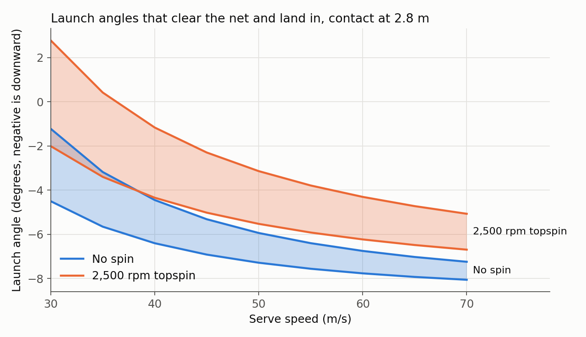

Anyone who plays tennis knows the feeling of a first serve that clips the tape or lands a foot
long, and the strange sense that the difference between a good serve and a fault was almost
nothing. I wanted to put a number on "almost nothing." For a serve of a given speed, hit from a
given contact height, what range of launch angles clears the net and lands in the service
box? And how do speed, height, drag, and topspin move that range around?

The answer turns out to be a window about one degree wide for a hard flat serve. Working out why it's that narrow, and what widens it, comes down to projectile motion and a little fluid dynamics.

Start with the geometry. I'll put the server at the baseline
(\\(x = 0\\)) hitting straight down the center line toward the T, which is the shortest serve on
the court and the one where the net is lowest. The relevant numbers are

\\[x\_n = 11.885 \text{ m}, \qquad h\_n = 0.914 \text{ m}, \qquad x\_s = 18.285 \text{ m}\\]

where \\(x\_n\\) is the distance from the baseline to the net, \\(h\_n\\) is the height of the net at
the center strap, and \\(x\_s = x\_n + 6.40\\) m is the distance to the service line. The ball has
mass \\(m = 57.7\\) g and radius \\(r = 3.35\\) cm, and I'll write \\(H\\) for the height of the
ball's center at contact. Since the ball has a finite size, the two conditions for a good serve
are on the ball's center: it has to pass the net at a height of at least \\(h\_n + r\\), and it
has to reach height \\(r\\) (the bottom of the ball touching the court) at some
\\(x \leq x\_s\\).

The simplest model ignores gravity and treats the serve as a straight line. That
sounds silly for a projectile, but at 50 m/s the ball reaches the service line in under half a
second, and it's a useful baseline. Shift the vertical coordinate by \\(r\\) so the ground is at
zero. A straight line from \\((0, H - r)\\) that passes exactly over the net at \\((x\_n, h\_n)\\)
hits the ground where

\\[x\_{\text{land}} = x\_n \, \frac{H - r}{H - r - h\_n}\\]

and requiring \\(x\_{\text{land}} \leq x\_s\\) and solving for \\(H\\),

\\[H \geq r + h\_n \, \frac{x\_s}{x\_s - x\_n} = 0.0335 + 0.914 \times \frac{18.285}{6.40} \approx 2.64 \text{ m}\\]

So a serve with no curvature at all needs a contact point above about 2.64 m just to have a
nonzero chance of going in, and that's down the middle, where the geometry is most forgiving. A
tall player reaching up can make contact around 2.8 to 3.0 m, so a serve hit like a laser beam
is barely possible. Everything that makes serving easier comes from the ball curving downward
between the net and the service line.

The next step up is a parabola. With launch speed \\(v\\) and launch angle \\(\theta\\) (negative
means downward), the trajectory in a vacuum is

\\[y(x) = H + x \tan \theta - \frac{g x^2}{2 v^2 \cos^2 \theta}\\]

The useful trick here is to write \\(u = \tan \theta\\) and use
\\(1 / \cos^2 \theta = 1 + u^2\\), which turns the trajectory into a quadratic in \\(u\\):

\\[y(x) = H + x u - \frac{g x^2}{2 v^2} (1 + u^2)\\]

Each condition is then a quadratic inequality in \\(u\\). Clearing the net is
\\(y(x\_n) \geq h\_n + r\\) and landing in is \\(y(x\_s) \leq r\\). Writing
\\(\kappa\_x = g x^2 / (2 v^2)\\), the boundary of each condition is a root of

\\[\kappa\_x u^2 - x u + \left( \kappa\_x - H + y\_{\text{target}} \right) = 0 \quad \Longrightarrow \quad u = \frac{x \pm \sqrt{x^2 - 4 \kappa\_x \left( \kappa\_x - H + y\_{\text{target}} \right)}}{2 \kappa\_x}\\]

The larger root corresponds to a lob, which is not how anyone serves, so the flat serve takes the
smaller root in each case. The window of good launch angles runs from the smaller root of the net
condition up to the smaller root of the service line condition. With \\(H = 2.8\\) m, a 40 m/s serve has to leave the racquet between -6.78° and -5.41°, a window 1.37° wide. At 50 m/s the window runs from -7.53° to -6.56°, 0.97° wide, and at 60 m/s from -7.93° to -7.18°, 0.75° wide.

A 50 m/s serve, about 112 mph, has a window just under one degree wide. You hit the ball
downward at around seven degrees, and you have to get that angle right to within about half a
degree in either direction.

A tennis ball in air doesn't move like a projectile in a vacuum, though, and the difference is large enough to change the answer. The equation of motion with drag and spin is

\\[m \frac{d \mathbf{v}}{d t} = -m g \, \hat{\mathbf{y}} - \frac{1}{2} \rho A C\_D \lvert \mathbf{v} \rvert \, \mathbf{v} + \frac{1}{2} \rho A C\_L \lvert \mathbf{v} \rvert^2 \, \hat{\mathbf{n}}\\]

where \\(\rho \approx 1.21\\) kg/m³ is the density of air, \\(A = \pi r^2\\) is the ball's
cross section, \\(C\_D\\) is the drag coefficient, \\(C\_L\\) is the lift coefficient from spin,
and \\(\hat{\mathbf{n}}\\) is the unit vector perpendicular to the velocity in the direction of
\\(\boldsymbol{\omega} \times \mathbf{v}\\). For topspin, \\(\hat{\mathbf{n}}\\) is the velocity
rotated 90 degrees downward, so for a nearly horizontal serve it points almost straight down. I'll take
\\(C\_D = 0.55\\), which is a typical value for tennis balls at these speeds and an assumption on my part, and come
back to \\(C\_L\\).

Drag sets a natural length scale. Dividing the drag term by \\(m\\), the deceleration is
\\(\lvert \mathbf{v} \rvert^2 / L\_D\\) with

\\[L\_D = \frac{2 m}{\rho A C\_D} = \frac{2 \times 0.0577}{1.21 \times 0.00353 \times 0.55} \approx 49 \text{ m}\\]

which is the distance over which drag alone would reduce the ball's speed by a factor of \\(e\\).
That is less than three times the length of the serve, so drag is not a small correction.

This can be handled analytically. A serve is a flat trajectory: the launch angle is
under ten degrees, so \\(\lvert \mathbf{v} \rvert \approx v\_x\\) to within about one percent. Write
\\(w(x)\\) for the horizontal velocity as a function of position. Using \\(d / dt = w \, d / dx\\),
the horizontal equation becomes

\\[w \frac{d w}{d x} = -\frac{w^2}{L\_D} \quad \Longrightarrow \quad w(x) = v \, e^{-x / L\_D}\\]

So the ball's speed decays exponentially with distance traveled. At the service line,
\\(e^{-18.285 / 49.2} \approx 0.69\\), so a serve leaves the racquet at 50 m/s and arrives at the
bounce at around 35 m/s. The full simulation below gives 35.6 m/s, which is close.

The vertical motion takes more work. Define the slope of the trajectory
\\(s = dy / dx = v\_y / w\\). The vertical equation, without spin for now, is

\\[\frac{d v\_y}{d t} = -g - \frac{w}{L\_D} v\_y\\]

using \\(\lvert \mathbf{v} \rvert \approx w\\) in the drag term. Switching to \\(x\\) with
\\(d / dt = w \, d / dx\\) and substituting \\(v\_y = s w\\):

\\[w \frac{d (s w)}{d x} = w \left( w \frac{d s}{d x} + s \frac{d w}{d x} \right) = w^2 \frac{d s}{d x} - \frac{s w^2}{L\_D}\\]

where I used \\(dw / dx = -w / L\_D\\). The right side of the vertical equation is
\\(-g - s w^2 / L\_D\\). The drag terms cancel exactly, and what is left is

\\[w^2 \frac{d s}{d x} = -g \quad \Longrightarrow \quad \frac{d^2 y}{d x^2} = -\frac{g}{w(x)^2} = -\frac{g}{v^2} e^{2 x / L\_D}\\]

So in the flat-trajectory approximation, drag doesn't act on the vertical
motion directly at all. Its only effect is to slow the ball down, which gives gravity more time per
meter of horizontal travel, so the path curves more and more sharply as the ball goes. Integrating
twice with \\(y(0) = H\\) and \\(y\'(0) = \tan \theta\\),

\\[y(x) = H + x \tan \theta - F\_g(x), \qquad F\_g(x) = \frac{g L\_D^2}{4 v^2} \left( e^{2 x / L\_D} - 1 - \frac{2 x}{L\_D} \right)\\]

As a check, expanding the exponential for \\(L\_D \to \infty\\),
\\(e^{2 x / L\_D} - 1 - 2 x / L\_D \approx 2 x^2 / L\_D^2\\), and \\(F\_g \to g x^2 / (2 v^2)\\), which
is the vacuum parabola.

Now the spin. A spinning ball drags a thin layer of air around with it, and the asymmetry in the
flow on the two sides produces a force perpendicular to the velocity, the Magnus force. For
topspin it points down. The lift coefficient depends mostly on the spin parameter, the ratio of
the surface speed of the ball to its forward speed,

\\[S = \frac{r \omega}{\lvert \mathbf{v} \rvert}\\]

and I'll use the simple empirical form \\(C\_L = 1 / (2 + 1 / S)\\), which rises linearly for small
spin and levels off at one half. It's an assumed form, and I haven't checked it against any particular ball. At 2500 rpm, \\(\omega \approx 262\\) rad/s, so \\(r \omega \approx 8.8\\)
m/s, and at 50 m/s that gives \\(S \approx 0.18\\) and \\(C\_L \approx 0.13\\).

In the flat approximation the Magnus force is vertical with magnitude
\\(\tfrac{1}{2} \rho A C\_L w^2\\). Defining \\(L\_M = 2 m / (\rho A C\_L)\\) in the same way as
\\(L\_D\\), it adds a downward acceleration \\(w^2 / L\_M\\), and the same substitution as before
gives

\\[w^2 \frac{d s}{d x} = -g - \frac{w^2}{L\_M} \quad \Longrightarrow \quad \frac{d^2 y}{d x^2} = -\frac{g}{w(x)^2} - \frac{1}{L\_M}\\]

The topspin contribution to the curvature is \\(1 / L\_M\\), and it doesn't depend on speed. Gravity's curvature \\(g / w^2\\) gets weaker as the ball goes faster, because
the ball spends less time falling per meter. The Magnus force grows as \\(w^2\\), which exactly
cancels that, so a fixed amount of spin bends the path by a fixed amount per meter regardless of
pace (as long as \\(C\_L\\) is held fixed). With \\(C\_L = 0.13\\), \\(L\_M \approx 208\\) m, and the
ratio of the two curvatures at launch is

\\[\frac{1 / L\_M}{g / v^2} = \frac{v^2}{g L\_M} = \frac{2500}{9.81 \times 208} \approx 1.2\\]

So at 50 m/s, 2500 rpm of topspin bends the serve slightly more than gravity does. For a hard serve, the curvature from spin is at least as large as the curvature from gravity.

Putting the pieces together, the flat-trajectory path is

\\[y(x) = H + x \tan \theta - F(x), \qquad F(x) = \frac{g L\_D^2}{4 v^2} \left( e^{2 x / L\_D} - 1 - \frac{2 x}{L\_D} \right) + \frac{x^2}{2 L\_M}\\]

and because \\(y\\) is linear in \\(\tan \theta\\), both conditions solve directly. The net condition
\\(y(x\_n) \geq h\_n + r\\) and the service line condition \\(y(x\_s) \leq r\\) give

\\[\tan \theta\_{\text{low}} = \frac{h\_n + r - H + F(x\_n)}{x\_n}, \qquad \tan \theta\_{\text{high}} = \frac{F(x\_s) - (H - r)}{x\_s}\\]

and the width of the window, in the small angle approximation where
\\(\Delta \theta \approx \tan \theta\_{\text{high}} - \tan \theta\_{\text{low}}\\), is

\\[\Delta \theta \approx (H - r) \left( \frac{1}{x\_n} - \frac{1}{x\_s} \right) - \frac{h\_n}{x\_n} + \left( \frac{F(x\_s)}{x\_s} - \frac{F(x\_n)}{x\_n} \right)\\]

The first two terms are the straight line geometry from earlier, and
the last term is the bonus you get from curvature. For a pure parabola with constant curvature
\\(c\\), \\(F(x) = c x^2 / 2\\), and the curvature term is just \\(c (x\_s - x\_n) / 2\\). The window is
the straight line window plus half the curvature times the length of the service box. Anything that adds curvature between the net and the service line opens the window.

Two consequences fall straight out of this formula. The first is that contact height enters
linearly with a coefficient that doesn't depend on speed or spin at all:

\\[\frac{\partial \, \Delta \theta}{\partial H} = \frac{1}{x\_n} - \frac{1}{x\_s} = \frac{x\_s - x\_n}{x\_n x\_s} = \frac{6.40}{11.885 \times 18.285} \approx 0.0295 \text{ rad/m}\\]

which is about 0.17 degrees of extra window for every 10 cm of extra contact height. For
context, that's roughly an eighth of the whole window for a 50 m/s flat serve, so the height of your
contact point is not a minor detail. The second consequence is the high speed limit. As
\\(v \to \infty\\) the gravity part of \\(F\\) vanishes, and without spin the window approaches the
straight line value,

\\[\Delta \theta\_\infty = (H - r) \frac{x\_s - x\_n}{x\_n x\_s} - \frac{h\_n}{x\_n} = 2.7665 \times 0.02945 - 0.0769 \approx 0.0046 \text{ rad} \approx 0.26°\\]

for \\(H = 2.8\\) m. The window never closes for a contact point above 2.64 m, but it shrinks
toward a quarter of a degree.

Drag also makes serving easier, which surprised me. Compare the vacuum table
above with the results with drag included. At 50 m/s from 2.8 m, the vacuum window is 0.97
degrees, and with drag it's 1.34 degrees. Drag slows the ball most at the end of its flight, which
increases the curvature exactly where it helps, between the net and the service line. The
\\(e^{2 x / L\_D}\\) factor in \\(F\_g\\) makes this precise: the curvature at the service line is
\\(e^{2 \times 18.285 / 49.2} \approx 2.1\\) times what it is at the racquet.

To check all of this I integrated the full equations of motion numerically, with the exact speed in
the drag and Magnus terms, \\(C\_L\\) recomputed from the spin parameter at every step as the ball
slows, and a scan over launch angles in steps of a hundredth of a degree. The window widths, in
degrees, are:

| Contact height | Spin | 40 m/s | 50 m/s | 60 m/s |
|---|---|---|---|---|
| 2.6 m | none | 1.61 | 1.00 | 0.67 |
| 2.8 m | none | 1.95 | 1.34 | 1.01 |
| 3.0 m | none | 2.27 | 1.67 | 1.33 |
| 2.6 m | 2500 rpm | 2.84 | 2.05 | 1.58 |
| 2.8 m | 2500 rpm | 3.17 | 2.38 | 1.91 |
| 3.0 m | 2500 rpm | 3.49 | 2.70 | 2.24 |

Without spin, the closed form matches the simulation to within about 0.05 degrees everywhere in
the table, so the flat-trajectory approximation holds up. With spin, the closed form comes out
about 0.15 degrees narrow, because I evaluated \\(C\_L\\) at the launch speed, and in reality the
spin parameter grows as the ball slows down, so the ball curves a bit more at the end than the
formula assumes. You can also read the height result directly off the table: every 20 cm of contact
height adds about 0.33 degrees in every column, just as the derivative predicted.

*The range of launch angles that clears the net and lands in, from the full simulation with drag, for contact at 2.8 m. Topspin moves the window up and widens it at every speed.*

The effect of topspin is large. At 50 m/s from 2.8 m, adding 2500 rpm takes the window from 1.34
degrees to 2.38, an increase of nearly 80 percent. It also changes the margins in physical terms.
Aiming at the middle of the window, a flat serve clears the net by about 14 cm and lands about 1.0
m inside the service line. With topspin, it clears the net by about 25 cm and lands about 1.4 m
inside the line. The spin buys margin at both ends at once, because it lets you hit higher over
the net and still bring the ball down in time.

Push it further and you get the kick serve. At 35 m/s with 4000 rpm of topspin from 2.8 m, the
simulation gives a window from -2.67 degrees to +1.55 degrees, more than four degrees wide, and it
includes launch angles that point upward. That's the physics of a second serve in one number. You
give up pace and get a window three times as wide as a hard flat first serve.

The window can be turned into a success rate. Suppose a player's launch
angle has some random error that is roughly normal with standard deviation \\(\sigma\\), and they
aim at the middle of the window. The probability the serve lands in is

\\[P(\text{in}) = \Phi\left( \frac{\Delta \theta}{2 \sigma} \right) - \Phi\left( -\frac{\Delta \theta}{2 \sigma} \right) = 2 \, \Phi\left( \frac{\Delta \theta}{2 \sigma} \right) - 1\\]

where \\(\Phi\\) is the standard normal CDF. I don't have real data on how consistent anyone's
launch angle is, so take this as illustrative, but suppose \\(\sigma = 0.5\\) degrees. The flat
serve at 50 m/s from 2.8 m, with \\(\Delta \theta = 1.34\\), goes in with probability
\\(2 \Phi(1.34) - 1 \approx 0.82\\). The topspin version, with \\(\Delta \theta = 2.38\\), goes in with
probability \\(2 \Phi(2.38) - 1 \approx 0.98\\). That gap, between a serve that misses one time
in five and a serve that misses less than one time in fifty, is the reason second serves look the way they
do. The formula also makes the tradeoff smooth: \\(\Delta \theta\\) shrinks with speed, so each
extra meter per second costs a predictable amount of reliability.

The same formula tells you how low a contact point you can get away with. Setting
\\(\Delta \theta = 0\\) and solving for \\(H\\) with the closed form, a 50 m/s flat serve needs a
contact point above about 2.0 m, while with 2500 rpm of topspin the threshold drops to about 1.5 m.
Curvature is what lets shorter players serve at all, and spin is the curvature they control.

There are a few things this leaves out. I've only looked at the serve down the T. A wide serve
travels farther, crosses the net closer to the posts where it's higher, and has to land in a box
that's angled relative to its path, which all narrow the window. I've also put the contact point
directly above the baseline, while real servers make contact somewhat inside the court, which
helps a little. The drag and lift coefficients are the weakest part of the model, since both
depend on the condition of the felt and \\(C\_D\\) can shift with spin. I've ignored the slow decay
of spin during the flight, sidespin, and wind, and I've treated the ball as a point that only has
size at the net and the bounce. None of these change the structure of the answer, which comes from
the window formula: straight line geometry plus a curvature bonus over the length of the service
box.

Next I want to look at the wide serve, and at combining the success probability above with a point-by-point model of a service game to find the serve speed that maximizes the chance of winning the point.
