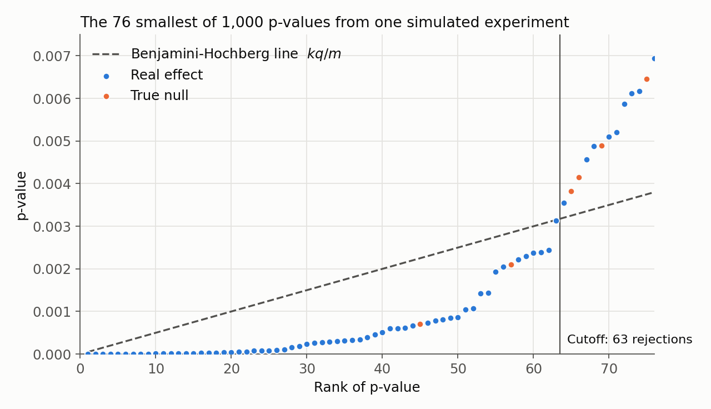

Suppose you measure the expression level of 1,000 genes in two groups of samples, say tissue from
patients and tissue from healthy controls, and you want to know which genes behave differently
between the groups. The obvious plan is to run a two-sample test on each gene, get 1,000 p-values,
and call every gene with \\(p < 0.05\\) a discovery. This post is about why that plan fails and how a procedure Benjamini and Hochberg published in 1995 improves on the classical fix. I'll derive each method, prove the main theorem, and then run all of them on
a simulated experiment to see how they compare.

The setting throughout is \\(m\\) hypotheses \\(H\_1, \ldots, H\_m\\), each with a p-value
\\(p\_1, \ldots, p\_m\\). Some unknown number \\(m\_0\\) of them are true nulls (genes with no real
difference), and the other \\(m\_1 = m - m\_0\\) are true effects. For the simulation I'll use
\\(m = 1{,}000\\) with \\(m\_0 = 900\\) and \\(m\_1 = 100\\).

It helps to start with what a p-value is when the null is true. If a test statistic \\(T\\) has a
continuous distribution with CDF \\(F\\) under the null, and large values count as evidence against
it, the p-value is \\(p = 1 - F(T)\\). Then for any \\(t\\) in \\([0, 1]\\),

\\[P(p \leq t) = P\big(F(T) \geq 1 - t\big) = P\big(T \geq F^{-1}(1 - t)\big) = 1 - F\big(F^{-1}(1 - t)\big) = t\\]

so a null p-value is uniformly distributed on \\([0, 1]\\). Everything below rests on this fact. A
test at level \\(\alpha\\) rejects when \\(p \leq \alpha\\), so a true null is rejected with probability
exactly \\(\alpha\\).

With one test, that's the whole story. With many, the false rejections add up. Let \\(V\\) be the
number of true nulls that get rejected. By linearity of expectation, which needs no assumption about
independence,

\\[\mathbb{E}[V] = \sum\_{i \in \mathcal{H}\_0} P(p\_i \leq \alpha) = m\_0 \alpha\\]

where \\(\mathcal{H}\_0\\) is the set of true nulls. With 900 true nulls at \\(\alpha = 0.05\\), that's 45
false discoveries on average. The chance of at least one false rejection, if the tests are
independent and every null is true, is

\\[P(V \geq 1) = 1 - P(\text{no null rejected}) = 1 - (1 - \alpha)^m\\]

For \\(m = 10\\) that's \\(1 - 0.95^{10} \approx 0.40\\). For \\(m = 100\\) it's
\\(1 - 0.95^{100} \approx 0.994\\). For \\(m = 1{,}000\\) it's \\(1 - 0.95^{1000} \approx 1 - 5 \times 10^{-23}\\),
which is a certainty for any practical purpose. Running the experiment and reporting everything
under 0.05 guarantees a list with dozens of false discoveries on it.

The classical response is to control the family-wise error rate, the probability of making even one
false rejection, \\(\text{FWER} = P(V \geq 1)\\). The simplest way to do that is the Bonferroni
correction: test each hypothesis at level \\(\alpha / m\\). The proof is the union bound, which says
the probability of a union of events is at most the sum of their probabilities:

\\[\text{FWER} = P\left( \bigcup\_{i \in \mathcal{H}\_0} \left\\{ p\_i \leq \frac{\alpha}{m} \right\\} \right) \leq \sum\_{i \in \mathcal{H}\_0} P\left( p\_i \leq \frac{\alpha}{m} \right) = m\_0 \cdot \frac{\alpha}{m} \leq \alpha\\]

This holds under any dependence between the tests, since the union bound doesn't need independence.
If the tests are independent, you can do very slightly better. Setting the per-test level to
\\(\alpha\'\\) and requiring \\(1 - (1 - \alpha\')^m = \alpha\\) gives the Šidák level
\\(\alpha\' = 1 - (1 - \alpha)^{1/m}\\). Expanding \\((1 - \alpha)^{1/m} = e^{\ln(1 - \alpha) / m} \approx 1 + \ln(1 - \alpha) / m\\)
for large \\(m\\),

\\[\alpha\' \approx -\frac{\ln(1 - \alpha)}{m} = \frac{\alpha + \alpha^2 / 2 + \cdots}{m}\\]

which at \\(\alpha = 0.05\\) is only about 2.5% larger than \\(\alpha / m\\). For practical purposes the two
are the same.

There's also a step-down version due to Holm that is never worse than Bonferroni. Sort the p-values
so that \\(p\_{(1)} \leq p\_{(2)} \leq \cdots \leq p\_{(m)}\\). Compare the smallest with \\(\alpha / m\\), the
next with \\(\alpha / (m - 1)\\), and in general the \\(j\\)th with \\(\alpha / (m - j + 1)\\), and stop at the
first one that fails. Everything before that point is rejected. To see that Holm still controls the
family-wise error rate, look at the smallest p-value among the true nulls, and say it sits at rank
\\(j\\) in the sorted list. Only the \\(m\_1\\) true effects can come before it, so \\(j \leq m\_1 + 1\\), which
means

\\[m - j + 1 \geq m - m\_1 = m\_0 \quad \Longrightarrow \quad \frac{\alpha}{m - j + 1} \leq \frac{\alpha}{m\_0}\\]

Holm can make a false rejection only if it reaches this null and rejects it, which requires its p-value
to be at most \\(\alpha / m\_0\\). So

\\[\text{FWER} \leq P\left( \min\_{i \in \mathcal{H}\_0} p\_i \leq \frac{\alpha}{m\_0} \right) \leq m\_0 \cdot \frac{\alpha}{m\_0} = \alpha\\]

by the union bound again.

The cost of all this is power. With \\(m = 1{,}000\\) and \\(\alpha = 0.05\\), Bonferroni's per-test threshold
is \\(5 \times 10^{-5}\\). For a one-sided z-test, that corresponds to a cutoff of \\(z \approx 3.89\\),
compared with \\(1.645\\) for a single test. In the simulation below, the true effects have a mean shift
of 3 standard deviations, which is a large effect, and Bonferroni finds only about 19% of them. In a
gene expression study, the goal is usually a list of candidates for follow-up experiments. Guaranteeing
that not a single gene on the list is a false lead is a much stricter standard than the work needs, and
it throws away most of the real signal to meet it.

Benjamini and Hochberg's idea was to control a different quantity. Write \\(R\\) for the number of
rejections and \\(V\\) for the number of those that are false, and define the false discovery
proportion

\\[\text{FDP} = \frac{V}{\max(R, 1)}\\]

which is the fraction of the discovery list that is wrong, with the convention that it's zero when
nothing is rejected. The false discovery rate is its expectation, \\(\text{FDR} = \mathbb{E}[\text{FDP}]\\).
Controlling it at \\(q = 0.05\\) means that on average, at most 5% of the genes on your list are false
leads. FDR and FWER are related in a simple way. Whenever \\(V = 0\\), the FDP is zero, and whenever
\\(V \geq 1\\), the FDP is at most one, so \\(\text{FDP} \leq \mathbb{1}[V \geq 1]\\). Taking expectations,

\\[\text{FDR} \leq P(V \geq 1) = \text{FWER}\\]

So any procedure that controls FWER also controls FDR, and FDR is the weaker requirement, which leaves
room for more power. When every null is true, \\(V = R\\), so the FDP is exactly
\\(\mathbb{1}[V \geq 1]\\) and the two error rates coincide. FDR control only becomes more lenient when
there are real effects to find.

The procedure itself is short. Sort the p-values, find the largest \\(k\\) such that

\\[p\_{(k)} \leq \frac{k q}{m}\\]

and reject the hypotheses with the \\(k\\) smallest p-values. If no \\(k\\) satisfies the condition,
reject nothing. The threshold rises linearly with rank, from \\(q / m\\) for the smallest p-value (the
Bonferroni threshold) up to \\(q\\) for the largest. It's called a step-up procedure because it searches
from the top of the list down and stops at the first p-value under its line, even if some smaller
p-values sat above their own lines.

One way to see where the line \\(k q / m\\) comes from. Let \\(N(t)\\) be the number of
p-values at or below a threshold \\(t\\). If you reject everything at or below \\(t\\), the expected number
of false rejections is \\(m\_0 t\\), since each null p-value is uniform. That's at most \\(m t\\), which
doesn't require knowing \\(m\_0\\). So a natural estimate of the false discovery proportion at
threshold \\(t\\) is

\\[\widehat{\text{FDP}}(t) = \frac{m t}{N(t)}\\]

and a natural procedure is to pick the largest \\(t\\) whose estimate is at most \\(q\\). Restrict \\(t\\) to the
grid \\(t = k q / m\\). At \\(t = k q / m\\),

\\[\frac{m \cdot k q / m}{N(k q / m)} \leq q \quad \Longleftrightarrow \quad N\!\left( \frac{k q}{m} \right) \geq k \quad \Longleftrightarrow \quad p\_{(k)} \leq \frac{k q}{m}\\]

The last step holds because at least \\(k\\) p-values lie at or below a threshold exactly when the
\\(k\\)th smallest does. So Benjamini-Hochberg picks the largest threshold whose estimated false discovery
proportion is at most \\(q\\). Equivalently, the number of rejections is

\\[R = \max\left\\{ k : N\!\left( \frac{k q}{m} \right) \geq k \right\\}\\]

and that form is the one the proof uses.

The theorem is that if the p-values are independent and the null p-values are uniform, then

\\[\text{FDR} = \frac{m\_0}{m} \, q \leq q\\]

The proof is short once you find the right trick. Start by splitting the FDP into a sum over the true
nulls, using \\(V = \sum\_{i \in \mathcal{H}\_0} \mathbb{1}[i \text{ rejected}]\\), and then over the possible
values of \\(R\\):

\\[\text{FDR} = \mathbb{E}\left[ \frac{V}{\max(R, 1)} \right] = \sum\_{i \in \mathcal{H}\_0} \sum\_{k=1}^{m} \frac{1}{k} \, P(i \text{ rejected}, \ R = k)\\]

When \\(R = k\\), the procedure rejects every p-value at or below \\(k q / m\\), so hypothesis \\(i\\) is rejected
with \\(R = k\\) exactly when \\(p\_i \leq k q / m\\) and \\(R = k\\):

\\[\text{FDR} = \sum\_{i \in \mathcal{H}\_0} \sum\_{k=1}^{m} \frac{1}{k} \, P\!\left( p\_i \leq \frac{k q}{m}, \ R = k \right)\\]

The difficulty is that \\(R\\) depends on \\(p\_i\\), so the two events in that probability aren't
independent. The trick is to define \\(R^{(i)}\\), the number of rejections Benjamini-Hochberg would make
if \\(p\_i\\) were replaced by zero, keeping all the other p-values the same. Since \\(R^{(i)}\\) depends only
on the other p-values, it's independent of \\(p\_i\\). The key claim is that, on the event
\\(p\_i \leq k q / m\\), the two counts agree:

\\[\left\\{ p\_i \leq \frac{k q}{m}, \ R = k \right\\} = \left\\{ p\_i \leq \frac{k q}{m}, \ R^{(i)} = k \right\\}\\]

To see why, write \\(N^{(i)}(t)\\) for the count of p-values at or below \\(t\\) after \\(p\_i\\) is set to zero.
Setting \\(p\_i\\) to zero only changes the count for thresholds below the original \\(p\_i\\), so
\\(N^{(i)}(t) = N(t) + \mathbb{1}[p\_i > t]\\). If \\(p\_i \leq k q / m\\), then for every \\(k\' \geq k\\), the
threshold \\(k\' q / m\\) is at least \\(p\_i\\), and so \\(N^{(i)}(k\' q / m) = N(k\' q / m)\\). Now suppose
\\(R = k\\). From the formula for \\(R\\), that means \\(N(k q / m) \geq k\\) and \\(N(k\' q / m) < k\'\\) for every
\\(k\' > k\\). Since \\(N^{(i)}\\) agrees with \\(N\\) at all of these thresholds, the same inequalities hold for
\\(N^{(i)}\\), so \\(R^{(i)} = k\\). The argument runs the same way in reverse, so the two events are equal.

With the claim in hand, independence finishes the proof:

\\[P\!\left( p\_i \leq \frac{k q}{m}, \ R = k \right) = P\!\left( p\_i \leq \frac{k q}{m} \right) P\big( R^{(i)} = k \big) = \frac{k q}{m} \, P\big( R^{(i)} = k \big)\\]

using the uniformity of the null p-value. Substituting back, the \\(1 / k\\) cancels the \\(k\\),

\\[\text{FDR} = \sum\_{i \in \mathcal{H}\_0} \sum\_{k=1}^{m} \frac{1}{k} \cdot \frac{k q}{m} \, P\big( R^{(i)} = k \big) = \frac{q}{m} \sum\_{i \in \mathcal{H}\_0} \sum\_{k=1}^{m} P\big( R^{(i)} = k \big) = \frac{q}{m} \sum\_{i \in \mathcal{H}\_0} 1 = \frac{m\_0}{m} \, q\\]

where the inner sum is one because \\(R^{(i)} \geq 1\\) always (with \\(p\_i = 0\\), at least that hypothesis is
rejected, since \\(0 \leq q / m\\)), so the probabilities over \\(k = 1, \ldots, m\\) cover every possibility.
The result is an equality, which means the procedure uses up exactly the fraction \\(m\_0 / m\\) of the
allowed error rate. When most hypotheses are null, that's nearly all of it.

Independence was used in exactly one place, the factoring step. Benjamini and Yekutieli later showed
that the same bound \\(\text{FDR} \leq q\\) holds under a form of positive dependence among the test
statistics, which covers many practical cases, including one-sided tests on positively correlated
measurements. For arbitrary dependence, there's a simple fix with an equally short proof. Split
\\([0, q]\\) into intervals \\(I\_j = ((j - 1) q / m, \ j q / m]\\). On the event \\(p\_i \leq k q / m\\), the
p-value lies in one of \\(I\_1, \ldots, I\_k\\), so

\\[\sum\_{k=1}^{m} \frac{1}{k} P\!\left( p\_i \leq \frac{k q}{m}, R = k \right) = \sum\_{k=1}^{m} \sum\_{j=1}^{k} \frac{1}{k} P(p\_i \in I\_j, R = k) \leq \sum\_{j=1}^{m} \frac{1}{j} \sum\_{k \geq j} P(p\_i \in I\_j, R = k) \leq \sum\_{j=1}^{m} \frac{1}{j} P(p\_i \in I\_j)\\]

where the first inequality uses \\(1 / k \leq 1 / j\\) for \\(k \geq j\\) after swapping the order of summation,
and the second drops the condition on \\(R\\). No independence is needed anywhere. Each interval has
probability \\(q / m\\) under the null, so this is at most \\((q / m) \sum\_{j=1}^{m} 1 / j = (q / m) H\_m\\), where
\\(H\_m\\) is the \\(m\\)th harmonic number. Summing over the true nulls gives
\\(\text{FDR} \leq (m\_0 / m) \, q \, H\_m\\). So running Benjamini-Hochberg at level \\(q / H\_m\\) controls the FDR
at \\(q\\) under any dependence at all. For \\(m = 1{,}000\\), \\(H\_m \approx \ln m + 0.5772 \approx 7.49\\), so the
level drops from 0.05 to about 0.0067. That's a large price, and it's the reason most applications use
the original procedure and argue for positive dependence instead.

The \\(m\_0 / m\\) factor in the theorem suggests another improvement. If only 90% of the hypotheses are
null, the procedure is controlling the FDR at \\(0.9 q\\), so you could run it at \\(q / \pi\_0\\), where
\\(\pi\_0 = m\_0 / m\\), and get back to exactly \\(q\\). That requires an estimate of \\(\pi\_0\\). Storey's estimator
uses the p-values above some cutoff \\(\lambda\\), commonly \\(\lambda = 0.5\\). Null p-values are uniform, so the
expected number of them above \\(\lambda\\) is \\(m\_0 (1 - \lambda)\\). True effects tend to have small p-values,
but any of them that land above \\(\lambda\\) only add to the count, so

\\[\mathbb{E}\big[ \\#\\{ i : p\_i > \lambda \\} \big] \geq m\_0 (1 - \lambda) \quad \Longrightarrow \quad \hat{\pi}\_0 = \frac{\\#\\{ i : p\_i > \lambda \\}}{(1 - \lambda) \, m}\\]

is an estimate that is biased upward, which is the safe direction. Running Benjamini-Hochberg at level
\\(q / \hat{\pi}\_0\\) is called the adaptive procedure.

To see how all of this plays out, I simulated the gene expression experiment. Each of the 1,000 genes
gets a z-statistic. The 900 null genes have \\(z \sim \mathcal{N}(0, 1)\\), and the 100 genes with a real
effect have \\(z \sim \mathcal{N}(3, 1)\\). Each test is one-sided, with \\(p = 1 - \Phi(z)\\). I repeated the
experiment 4,000 times with independent noise and applied six procedures at level 0.05 each time. The
averages are:

| Procedure | Rejections | False rejections | Power | FDR | FWER |
|---|---|---|---|---|---|
| No correction | 136.4 | 45.1 | 0.913 | 0.329 | 1.000 |
| Bonferroni | 18.8 | 0.04 | 0.187 | 0.002 | 0.039 |
| Holm | 18.9 | 0.04 | 0.189 | 0.002 | 0.040 |
| Benjamini-Yekutieli | 29.8 | 0.18 | 0.296 | 0.006 | 0.169 |
| Benjamini-Hochberg | 63.7 | 2.91 | 0.608 | 0.045 | 0.935 |
| Storey adaptive | 65.9 | 3.36 | 0.625 | 0.050 | 0.953 |

Power here is the average fraction of the 100 real effects that get found. The theorem predicts that
Benjamini-Hochberg should have an FDR of \\((900 / 1000) \times 0.05 = 0.045\\), and the simulation gives
0.0448. The adaptive procedure estimated \\(\pi\_0\\) at 0.902 on average, close to the true 0.9, and
brought the FDR up to 0.0499, almost exactly the target, while finding a few more real effects.

The comparison between the columns is the point of the whole method. With no correction, a third of the
discovery list is false. Bonferroni and Holm make essentially no false discoveries but find fewer than
one in five of the real effects. Benjamini-Hochberg finds three times as many real effects as
Bonferroni, and the list it returns is about 95% correct. It does make at least one false discovery in
most runs, as its FWER of 0.935 shows, and that's the trade being made: a few false leads on a long
list, in exchange for most of the signal.

Here is one run in detail. In a single draw, Benjamini-Hochberg rejected 63 hypotheses. The
63rd smallest p-value was 0.00313, just under its line at \\(63 \times 0.05 / 1000 = 0.00315\\), and the
64th was 0.00354, above its line at 0.0032. So the effective threshold was \\(p \leq 0.00315\\), which for a
one-sided z-test is a cutoff of \\(z \approx 2.73\\). That sits between the unadjusted cutoff of 1.645 and
Bonferroni's 3.89. The threshold depends on the data. When there are more real effects, more p-values
land under the line, and the cutoff moves toward the unadjusted one. Of the 63 rejections in that run,
2 were true nulls.

*The 76 smallest p-values from the run described above, sorted. Benjamini-Hochberg rejects everything up to the last point under the dashed line, at rank 63. The two orange points to its left are the false discoveries.*

The independent case is the friendly one, and gene expression measurements aren't independent, since
genes are co-regulated in groups. To see what correlation does, I reran the simulation with a shared
factor, \\(z\_i = \sqrt{\rho} \, W + \sqrt{1 - \rho} \, \varepsilon\_i\\) for the noise, with a common
\\(W \sim \mathcal{N}(0, 1)\\), independent \\(\varepsilon\_i\\), and \\(\rho = 0.5\\). Every pair of tests then has
correlation 0.5, which is strong positive dependence.

Benjamini-Hochberg still controlled the FDR on average, at 0.036, which is consistent with the
positive-dependence result. But the FDP became much less stable. Its standard deviation across runs grew
from 0.026 to 0.111, and the probability that more than 10% of the list was false rose from 2.7% to 9.0%.
The shared factor moves all the null statistics together, so in a run where \\(W\\) happens to be large,
many nulls cross the threshold at once. The FDR is an average over runs, and an average says nothing
about how far any one run can stray from it.

The adaptive procedure broke completely. Its FDR went to 0.128, more than twice the target, and in 21% of
runs more than 10% of its list was false. The reason is in the estimator. With a shared factor, the null
p-values don't spread uniformly within a single run. They're all shifted up or down together by \\(W\\).
When \\(W\\) is large, few null p-values land above \\(\lambda\\), so \\(\hat{\pi}\_0\\) comes out small, the
procedure raises its level to \\(q / \hat{\pi}\_0\\), and it does so in exactly the runs where the nulls are
already producing too many small p-values. The average of \\(\hat{\pi}\_0\\) fell to 0.72 against a true
value of 0.9. The uniformity argument behind the estimator holds for each p-value's marginal distribution,
but the estimator needs it to hold across the p-values within one experiment, and correlation removes
that.

There's a Bayesian reading of the procedure that explains why the FDR is a natural quantity. Suppose each
hypothesis is null with probability \\(\pi\_0\\), and its p-value then follows the uniform distribution, and is
an effect otherwise, with p-value distribution \\(F\_1\\). The overall distribution of a p-value is

\\[F(t) = \pi\_0 \, t + (1 - \pi\_0) F\_1(t)\\]

By Bayes' rule, the probability that a hypothesis is null given that its p-value is at or below \\(t\\) is

\\[P(\text{null} \mid p \leq t) = \frac{P(p \leq t \mid \text{null}) \, P(\text{null})}{P(p \leq t)} = \frac{\pi\_0 \, t}{F(t)}\\]

Replace \\(F(t)\\) with its empirical estimate \\(N(t) / m\\) and \\(\pi\_0\\) with its upper bound of one, and this
becomes \\(m t / N(t)\\), the same estimate Benjamini-Hochberg thresholds. So the procedure can be read as
choosing the largest threshold for which the posterior probability that a rejected hypothesis is null
stays below \\(q\\). This is a tail-area quantity. It averages over every p-value below the threshold, and the
hypotheses right at the cutoff are much more likely to be null than the average. Using densities in place of cumulative probabilities gives the local version,

\\[\text{fdr}(t) = \frac{\pi\_0 \, f\_0(t)}{f(t)} = \frac{\pi\_0}{f(t)}\\]

where \\(f\\) is the density of all the p-values and \\(f\_0 = 1\\) is the uniform null density. This is the
probability that a hypothesis with p-value exactly \\(t\\) is null. In the single run above, a gene that just
made the list at \\(p = 0.003\\) is far more likely to be a false lead than one at \\(p = 10^{-8}\\), even though
both count the same in the FDR.

A few practical points follow from the derivations. The guarantee depends entirely on the null p-values
being uniform. A misspecified test, such as a t-test applied to heavily skewed expression data with a
handful of samples, can produce null p-values that pile up near zero, and then no correction method can
recover. The FDR is a property of the list, not of any single gene on it, so the genes near the cutoff
deserve more skepticism than the ones at the top. And the guarantee is an average over hypothetical
repetitions of the experiment. With strongly correlated tests, the particular list you got can be
considerably worse than the average, which is one reason discoveries in genomics go on to independent
validation.

Next I'd like to estimate the local false discovery rate directly from the histogram of z-statistics, and
look at the empirical null, an idea of Efron's for the case where the null distribution itself is
shifted or widened by correlation and has to be estimated from the data.
