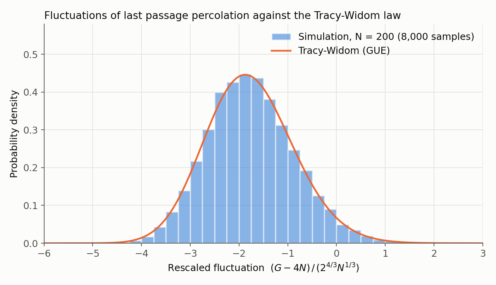

Hold a lighter to the edge of a sheet of paper and watch the burning front move inward. It isn't
straight, and it doesn't get straighter as it goes. The roughness grows, slowly, and if you measured
how far the front wanders from its average position you'd find that the typical deviation grows like
the cube root of time. The same exponent shows up in bacterial colonies spreading on a plate, in thin
films deposited atom by atom, and in a long list of mathematical models that look nothing alike. The
equation behind all of them is the Kardar-Parisi-Zhang (KPZ) equation, from 1986:

\\[\partial\_t h = \nu \, \partial\_x^2 h + \frac{\lambda}{2} (\partial\_x h)^2 + \xi\\]

Here \\(h(x, t)\\) is the height of the interface at position \\(x\\) and time \\(t\\), and \\(\xi\\) is
space-time white noise. This post derives the equation, solves its linear version exactly, and works through why the full equation needs special treatment before it means anything.
At the end I simulate a model from the same family and check the cube root law and the exact
distribution of the fluctuations against theory.

Start with the terms. The noise models the randomness in where material arrives or burns. It has mean
zero and covariance

\\[\mathbb{E}\big[ \xi(x, t) \, \xi(x\', t\') \big] = D \, \delta(x - x\') \, \delta(t - t\')\\]

so its values at different points and different times are independent, and \\(D\\) sets its strength.
The term \\(\nu \, \partial\_x^2 h\\) smooths the interface. It pushes down peaks, where \\(\partial\_x^2 h < 0\\),
and fills in valleys, which is what surface tension does, or what happens when particles that land on
the surface can hop sideways to lower spots.

The nonlinear term needs a little geometry. Suppose the interface grows at speed \\(v\\) in the direction
normal to itself, which is what a burning front or a growing colony does. Where the interface has slope
\\(s = \partial\_x h\\), its normal makes an angle \\(\theta\\) with the vertical where \\(\tan \theta = s\\). In
a short time \\(dt\\) the surface moves a distance \\(v \, dt\\) along the normal, and the height at a fixed
\\(x\\) rises by \\(v \, dt / \cos \theta\\). Since \\(1 / \cos \theta = \sqrt{1 + \tan^2 \theta}\\),

\\[\partial\_t h = v \sqrt{1 + (\partial\_x h)^2} \approx v + \frac{v}{2} (\partial\_x h)^2\\]

for small slopes. The constant \\(v\\) just moves everything up uniformly, so subtracting it off by working
in a moving frame \\(h \to h - v t\\) leaves the quadratic term, with \\(\lambda = v\\). A tilted piece of
interface grows faster vertically than a flat one, and that's the only physical content of the
nonlinearity. Notice that it breaks the symmetry \\(h \to -h\\), since the interface grows in one direction only.

The linear equation, with \\(\lambda = 0\\), is called the Edwards-Wilkinson equation, and it can be solved
exactly. Put the interface on a ring of length \\(L\\), so \\(h\\) is periodic, and expand in Fourier modes,

\\[h(x, t) = \sum\_k \hat{h}\_k(t) \, e^{i k x}, \qquad \hat{h}\_k = \frac{1}{L} \int\_0^L h(x, t) \, e^{-i k x} \, dx, \qquad k = \frac{2 \pi n}{L}\\]

The noise expands the same way, and its Fourier coefficients have covariance

\\[\mathbb{E}\big[ \hat{\xi}\_k(t) \, \hat{\xi}\_{k\'}^{\ast}(t\') \big] = \frac{1}{L^2} \int\_0^L \int\_0^L e^{-i k x + i k\' x\'} D \, \delta(x - x\') \, dx \, dx\' \, \delta(t - t\') = \frac{D}{L^2} \int\_0^L e^{-i (k - k\') x} \, dx \, \delta(t - t\') = \frac{D}{L} \, \delta\_{k k\'} \, \delta(t - t\')\\]

Different modes get independent noise. Since \\(\partial\_x^2 e^{i k x} = -k^2 e^{i k x}\\), the equation splits
into one equation per mode,

\\[\frac{d \hat{h}\_k}{d t} = -\nu k^2 \, \hat{h}\_k + \hat{\xi}\_k\\]

which is an Ornstein-Uhlenbeck process: a restoring force of strength \\(\nu k^2\\) plus white noise. Starting
from a flat interface, \\(\hat{h}\_k(0) = 0\\), the solution is

\\[\hat{h}\_k(t) = \int\_0^t e^{-\nu k^2 (t - s)} \, \hat{\xi}\_k(s) \, ds\\]

and its variance follows from the noise covariance, since the double integral collapses on \\(s = s\'\\):

\\[\mathbb{E}\big\vert  \hat{h}\_k(t) \big\vert ^2 = \frac{D}{L} \int\_0^t e^{-2 \nu k^2 (t - s)} \, ds = \frac{D}{L} \cdot \frac{1 - e^{-2 \nu k^2 t}}{2 \nu k^2}\\]

Short wavelengths, large \\(k\\), saturate almost immediately. Long wavelengths keep growing for a time of
order \\(1 / (\nu k^2)\\).

The quantity people measure is the interface width, the root mean square deviation from the average
height, \\(W^2 = \frac{1}{L} \int\_0^L (h - \bar{h})^2 \, dx\\). By Parseval's theorem this is the sum of
\\(\vert \hat{h}\_k\vert ^2\\) over every mode except \\(k = 0\\), which is the average height itself, so

\\[\mathbb{E}[W^2] = \sum\_{k \neq 0} \frac{D}{L} \cdot \frac{1 - e^{-2 \nu k^2 t}}{2 \nu k^2}\\]

At early times, before the longest modes have caught up, the system can't tell how big it is, and the
sum can be replaced by an integral using \\(\sum\_k \to \frac{L}{2 \pi} \int dk\\):

\\[\mathbb{E}[W^2] = \frac{D}{2 \pi} \int\_{-\infty}^{\infty} \frac{1 - e^{-2 \nu k^2 t}}{2 \nu k^2} \, dk = \frac{D}{4 \pi \nu} \, I(2 \nu t), \qquad I(a) = \int\_{-\infty}^{\infty} \frac{1 - e^{-a k^2}}{k^2} \, dk\\]

The integral \\(I(a)\\) is easiest through its derivative. Differentiating under the integral sign cancels
the \\(k^2\\),

\\[I\'(a) = \int\_{-\infty}^{\infty} e^{-a k^2} \, dk = \sqrt{\frac{\pi}{a}}, \qquad I(0) = 0 \quad \Longrightarrow \quad I(a) = 2 \sqrt{\pi a}\\]

so

\\[\mathbb{E}[W^2] = \frac{D}{4 \pi \nu} \cdot 2 \sqrt{2 \pi \nu t} = \frac{D}{\sqrt{2 \pi \nu}} \, t^{1/2}, \qquad W \propto t^{1/4}\\]

The width of an Edwards-Wilkinson interface grows like the fourth root of time. This growth stops once the
longest mode, \\(k = 2 \pi / L\\), saturates. At late times every mode has reached its stationary variance
\\(D / (2 \nu k^2 L)\\), and

\\[\mathbb{E}[W^2\_{\text{sat}}] = \sum\_{n \neq 0} \frac{D}{L} \cdot \frac{L^2}{2 \nu \, 4 \pi^2 n^2} = \frac{D L}{8 \pi^2 \nu} \sum\_{n \neq 0} \frac{1}{n^2} = \frac{D L}{8 \pi^2 \nu} \cdot \frac{\pi^2}{3} = \frac{D L}{24 \nu}\\]

using \\(\sum\_{n \geq 1} 1 / n^2 = \pi^2 / 6\\), counted twice for positive and negative \\(n\\). So the saturated
width grows like \\(L^{1/2}\\). Setting the growing and saturated widths equal gives the crossover time,
\\(\sqrt{t\_\times} \propto L\\), so \\(t\_\times \propto L^2\\).

These three facts combine into the scaling form that describes every growing interface. Define a roughness
exponent \\(\chi\\), a dynamic exponent \\(z\\), and a growth exponent \\(\beta\\) by

\\[W(L, t) = L^{\chi} \, f\!\left( \frac{t}{L^z} \right), \qquad f(u) \sim \begin{cases} u^{\beta} & u \ll 1 \\\\ \text{const} & u \gg 1 \end{cases}\\]

For the width at early times to be independent of \\(L\\), the powers of \\(L\\) have to cancel:
\\(L^\chi (t / L^z)^\beta \propto t^\beta\\) requires \\(\beta = \chi / z\\). Edwards-Wilkinson has \\(\chi = 1/2\\),
\\(z = 2\\), and \\(\beta = 1/4\\), all derived above. The question is what the nonlinear term does to these
numbers.

Before getting to that, there's a serious problem with the KPZ equation as written: in one dimension it
doesn't define anything. To see why, count how rough each object is. White noise in
space and time scales as

\\[\xi(b x, b^z t) \overset{d}{=} b^{-(1 + z)/2} \, \xi(x, t)\\]

because its covariance is \\(\delta(x) \delta(t)\\), and \\(\delta(b x) = b^{-1} \delta(x)\\),
\\(\delta(b^z t) = b^{-z} \delta(t)\\), so the covariance picks up \\(b^{-(1+z)}\\) and the noise itself
picks up the square root of that. With the heat equation's scaling, \\(z = 2\\), the noise behaves like
something of regularity \\(-3/2\\): rougher than a delta function in one variable. Solving the heat equation
gains two derivatives of regularity, so \\(h\\) has regularity just under \\(1/2\\). It's continuous, but no
better than Brownian motion. Then \\(\partial\_x h\\) has regularity just under \\(-1/2\\), which means it's a distribution that can't be evaluated at individual points, and there's no general way to square a distribution of negative regularity.

The divergence is easy to see concretely. Smooth the noise by cutting off all Fourier modes with
\\(\vert k\vert  > \pi / \varepsilon\\), so \\(\varepsilon\\) plays the role of a short-distance cutoff, and look at the
Edwards-Wilkinson interface in its stationary state. The slope has Fourier coefficients
\\(i k \hat{h}\_k\\), so

\\[\mathbb{E}\big[ (\partial\_x h\_\varepsilon)^2 \big] = \sum\_{0 < \vert k\vert  < \pi / \varepsilon} k^2 \, \mathbb{E} \vert \hat{h}\_k\vert ^2 = \sum\_{0 < \vert k\vert  < \pi / \varepsilon} k^2 \cdot \frac{D}{2 \nu k^2 L} = \frac{D}{2 \nu L} \cdot \\#\\{ k : 0 < \vert k\vert  < \pi / \varepsilon \\}\\]

Every mode contributes the same amount, \\(D / (2 \nu L)\\), regardless of its wavelength. The number of
modes below the cutoff is about \\(2 \times (\pi / \varepsilon) / (2 \pi / L) = L / \varepsilon\\), so

\\[\mathbb{E}\big[ (\partial\_x h\_\varepsilon)^2 \big] \approx \frac{D}{2 \nu \varepsilon} \longrightarrow \infty \quad \text{as } \varepsilon \to 0\\]

The squared slope has an infinite average. If you put the smoothed noise into the KPZ equation and take the
cutoff away, the term \\((\lambda / 2)(\partial\_x h)^2\\) adds an infinite upward velocity and the solution
runs off to infinity.

The fix that works is to subtract the divergence by hand. Define \\(h\_\varepsilon\\) as the solution of

\\[\partial\_t h\_\varepsilon = \nu \, \partial\_x^2 h\_\varepsilon + \frac{\lambda}{2} \Big[ (\partial\_x h\_\varepsilon)^2 - C\_\varepsilon \Big] + \xi\_\varepsilon, \qquad C\_\varepsilon = \frac{D}{2 \nu \varepsilon}\\]

with the noise smoothed at scale \\(\varepsilon\\). The subtracted constant only shifts the height by a
deterministic amount \\(\lambda C\_\varepsilon t / 2\\), so physically it's a correction to the average growth
velocity, which depends on the microscopic details anyway. The hard theorem, proved by Hairer in 2013 with rough path methods and later placed inside his theory of regularity structures, is that \\(h\_\varepsilon\\) then converges to a limit as
\\(\varepsilon \to 0\\), and the limit doesn't depend on how the noise was smoothed. That limit is what the
KPZ equation means. The theory works by building a local expansion of the solution in terms of explicit
random objects (the noise, its convolution with the heat kernel, products of those) and showing that, once a
finite number of divergent constants are subtracted from those objects, everything else is well defined. In
one dimension the only constant needed is \\(C\_\varepsilon\\).

There's an older and much shorter route to the same answer, called the Cole-Hopf transform. Set

\\[Z = \exp\!\left( \frac{\lambda}{2 \nu} h \right)\\]

and compute what equation \\(Z\\) satisfies. Spatial derivatives follow from the chain rule:

\\[\partial\_x Z = \frac{\lambda}{2 \nu} Z \, \partial\_x h, \qquad \partial\_x^2 Z = \frac{\lambda}{2 \nu} Z \, \partial\_x^2 h + \left( \frac{\lambda}{2 \nu} \right)^2 Z \, (\partial\_x h)^2\\]

so

\\[\nu \, \partial\_x^2 Z = \frac{\lambda}{2} Z \, \partial\_x^2 h + \frac{\lambda^2}{4 \nu} Z \, (\partial\_x h)^2\\]

The time derivative needs Itô's formula, because \\(h\\) is driven by white noise in time. With the noise
smoothed in space, so that the quadratic variation of \\(h(x, \cdot)\\) is finite, write \\(\rho\_\varepsilon\\)
for the smoothing kernel. The noise at a single point then has \\(d \langle h(x) \rangle\_t = D \rho\_\varepsilon(0) \, dt\\),
and Itô's formula for \\(Z = e^{a h}\\) with \\(a = \lambda / (2 \nu)\\) gives

\\[d Z = a Z \, d h + \frac{1}{2} a^2 Z \, d \langle h \rangle = a Z \, d h + \frac{\lambda^2}{8 \nu^2} D \rho\_\varepsilon(0) \, Z \, dt\\]

Substituting the renormalized equation for \\(dh\\),

\\[a Z \, d h = \left[ \frac{\lambda}{2} Z \, \partial\_x^2 h + \frac{\lambda^2}{4 \nu} Z \, (\partial\_x h)^2 - \frac{\lambda^2}{4 \nu} C\_\varepsilon Z \right] dt + \frac{\lambda}{2 \nu} Z \, \xi\_\varepsilon \, dt\\]

The first two terms in the bracket are exactly \\(\nu \, \partial\_x^2 Z\\). Collecting what's left,

\\[d Z = \nu \, \partial\_x^2 Z \, dt + \frac{\lambda}{2 \nu} Z \, \xi\_\varepsilon \, dt + \left[ \frac{\lambda^2 D \rho\_\varepsilon(0)}{8 \nu^2} - \frac{\lambda^2 C\_\varepsilon}{4 \nu} \right] Z \, dt\\]

and the last bracket vanishes when \\(C\_\varepsilon = D \rho\_\varepsilon(0) / (2 \nu)\\). For the sharp Fourier cutoff
at \\(\pi / \varepsilon\\), the kernel at zero is \\(\rho\_\varepsilon(0) = \frac{1}{2\pi} \int\_{-\pi/\varepsilon}^{\pi/\varepsilon} dk = 1 / \varepsilon\\),
which gives \\(C\_\varepsilon = D / (2 \nu \varepsilon)\\), the same constant that came out of the slope
calculation. The infinite constant in KPZ is exactly the Itô correction in the Cole-Hopf transform. With it
removed, \\(Z\\) satisfies the stochastic heat equation with multiplicative noise,

\\[\partial\_t Z = \nu \, \partial\_x^2 Z + \frac{\lambda}{2 \nu} Z \, \xi\\]

which is linear in \\(Z\\). In one dimension this equation has a well-defined solution for genuine white noise,
using the Itô interpretation of the product \\(Z \xi\\), and a theorem of Mueller guarantees that \\(Z\\) stays
strictly positive, so \\(h = (2 \nu / \lambda) \log Z\\) makes sense. That solution coincides with Hairer's.

The transform also explains why such different systems share the KPZ behavior. By the Feynman-Kac formula,
the solution of the stochastic heat equation is an average over random paths,

\\[Z(x, t) = \mathbb{E}\_x \left[ \exp\!\left( \frac{\lambda}{2 \nu} \int\_0^t \xi\big( B\_s, t - s \big) \, ds \right) Z(B\_t, 0) \right]\\]

where \\(B\\) is a Brownian motion started at \\(x\\) with generator \\(\nu \, \partial\_x^2\\), and the exponential is
understood with the Itô renormalization above. Read this as a partition function. Each path \\(B\\) is a
polymer stretched in the time direction, it collects energy from the random environment \\(\xi\\) along its
length, and \\(Z\\) sums the Boltzmann weights over all paths. The KPZ height \\(h \propto \log Z\\) is the
polymer's free energy. Lowering the temperature, so that the sum is dominated by its largest term, turns the
free energy into a maximum over paths of the total energy collected. That's last passage percolation, the
model I simulate below.

One more change of variables is useful. Differentiating KPZ in \\(x\\) and writing \\(u = \partial\_x h\\) gives

\\[\partial\_t u = \nu \, \partial\_x^2 u + \lambda u \, \partial\_x u + \partial\_x \xi\\]

which is the stochastic Burgers equation, the simplest model of a compressible fluid with viscosity \\(\nu\\).
The slope of the interface is the velocity of the fluid.

The KPZ equation has a symmetry that the Edwards-Wilkinson equation doesn't need:
tilting the interface. If \\(h\\) is a solution, then so is

\\[h\'(x, t) = h(x + \lambda \epsilon t, \, t) + \epsilon x + \frac{\lambda}{2} \epsilon^2 t\\]

for any slope \\(\epsilon\\). To check it, compute each term,

\\[\partial\_t h\' = \partial\_t h + \lambda \epsilon \, \partial\_x h + \frac{\lambda}{2} \epsilon^2, \qquad \partial\_x h\' = \partial\_x h + \epsilon, \qquad \frac{\lambda}{2} (\partial\_x h\')^2 = \frac{\lambda}{2} (\partial\_x h)^2 + \lambda \epsilon \, \partial\_x h + \frac{\lambda}{2} \epsilon^2\\]

with everything on the right evaluated at \\((x + \lambda \epsilon t, t)\\). Subtracting,
\\(\partial\_t h\' - \nu \, \partial\_x^2 h\' - \frac{\lambda}{2} (\partial\_x h\')^2 = \partial\_t h - \nu \, \partial\_x^2 h - \frac{\lambda}{2} (\partial\_x h)^2 = \xi(x + \lambda \epsilon t, t)\\).
White noise sheared along \\(x + \lambda \epsilon t\\) has the same distribution as the original, so \\(h\'\\) solves
the same equation. In Burgers language this is a Galilean boost: adding a constant velocity \\(\epsilon\\) to
the fluid is the same as watching it from a moving frame.

The symmetry ties the coefficient of the nonlinear term to something that can't change under rescaling.
Rescale \\(x = b x\'\\), \\(t = b^z t\'\\), and \\(h = b^\chi h\'\\). Substituting into KPZ and using the noise scaling,

\\[b^{\chi - z} \partial\_{t\'} h\' = \nu \, b^{\chi - 2} \, \partial\_{x\'}^2 h\' + \frac{\lambda}{2} b^{2 \chi - 2} (\partial\_{x\'} h\')^2 + b^{-(1 + z)/2} \xi\'\\]

and multiplying through by \\(b^{z - \chi}\\),

\\[\partial\_{t\'} h\' = \nu \, b^{z - 2} \, \partial\_{x\'}^2 h\' + \frac{\lambda}{2} b^{\chi + z - 2} (\partial\_{x\'} h\')^2 + b^{(z - 1)/2 - \chi} \xi\'\\]

For Edwards-Wilkinson, keeping the first and last coefficients fixed requires \\(z = 2\\) and
\\(\chi = (z - 1)/2 = 1/2\\), which matches the exact solution. With the nonlinearity present, \\(\nu\\) and \\(D\\)
pick up corrections when you coarse-grain, but \\(\lambda\\) can't. The tilt symmetry fixes the ratio between
an imposed slope and the extra velocity it produces, and that ratio is \\(\lambda\\) at every scale. So the
coefficient \\(b^{\chi + z - 2}\\) has to be one, which gives

\\[\chi + z = 2\\]

One more relation pins down both exponents, and in one dimension it comes from an exact property of the
equation: its stationary state is the same as Edwards-Wilkinson's. The argument is simplest in Burgers form.
The linear part, \\(\partial\_t u = \nu \, \partial\_x^2 u + \partial\_x \xi\\), is again a set of independent
Ornstein-Uhlenbeck modes, now with \\(\hat{u}\_k = i k \hat{h}\_k\\) and stationary variance

\\[\mathbb{E}\vert \hat{u}\_k\vert ^2 = k^2 \cdot \frac{D}{2 \nu k^2 L} = \frac{D}{2 \nu L}\\]

which is the same for every \\(k\\). A flat Fourier spectrum means \\(u\\) is spatial white noise, with
\\(\mathbb{E}[u(x) u(x\')] = \frac{D}{2 \nu} \delta(x - x\')\\), and its distribution has density proportional to
\\(\exp\!\big( -\frac{\nu}{D} \int u^2 \, dx \big)\\). The nonlinear term \\(\lambda u \, \partial\_x u\\) leaves that
density alone for two reasons. It conserves \\(\int u^2 \, dx\\), since

\\[\frac{d}{dt} \int u^2 \, dx \Big\vert \_{\text{nonlinear}} = 2 \lambda \int u^2 \, \partial\_x u \, dx = \frac{2 \lambda}{3} \int \partial\_x (u^3) \, dx = 0\\]

on a periodic domain, so it moves \\(u\\) along the level sets of the density. And it's formally divergence-free
as a vector field on the space of functions, so it doesn't concentrate probability anywhere. A flow with both
properties preserves the Gaussian measure, just as a Hamiltonian flow preserves a Boltzmann distribution. So
the slope stays white noise, the height is a Brownian motion in \\(x\\) with
\\(\mathbb{E}[(h(x) - h(0))^2] = \frac{D}{2 \nu} \vert x\vert \\), and the roughness exponent stays \\(\chi = 1/2\\). Then

\\[z = 2 - \chi = \frac{3}{2}, \qquad \beta = \frac{\chi}{z} = \frac{1/2}{3/2} = \frac{1}{3}\\]

The nonlinear term leaves the stationary shape of the interface unchanged, but it speeds up how fast
correlations spread, from \\(x \sim t^{1/2}\\) to \\(x \sim t^{2/3}\\), and it changes the growth of the width from
\\(t^{1/4}\\) to \\(t^{1/3}\\).

Beyond the exponents, it has been proved over the last 25 years that the fluctuations have an exact, universal distribution. Starting from a sharp wedge, the height at the origin grows as

\\[h(0, t) \simeq v\_\infty t + (\Gamma t)^{1/3} \chi\_{\text{GUE}}\\]

where \\(v\_\infty\\) and \\(\Gamma\\) depend on \\(\nu\\), \\(\lambda\\), and \\(D\\), and \\(\chi\_{\text{GUE}}\\) is a random variable
with the Tracy-Widom distribution. That distribution first appeared somewhere unrelated: if you take a large
\\(N \times N\\) Hermitian matrix with independent Gaussian entries (the Gaussian Unitary Ensemble), its largest
eigenvalue is approximately \\(2 \sqrt{N} + N^{-1/6} \chi\_{\text{GUE}}\\). The distribution isn't Gaussian. It has a
mean of about \\(-1.77\\), a standard deviation of about \\(0.90\\), and it's skewed, with a thinner left tail than
right. Starting from a flat interface gives a different member of the same family, the Tracy-Widom distribution
for real symmetric matrices.

To test all of this, I simulated last passage percolation, the zero-temperature polymer from above. Put an
independent exponential random variable \\(w\_{ij}\\) with mean one on each site of an \\(N \times N\\) grid, and let
\\(G(N, N)\\) be the largest total weight collected by a path from \\((1, 1)\\) to \\((N, N)\\) that only moves up or
right. It satisfies a one-line recursion,

\\[G(i, j) = w\_{ij} + \max\big( G(i - 1, j), \, G(i, j - 1) \big)\\]

which takes \\(N^2\\) steps to compute. The connection to growth is that the set of sites with \\(G(i, j) \leq t\\)
is a growing cluster in the corner of the grid, and its boundary is an interface that moves forward as \\(t\\)
increases. For this model two exact results are known. Rost showed that \\(G(M, N)\\) grows like
\\((\sqrt{M} + \sqrt{N})^2\\), which is \\(4 N\\) on the diagonal. Johansson showed that

\\[\frac{G(N, N) - 4 N}{2^{4/3} N^{1/3}} \longrightarrow \chi\_{\text{GUE}}\\]

So the fluctuations grow like \\(N^{1/3}\\), the KPZ exponent, with Tracy-Widom fluctuations.

The \\(N^{1/3}\\) has a short heuristic explanation that also shows where \\(z = 3/2\\) comes from. Suppose the best
path wanders a distance \\(\ell\\) away from the diagonal. Ending at \\((N + \ell, N - \ell)\\) costs, on average,

\\[\big( \sqrt{N + \ell} + \sqrt{N - \ell} \big)^2 = 2 N + 2 \sqrt{N^2 - \ell^2} \approx 4 N - \frac{\ell^2}{N}\\]

so a deviation of \\(\ell\\) costs \\(\ell^2 / N\\) in expected weight. A path will wander as far as the random gains
from doing so can pay for that cost. If the fluctuations of the total are of order \\(N^{\beta}\\) and the wandering is
of order \\(N^{\xi}\\), balancing \\(\ell^2 / N \sim N^{\beta}\\) gives \\(2 \xi - 1 = \beta\\). With \\(\xi = 2/3\\), the inverse of
\\(z = 3/2\\), this gives \\(\beta = 1/3\\). The same relation \\(\chi + z = 2\\) is hiding inside it.

Here's what came out, with the predictions using the Tracy-Widom mean \\(-1.771\\) and standard deviation
\\(0.902\\), so the predicted mean is \\(4N - 1.771 \times 2^{4/3} N^{1/3}\\) and the predicted standard deviation is
\\(0.902 \times 2^{4/3} N^{1/3}\\):

| \\(N\\) | Samples | Mean of \\(G\\) | Predicted mean | Std. dev. | Predicted std. dev. | Rescaled mean |
|---|---|---|---|---|---|---|
| 25 | 8,000 | 87.40 | 86.95 | 6.14 | 6.64 | -1.711 |
| 50 | 6,000 | 183.93 | 183.56 | 7.98 | 8.37 | -1.731 |
| 100 | 4,000 | 379.47 | 379.28 | 10.36 | 10.55 | -1.756 |
| 200 | 2,500 | 774.09 | 773.90 | 13.08 | 13.29 | -1.758 |
| 400 | 1,200 | 1568.09 | 1567.12 | 17.23 | 16.74 | -1.719 |

The mean falls short of \\(4N\\) by an amount that grows like \\(N^{1/3}\\), and the Tracy-Widom prediction gets that
shortfall right to within a unit at every size. The ratio of the measured to predicted standard deviation goes 0.92,
0.95, 0.98, 0.98, 1.03 as \\(N\\) grows, converging on one, and the rescaled mean settles near \\(-1.77\\). The last
row has the fewest samples, so its standard error is the largest, about 0.03 on the rescaled mean. Fitting
\\(\log(\text{std. dev.})\\) against \\(\log N\\) across all five sizes gives a slope of 0.37 against the predicted
\\(1/3\\). The excess comes from the small sizes, where the standard deviation is still below its asymptotic value,
and it's the usual way finite-size corrections show up in these fits. A straight fit to a power law is a weaker test
than comparing each size with the exact prediction, which the table does.

*The rescaled last passage time for N = 200, from 8,000 samples, against the Tracy-Widom density computed from the Airy kernel. The histogram sits slightly to the right of the curve, the finite-size shift visible in the table.*

For contrast I also ran the Edwards-Wilkinson equation directly, discretized on a ring of 2,048 sites with
\\(\nu = D = 1\\) and a time step of 0.05. The width grew with a fitted exponent of 0.245 between \\(t = 10\\) and
\\(t = 400\\), against the predicted \\(1/4\\). At \\(t = 100\\) the measured \\(W^2\\) was 3.74 against the continuum
prediction of \\(\sqrt{100} / \sqrt{2 \pi} \approx 3.99\\). The gap comes from the lattice: with a grid spacing of one, the
discrete Laplacian damps mode \\(k\\) at rate \\(2 \nu (1 - \cos k)\\) in place of \\(\nu k^2\\), and the shortest wavelengths
contribute differently, while the exponent is unaffected.

I also tried ballistic deposition, a classic growth model where particles fall onto random columns and stick to
the first neighbor they touch. It's believed to be in the KPZ class, but on a ring of 1,000 sites up to time 1,000
its width grew with an effective exponent of only 0.27. Models like this are known to approach their asymptotic
exponents very slowly, and it's a good reminder of why the exactly solvable models such as last passage
percolation became the standard way to test KPZ predictions numerically.

There are a few limits to what's here. All of it is one-dimensional. In two dimensions, which is the case for a real
deposited film, the KPZ equation can't be renormalized the same way, there's no exact solution, and the exponents of the strongly nonlinear regime are known only from simulations. The connection between the continuum equation and lattice models like last
passage percolation is itself a theorem in only some cases, and in others it's supported by simulation and by the
matching exponents and distributions. And the arguments above for \\(\chi + z = 2\\) and for the polymer wandering are scaling arguments. In one dimension both conclusions have since been proved rigorously.

I'd like to follow this up with the stochastic heat equation itself, done carefully. Its solution in one dimension
can be written down explicitly through the heat kernel, and working out why it stops being a function in two
dimensions shows exactly where the regularity counting above breaks down.
