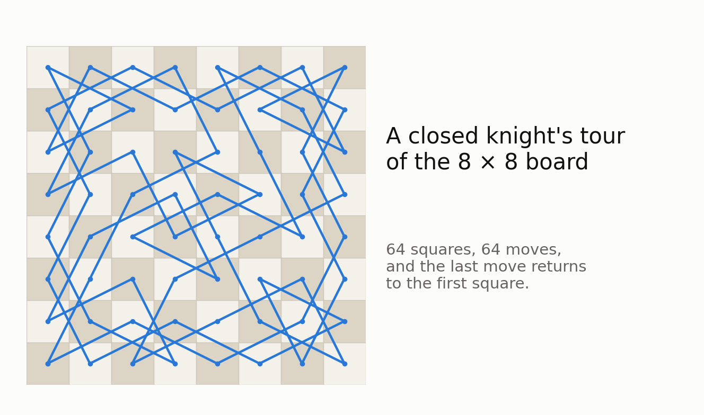
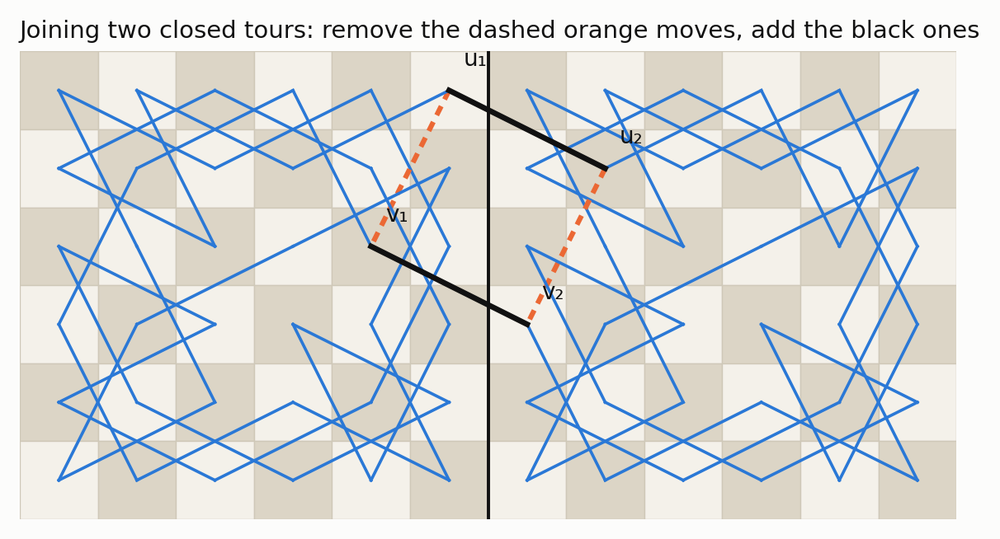
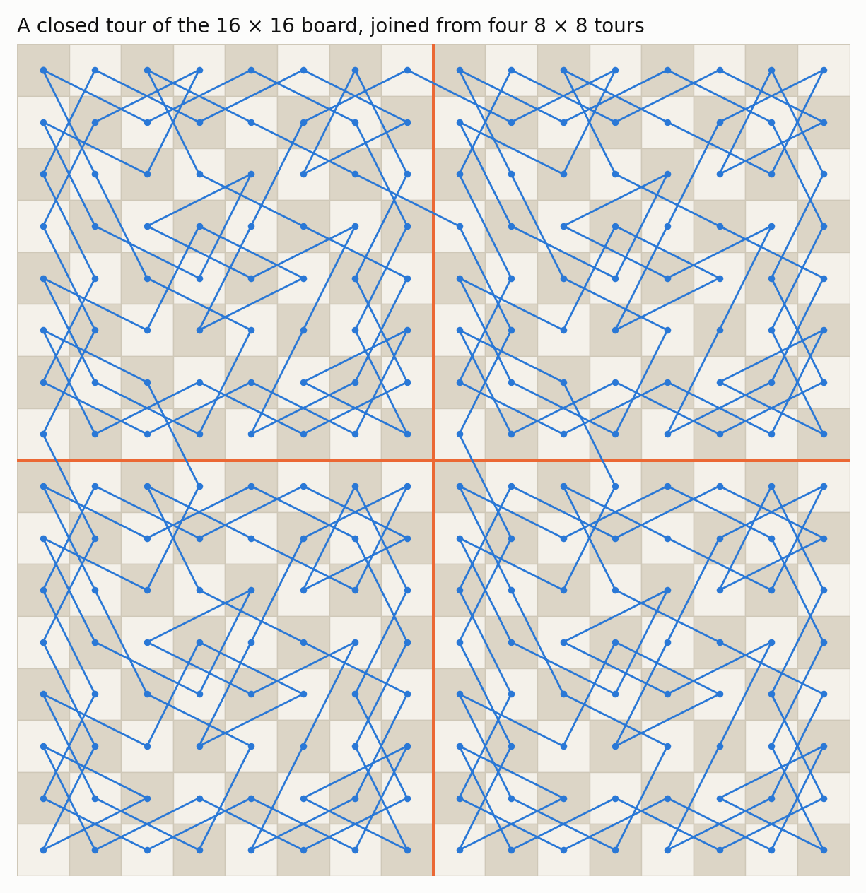

Put a knight on a corner of an empty chessboard and try to move it so that it lands on every one of the 64 squares exactly once. You'll get stuck the first few times, usually with a handful of squares left near an edge that the knight can no longer reach, but it can be done. This is the knight's tour, and the version I want to work through here is the general one: on an N × N board, for which N does a tour exist, and when one exists, how do you actually find it? If the last square of the tour is one knight move from the first, so the knight could keep going around the same loop forever, the tour is called closed. Otherwise it's open. I'll start with boards small enough to check by hand, use what they show to rule out the boards that can't work, and then build tours for every board that can, with a construction whose running time I can bound.

The first step is to turn the board into a graph. Each square is a vertex, and two squares are joined by an edge when a knight can move between them. I'll label squares by \\((r, c)\\), with \\(r\\) the row counted from the top and \\(c\\) the column counted from the left, both running from 1 to \\(N\\). A knight moves two squares in one direction and one square in the other, so \\((r, c)\\) and \\((r\', c\')\\) are joined exactly when

\\[\big\\{ \lvert r - r\' \rvert, \; \lvert c - c\' \rvert \big\\} = \\{1, 2\\}\\]

An open tour is then a path that visits every vertex of this graph once, which is called a Hamiltonian path, and a closed tour is a Hamiltonian cycle. A closed tour always gives an open one, since deleting any single move from the loop leaves a path through every square, so closed tours are the stronger thing to ask for.

It helps to know how big this graph is. Any knight move fits exactly inside a box that is either 2 rows by 3 columns or 3 rows by 2 columns, with the two squares at opposite corners of the box. A 2 × 3 box contains exactly two knight moves, one for each pair of opposite corners, and each move has only one such box, so counting boxes counts moves. A 2 × 3 box can sit in \\(N - 1\\) vertical positions and \\(N - 2\\) horizontal ones, and the 3 × 2 boxes give the same count turned sideways, so the number of edges is

\\[E(N) = 2 (N - 1)(N - 2) + 2 (N - 2)(N - 1) = 4 (N - 1)(N - 2)\\]

For the ordinary 8 × 8 board that's \\(4 \times 7 \times 6 = 168\\) edges. The number of moves from each square, its degree, depends on how close it is to the edge. On the 8 × 8 board the 4 corners have 2 moves, the 8 squares next to the corners along the edges have 3, the other 16 edge squares and the 4 squares diagonally inside the corners have 4, the remaining 16 squares of the second ring have 6, and the 16 squares of the central 4 × 4 block have all 8. As a check, every edge has two ends, so the degrees have to add up to twice the number of edges:

\\[4 \cdot 2 + 8 \cdot 3 + 20 \cdot 4 + 16 \cdot 6 + 16 \cdot 8 = 8 + 24 + 80 + 96 + 128 = 336 = 2 \times 168\\]

The other fact I'll use over and over is the coloring of the board. Call \\((r, c)\\) dark when \\(r + c\\) is even and light when it's odd. A knight move changes \\(r + c\\) by \\(\pm 1\\) or \\(\pm 3\\), which is always odd, so every move goes from a dark square to a light one or from a light square to a dark one. In graph terms the knight graph is bipartite, with the two colors as the two sides. Along any tour the colors alternate.

The smallest boards are quick. On the 1 × 1 board the knight is already on the only square, so there's a tour with no moves in it, and I'll set that case aside. On the 2 × 2 board every move takes the knight off the board, so there are no edges at all and no tour. The 3 × 3 board is the first interesting one. The center square \\((2, 2)\\) has no moves, since every knight move from it changes the row or column by 2 and lands outside the board. The other eight squares do have moves, and in fact they form a single loop. In chess notation, with files a to c from left to right and ranks 1 to 3 from bottom to top, the loop is

\\[\text{a1} \to \text{b3} \to \text{c1} \to \text{a2} \to \text{c3} \to \text{b1} \to \text{a3} \to \text{c2} \to \text{a1}\\]

which uses all \\(4 \times 2 \times 1 = 8\\) edges from the formula above. So the knight can visit every square of the 3 × 3 board except the one in the middle, and no tour exists.

The 4 × 4 board takes more work. Every square has at least two moves, so nothing is unreachable, and a computer search over every possible path finds no tour, but I wanted a proof that someone could check by hand. I'll use chess notation again, with files a to d and ranks 1 to 4, and split the 16 squares into three groups: the four corners, which I'll call \\(K\\), the four central squares b2, b3, c2, c3, which I'll call \\(C\\), and the eight remaining squares along the edges, which I'll call \\(Q\\). Writing out the moves from each square shows how these groups connect. A corner can only move to the center, for example a1 moves to b3 and c2 and nowhere else. A central square moves to exactly two corners and exactly two edge squares, and never to another central square, for example b2 moves to the corners a4 and d1 and to the edge squares c4 and d3. An edge square moves to exactly one central square and exactly two other edge squares, and the moves between edge squares form two separate loops of four, a2, b4, d3, c1 and a3, c4, d2, b1.

*The three groups of squares on the 4 × 4 board. Corners are orange, central squares dark blue, and edge squares light blue. No move joins two corners, two central squares, or a corner and an edge square.*

Now suppose there is an open tour. It's a path with 16 squares and 15 moves, where the two end squares each use one move and every other square uses two. Let \\(e\_K\\), \\(e\_C\\) and \\(e\_Q\\) be the number of ends of the path in each group, so \\(e\_K + e\_C + e\_Q = 2\\). Let \\(x\_{KC}\\), \\(x\_{QC}\\) and \\(x\_{QQ}\\) be the number of moves in the path between a corner and a central square, between an edge square and a central square, and between two edge squares. From the list of moves above, these are the only kinds of move there are. Adding up the number of moves used at each corner, every one of them goes to the center, so

\\[x\_{KC} = 2 \cdot 4 - e\_K = 8 - e\_K\\]

Doing the same at the central squares, every move used there goes to a corner or an edge square, so

\\[x\_{KC} + x\_{QC} = 8 - e\_C\\]

and subtracting the first equation from the second gives

\\[x\_{QC} = e\_K - e\_C\\]

Now count at the edge squares. Each of the 8 uses two moves unless it's an end, and a move between two edge squares gets counted at both of its ends, so

\\[x\_{QC} + 2 x\_{QQ} = 16 - e\_Q\\]

A path never returns to a square, so it can't use all four moves of either loop of four, and it uses at most 3 moves from each. That means \\(x\_{QQ} \leq 6\\), and

\\[x\_{QC} = 16 - e\_Q - 2 x\_{QQ} \geq 16 - e\_Q - 12 = 4 - e\_Q\\]

Putting the two expressions for \\(x\_{QC}\\) together,

\\[e\_K - e\_C \geq 4 - e\_Q \quad \Longrightarrow \quad e\_K + e\_Q - e\_C \geq 4\\]

but the path only has two ends, so \\(e\_K + e\_Q \leq 2\\) and the left side is at most 2. That's a contradiction, so the 4 × 4 board has no open tour, and since a closed tour would give an open one, it has no closed tour either. What I like about this proof is that it never has to guess where the path starts or ends. The four corners all funnel into the same four central squares, and those central squares don't have enough moves left over to also collect the eight edge squares, which can't link up among themselves without closing a loop.

The 5 × 5 board is the first one with tours, and it's also where the coloring starts to matter. The board has 25 squares, which is odd, and the colors alternate along any tour, so a closed tour would have to alternate dark, light, dark, light all the way around a loop of 25 squares and come back to the color it started on after 25 moves. After an odd number of moves the knight is always on the opposite color, so that's impossible. The same argument works for any odd \\(N\\): the board has \\(N^2\\) squares, which is odd, and no closed tour exists.

Open tours on odd boards are allowed, but the coloring restricts where they can start. Number the squares of the tour 1 through \\(N^2\\). The colors alternate, so all the odd-numbered squares are one color, and there are \\((N^2 + 1) / 2\\) of them, against \\((N^2 - 1) / 2\\) even-numbered squares of the other color. For odd \\(N\\), the dark squares, the color of the corners, are the more common one. The rows alternate between having \\((N + 1) / 2\\) and \\((N - 1) / 2\\) dark squares, starting and ending with the larger number, so there are \\((N + 1) / 2\\) rows of the first kind and \\((N - 1) / 2\\) of the second, and

\\[\frac{N + 1}{2} \cdot \frac{N + 1}{2} + \frac{N - 1}{2} \cdot \frac{N - 1}{2} = \frac{(N + 1)^2 + (N - 1)^2}{4} = \frac{2 N^2 + 2}{4} = \frac{N^2 + 1}{2}\\]

The odd-numbered squares of the tour have to be the dark ones, since there are exactly enough of them, and squares 1 and \\(N^2\\) are both odd-numbered. So on an odd board every open tour starts and ends on a square of the corner color. On the 5 × 5 board that's 13 of the 25 squares.

The 5 × 5 board is small enough to list every tour. I wrote a short program that starts a search from each of the 25 squares and follows every possible sequence of moves, backing up whenever the knight runs out of new squares, and it took about seven seconds. It found 1,728 tours counting each direction separately, or 864 different routes. Every one of them starts on one of the 13 dark squares, as the coloring argument says it must. The corners are by far the most common starting squares, with 304 tours from each, and the totals add up:

\\[4 \times 304 + 8 \times 56 + 64 = 1216 + 448 + 64 = 1728\\]

*One open tour of the 5 × 5 board, and the number of tours that start on each square. Only the 13 squares of the corner color can start a tour.*

The 6 × 6 board has 36 squares, an even number, so the coloring no longer rules out a closed tour, and closed tours do exist there. One is drawn twice, side by side, further down, where I use it to build bigger tours. The ordinary 8 × 8 board has closed tours as well, like the one below. At this point the pattern for square boards is that the 1 × 1 board is trivial, the 2 × 2, 3 × 3 and 4 × 4 boards have no tour at all, odd boards from 5 × 5 up can only have open tours, and even boards from 6 × 6 up can have closed ones. To show that this pattern continues for every \\(N\\), I need a way to produce a tour for each size, and that's where the computer science comes in.

*A closed tour of the 8 × 8 board. The last move returns to the first square.*

Finding a Hamiltonian path in a general graph is NP-complete, so there's no known method that works quickly on every graph, and the obvious search takes exponential time in the worst case. The obvious search is backtracking: start somewhere, move to an unvisited square, keep going, and when the knight is stuck with squares left over, undo the last move and try the next option. A square has at most 8 moves and, after the first move, at most 7 that don't go straight back, so the search tree for an \\(N \times N\\) board has at most

\\[1 + 8 \sum\_{k=0}^{N^2 - 2} 7^k\\]

nodes, which for the 8 × 8 board is a number with 54 digits. Most of that tree is never reached in practice, but how much of it gets explored depends heavily on which move the search tries first. I ran the search from the top left corner on four board sizes, once trying moves in a fixed order and once trying first the move to the square that has the fewest unvisited squares one knight move away from it, and counted the number of squares the search placed before it found a full tour:

| Board | Fixed move order | Fewest onward moves first |
|---|---|---|
| 5 × 5 | 70,716 | 25 |
| 6 × 6 | 253,102 | 36 |
| 7 × 7 | 578 | 49 |
| 8 × 8 | more than 30,000,000 (stopped) | 64 |

With the second ordering the search never had to back up at all. It placed exactly one square per move and found a tour on the first try. The reason it works is easiest to see from how a search fails. A square with no unvisited neighbors left can only be reached if it's the very last square of the tour, so once two such squares exist, the tour is already doomed, and the search may spend a long time finding that out. Visiting the most hemmed-in square first uses it up before it can become a dead end, and leaves the squares with many exits for later, when the board is crowded.

That suggests dropping the backtracking entirely and just following the rule: from the current square, always move to the unvisited square with the fewest onward moves, breaking ties by taking the first one in a fixed order. Each step looks at no more than 8 squares and checks no more than 8 neighbors of each, so the whole walk takes time proportional to \\(N^2\\). The problem is that nothing guarantees it finishes. I ran it from every starting square on every board from 5 × 5 up to 36 × 36, and from 400 random starting squares on each board from 37 × 37 to 50 × 50.

*How often following the fewest-onward-moves rule, with no backtracking, completes a tour. Boards above 36 × 36 use 400 random starting squares each.*

On even boards it works from almost every starting square for small and medium boards, from all 36 starting squares on the 6 × 6 board and 62 of the 64 on the 8 × 8 board, and then slowly gets worse, down to about 85% on the 50 × 50 board. On odd boards it only works from about half the starting squares, but that's the coloring argument again, since a tour can't start on a light square at all. Counting only the dark starting squares, its success rate on odd boards from 9 × 9 up is close to the rate on even boards. The tours it finds are rarely closed: on the 8 × 8 board only 8 of the 64 starting squares give a tour that ends one move from where it started. So the rule is a good way to find a tour in practice, but it isn't a proof that a tour exists for every \\(N\\), and it doesn't give closed tours on demand. For that I'll use a different approach, which builds a tour of a large board by joining tours of smaller boards.

The joining step rests on one lemma. Suppose two boards sit next to each other, and each has a closed tour of its own. Pick a move \\(u\_1 v\_1\\) in the first tour and a move \\(u\_2 v\_2\\) in the second, chosen so that \\(u\_1\\) and \\(u\_2\\) are one knight move apart, and \\(v\_1\\) and \\(v\_2\\) are also one knight move apart. Delete the moves \\(u\_1 v\_1\\) and \\(u\_2 v\_2\\), and add the moves \\(u\_1 u\_2\\) and \\(v\_1 v\_2\\). The result is a single closed tour of both boards together. To see why, deleting \\(u\_1 v\_1\\) from the first loop leaves a path that runs through every square of the first board, starting at \\(v\_1\\) and ending at \\(u\_1\\). In the same way the second board is left with a path from \\(u\_2\\) to \\(v\_2\\). Then

\\[v\_1 \leadsto u\_1 \to u\_2 \leadsto v\_2 \to v\_1\\]

goes through every square of the first board, jumps across, goes through every square of the second board, and jumps back to where it started, which is one loop through every square of both.

*Joining two closed tours of 6 × 6 boards into one closed tour of a 6 × 12 board. The dashed orange moves are removed and the black moves are added.*

The hard part is making sure the right moves are always available. On a board with columns 1 to \\(a\\), the corner square \\((1, a)\\) has only two moves, to \\((2, a - 2)\\) and \\((3, a - 1)\\), and a closed tour has to use both moves of every square, so every closed tour of that board contains the move \\((1, a) \to (3, a - 1)\\). That takes care of the left board for free. Put the right board in columns \\(a + 1\\) to \\(a + b\\). If its tour contains the move \\((2, a + 2) \to (4, a + 1)\\), I can join the two with

\\[u\_1 = (1, a), \quad v\_1 = (3, a - 1), \quad u\_2 = (2, a + 2), \quad v\_2 = (4, a + 1)\\]

and the two new moves are \\((1, a) \to (2, a + 2)\\), one row down and two columns right, and \\((3, a - 1) \to (4, a + 1)\\), also one row down and two columns right. Both are knight moves, so the lemma applies. In the right board's own coordinates, with its top left square as \\((1, 1)\\), the move it needs is \\((2, 2) \to (4, 1)\\). Joining a board on top of another one is the same picture with rows and columns swapped, and needs the bottom board to contain \\((2, 2) \to (1, 4)\\) in its own coordinates.

That leads to the definition the whole construction depends on. I'll call a closed tour of a rectangular board structured if, at each of its four corners, the square two rows and two columns in from that corner is joined to the two squares shown by these moves. At the top left that means the tour contains both

\\[(2, 2) \to (1, 4) \qquad \text{and} \qquad (2, 2) \to (4, 1)\\]

and at the other three corners it contains the mirror images of these. The definition doesn't change if the board is flipped or turned on its side, so a structured tour of an \\(m \times n\\) board turned sideways is a structured tour of the \\(n \times m\\) board.

Joining two structured tours with the lemma gives another structured tour. The two moves the join removes are next to the line between the boards, at one end of it, and the four corners of the combined board are the outer corners of the two pieces, which the join doesn't touch. On boards at least 6 squares wide, the moves removed at one corner are also never the same as the moves required at another corner, which I checked by writing out the squares involved for the narrowest case, 6 columns. So the structure carries through every join.

With that, the construction is a recursion. To build a structured closed tour of an \\(m \times n\\) board with \\(m\\) and \\(n\\) both even and at least 6, use a stored tour if both sides are 6, 8 or 10. Otherwise the longer side has some length \\(k \geq 12\\), and I cut it into two even pieces of at least 6, as close to equal as possible: \\(k / 2\\) and \\(k / 2\\) if \\(k / 2\\) is even, and \\(k / 2 - 1\\) and \\(k / 2 + 1\\) if it's odd. Then I build a structured tour of each piece and join them at the end of the cut nearest the top or left edge.

Any even \\(k \geq 12\\) cuts into two even pieces of at least 6, since \\(k / 2 \geq 6\\), and when \\(k / 2\\) is odd it's at least 7, so \\(k / 2 - 1 \geq 6\\). Both pieces are smaller than \\(k\\), so the recursion always reaches boards whose sides are all 6, 8 or 10. By induction on \\(m + n\\), every even board with both sides at least 6 has a structured closed tour, provided the six starting boards do: 6 × 6, 6 × 8, 6 × 10, 8 × 8, 8 × 10 and 10 × 10. Those I found by computer, with a backtracking search that tries the fewest-onward-moves square first and has the eight structure moves fixed in advance. Five of them came back almost immediately, and the 10 × 10 board took about a minute. Once a program checks them, they stay checked, since each one is a fixed list of moves.

*A closed tour of the 16 × 16 board, made by joining four 8 × 8 tours. Each orange line marks where two pieces were joined.*

Odd boards need one more piece. For odd \\(N \geq 11\\), write \\(N = 5 + b\\) with \\(b = N - 5\\), which is even and at least 6, and divide the board into four parts: a 5 × 5 block in the top left, a 5 × \\(b\\) strip to its right, a \\(b \times 5\\) strip below it, and a \\(b \times b\\) block in the bottom right. The \\(b \times b\\) block gets a structured closed tour from the recursion above. The 5 × \\(b\\) strip is built the same way from 5 × 6, 5 × 8 and 5 × 10 blocks joined side by side, and the strip below is that strip turned on its side. A 5-row block can't have the full structure, and a complete search of the 5 × 6 board confirmed that none of its closed tours do, but the side-by-side joins only ever need the single move \\((2, 2) \to (4, 1)\\) at a block's top left corner, and 5-row tours with that move exist. Two more joins attach the two strips to the large block, one at the right edge of the board and one at the bottom, which uses each strip's forced corner move and the large block's structure, and leaves one closed loop through everything except the 5 × 5 block.

The last step attaches an open tour of the 5 × 5 block that ends at its corner square \\((5, 5)\\). That square is one knight move from \\((7, 6)\\), which is on the loop. If a path ends at a square \\(t\\), and \\(t\\) is one move from a square \\(x\\) on a closed loop, then removing one of the loop's moves at \\(x\\), say \\(x y\\), turns the loop into a path from \\(x\\) to \\(y\\), and

\\[s \leadsto t \to x \leadsto y\\]

is a single path through every square of both, where \\(s\\) is where the first path started. That gives an open tour of the whole odd board. The 7 × 7 and 9 × 9 boards are too small for this split, since \\(b\\) would be 2 or 4, so I found open tours for them directly, which the fewest-onward-moves search does in 49 and 81 steps with no backtracking.

To check all of this, I wrote the construction as a program and verified the output for every board from 5 × 5 to 100 × 100. For each even board it checked that the result has exactly two moves at every square, that every move is a knight move, that following the moves visits all \\(N^2\\) squares before returning to the start, and that the structure moves are there. For each odd board it checked that the result is a list of all \\(N^2\\) squares with a knight move between each consecutive pair. All 96 boards passed, and the whole run took about 30 seconds in Python.

The running time is easy to bound. Every stored piece has at least \\(5 \times 6 = 30\\) squares, so an \\(N \times N\\) board is cut into at most \\(N^2 / 30\\) pieces. Each join removes two moves and adds two, which takes a fixed amount of work, and it takes one fewer join than there are pieces to connect them all. If \\(J(m, n)\\) is the number of joins for an \\(m \times n\\) board, the recursion gives

\\[J(m, n) = J(m, n\_1) + J(m, n\_2) + 1, \qquad J = 0 \text{ for a stored board}\\]

and by induction \\(J(m, n)\\) is one less than the number of stored pieces. For example the 16 × 16 board above uses 4 pieces and 3 joins, and the 100 × 100 board uses 256 pieces and 255 joins. The joins together take time proportional to \\(N^2\\), and so does writing the pieces onto the board in the first place, so the whole construction runs in time proportional to \\(N^2\\). That's as fast as anything could be, since the answer is a list of \\(N^2\\) squares. My version copies each piece again at every level of the recursion, which adds a factor of about \\(\log N\\), but writing every piece straight into one array for the whole board removes that.

Putting the pieces together gives the full answer for square boards. A closed tour of the \\(N \times N\\) board exists exactly when \\(N\\) is even and \\(N \geq 6\\): odd boards fail the coloring argument, the 2 × 2 and 4 × 4 boards have no tour of any kind, and the recursion builds one for every other even \\(N\\). An open tour exists exactly when \\(N = 1\\) or \\(N \geq 5\\): the 2 × 2, 3 × 3 and 4 × 4 boards were ruled out directly, even boards from 6 × 6 up get one by deleting a move from a closed tour, and odd boards from 5 × 5 up get one from the construction with the 5 × 5 corner.

A few parts of this depend on the computer, so here is exactly which. The proofs that the small boards fail, the coloring argument, the joining lemma and the recursion are all done by hand above. What the computer supplies is the six starting boards, the three 5-row blocks, and the open tours of the 5 × 5, 7 × 7 and 9 × 9 boards, all of which are finite lists of moves that anyone can check. The success rates for the fewest-onward-moves rule also depend on how ties are broken. I always took the first square in a fixed order, and a different order would change the exact numbers, though not the half-and-half split on odd boards, which comes from the coloring.

The same questions make sense for rectangular boards, and most of the construction carries over, since the recursion already builds tours of rectangles along the way. The 4 × \\(n\\) boards are the interesting exception, and I'd like to look next at why no 4 × \\(n\\) board has a closed tour for any \\(n\\), since there's a short coloring argument for it that uses two different colorings of the board at once.
