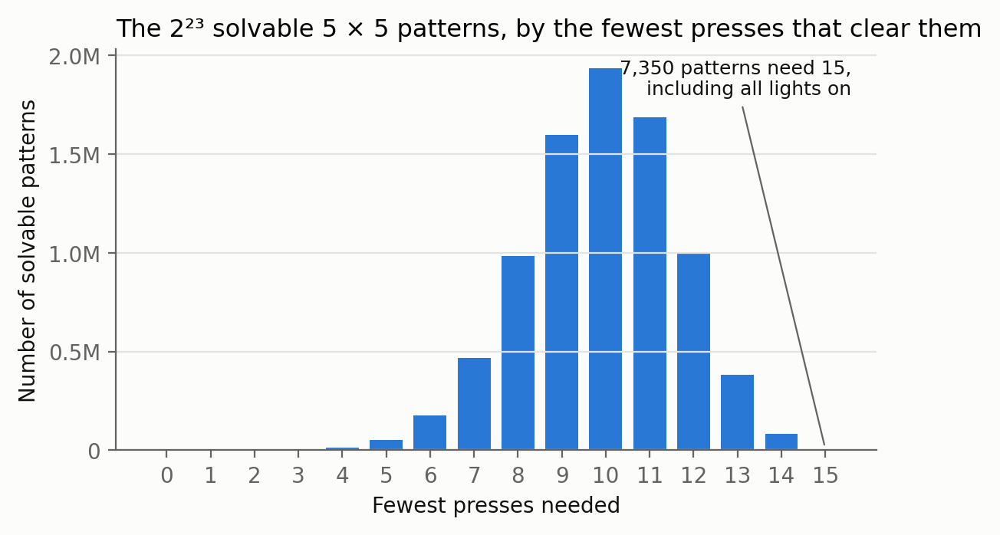
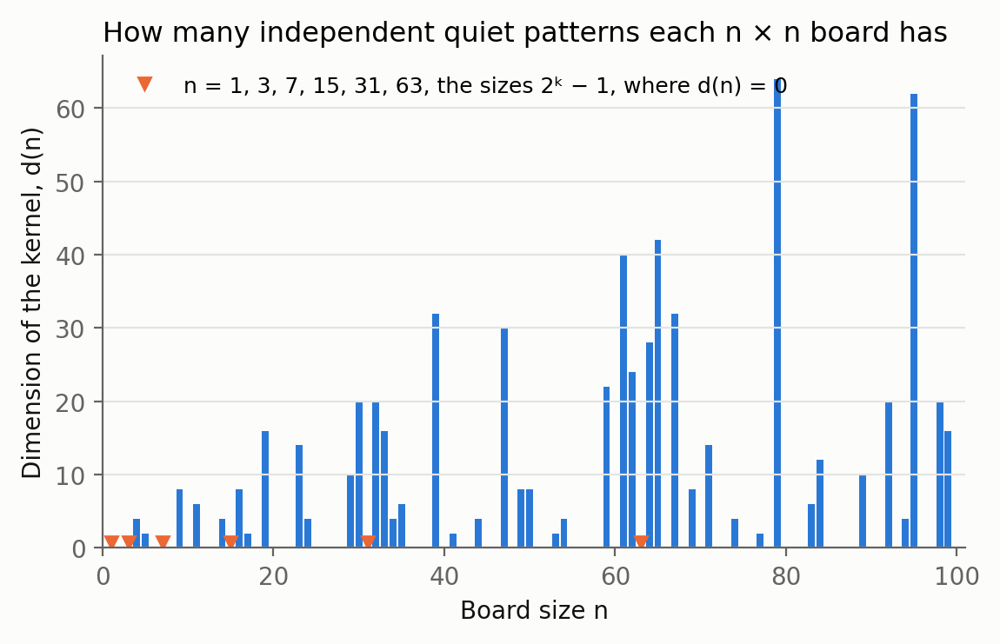
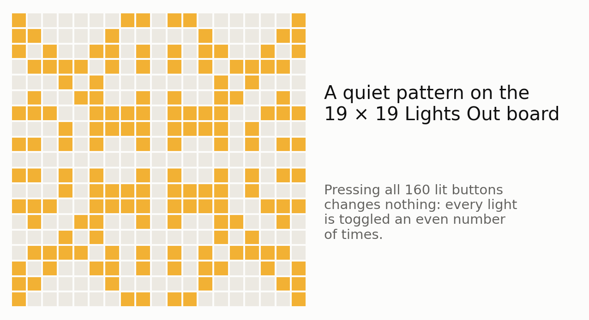

Lights Out is a grid of buttons, each with a light that is either on or off. Pressing a button flips its own light and the lights directly above, below, left and right of it, so a press in the middle of the board flips five lights, a press on an edge flips four, and a press in a corner flips three, as in the top row of Figure 1. You start from some pattern of lit buttons and the goal is to turn every light off, which the bottom row of Figure 1 does in two presses. On the 5 × 5 board it doesn't take long to find patterns that seem impossible, and some of them are: of the \\(2^{25} = 33{,}554{,}432\\) possible patterns, exactly a quarter can be cleared. I wanted to work out why it's a quarter, and more generally, for which \\(n\\) every pattern on the \\(n \times n\\) board can be cleared. The answer comes down to a pair of polynomials, and I'll derive it step by step and then check it by computer for every \\(n\\) from 1 to 100.

*Figure 1. The rules on a 5 × 5 board. Top: the lights flipped by one press, marked with a dot, in the middle, on an edge and in a corner. Bottom: a board with 10 lights on, cleared by pressing the two dotted buttons.*

I'll state the rules precisely first, since everything below depends on them. The board has \\(n\\) rows and \\(n\\) columns, and I number the squares \\(1\\) to \\(N = n^2\\) row by row. Two squares are neighbors when they share a side, so diagonal squares are not neighbors and the board doesn't wrap around at the edges. Pressing square \\(j\\) flips the light at \\(j\\) and at every neighbor of \\(j\\), and nothing else. A pattern is the set of squares that are lit.

Two facts about presses make the problem much smaller than it looks. The first is that the order of presses doesn't matter. A light ends up on or off depending only on whether it was flipped an even or an odd number of times, and the number of times a light gets flipped is a sum over the presses, which doesn't depend on their order. The second is that pressing a button twice does nothing, since it flips the same set of lights twice. Together these mean that any sequence of presses has the same effect as pressing each button either once or not at all, so a solution is just a subset of the \\(N\\) buttons. That already turns the 5 × 5 puzzle into a finite search over \\(2^{25}\\) subsets, but for a 10 × 10 board it's \\(2^{100}\\) subsets, which no computer can list, so I need structure.

The structure is linear algebra over the field with two elements, \\(\mathbb{F}\_2 = \\{0, 1\\}\\), where addition and multiplication are done mod 2. In this field \\(1 + 1 = 0\\), so addition is the same as subtraction, and adding 1 flips a value. Write a pattern as a vector \\(b \in \mathbb{F}\_2^N\\), with \\(b\_i = 1\\) when square \\(i\\) is lit, and a set of presses as a vector \\(x \in \mathbb{F}\_2^N\\), with \\(x\_j = 1\\) when button \\(j\\) is pressed. Let \\(A\\) be the \\(N \times N\\) matrix with

\\[A\_{ij} = \begin{cases} 1 & \text{if } i = j \text{ or } i \text{ and } j \text{ are neighbors} \\\\ 0 & \text{otherwise} \end{cases}\\]

so column \\(j\\) of \\(A\\) is the set of lights that button \\(j\\) flips. Pressing the buttons in \\(x\\) flips light \\(i\\) a total of \\(\sum\_j A\_{ij} x\_j\\) times, and only the parity of that count matters, so the lights that change are exactly \\(A x\\), computed over \\(\mathbb{F}\_2\\). Starting from \\(b\\), the board ends at \\(b + A x\\), and it's dark when \\(b + A x = 0\\), which over \\(\mathbb{F}\_2\\) is the same as

\\[A x = b\\]

So a pattern \\(b\\) can be cleared exactly when \\(b\\) is in the image of \\(A\\), and the presses that clear it are the solutions \\(x\\). The neighbor relation is symmetric, so \\(A\_{ij} = A\_{ji}\\) and \\(A\\) is a symmetric matrix, which will matter in a moment.

The 2 × 2 board is small enough to do completely by hand. Number its squares 1 and 2 across the top and 3 and 4 across the bottom. Square 1 neighbors 2 and 3 but not 4, which is diagonal from it, and the same pattern holds at every corner, so each button flips every light except the one diagonally opposite. If \\(J\\) is the 4 × 4 matrix of all ones and \\(P\\) is the permutation matrix that swaps 1 with 4 and 2 with 3, then \\(A = J + P\\), since adding \\(P\\) to \\(J\\) turns off exactly the diagonally opposite entry in each row. Squaring,

\\[A^2 = J^2 + J P + P J + P^2\\]

Each entry of \\(J^2\\) is a sum of four ones, which is \\(4 = 0\\) in \\(\mathbb{F}\_2\\), so \\(J^2 = 0\\). Permuting the rows or columns of \\(J\\) leaves it unchanged, so \\(J P = P J = J\\), and \\(J + J = 0\\). A swap done twice is nothing, so \\(P^2 = I\\). That leaves

\\[A^2 = 0 + J + J + I = I\\]

so \\(A\\) is its own inverse, every pattern on the 2 × 2 board can be cleared, and the presses that clear \\(b\\) are \\(x = A b\\). For example, with all four lights on, \\(x = A (1, 1, 1, 1)^T\\) has entries \\(1 + 1 + 1 = 1\\), so you press all four buttons. Each light then gets flipped three times, which is odd, and the board goes dark.

On bigger boards \\(A\\) isn't always invertible, and the vectors that tell you what goes wrong are the ones in its kernel. I'll call \\(z\\) a quiet pattern if \\(A z = 0\\), which means pressing the buttons in \\(z\\) leaves every light the way it was. Let \\(d = \dim \ker A\\). By rank-nullity, the image of \\(A\\) has dimension \\(N - d\\), so exactly \\(2^{N - d}\\) of the \\(2^N\\) patterns can be cleared, which is a fraction \\(2^{-d}\\) of them. If \\(x\\) clears \\(b\\), then so does \\(x + z\\) for every quiet \\(z\\), since \\(A(x + z) = A x + A z = b\\), and every other solution differs from \\(x\\) by something in the kernel, so each pattern that can be cleared can be cleared in exactly \\(2^d\\) different ways. Every pattern can be cleared exactly when \\(d = 0\\).

Symmetry gives a direct test for whether a pattern can be cleared. Take the dot product on \\(\mathbb{F}\_2^N\\), \\(u \cdot v = \sum\_i u\_i v\_i\\), and for a subspace \\(S\\) write \\(S^\perp\\) for the vectors whose dot product with everything in \\(S\\) is 0. I'll use one standard fact here, that \\(\dim S^\perp = N - \dim S\\) for any subspace \\(S\\) of \\(\mathbb{F}\_2^N\\), which holds because \\(S^\perp\\) is the solution set of \\(\dim S\\) independent linear equations. If \\(b = A x\\) and \\(z\\) is quiet, then

\\[z \cdot b = z^T A x = (A^T z)^T x = (A z)^T x = 0^T x = 0\\]

using \\(A^T = A\\) in the third step. So the image of \\(A\\) sits inside \\((\ker A)^\perp\\). Both have dimension \\(N - d\\), so they're equal, and a pattern can be cleared exactly when it has an even number of lit squares in common with every quiet pattern. It's enough to check this against a basis of the kernel, which is \\(d\\) checks.

The same symmetry shows that the board with every light on can always be cleared, for every \\(n\\). For a symmetric matrix over \\(\mathbb{F}\_2\\) and any vector \\(z\\),

\\[z^T A z = \sum\_i A\_{ii} z\_i^2 + \sum\_{i < j} 2 A\_{ij} z\_i z\_j = \sum\_i A\_{ii} z\_i\\]

because each off-diagonal term appears twice, once as \\(A\_{ij} z\_i z\_j\\) and once as \\(A\_{ji} z\_j z\_i\\), and \\(2 = 0\\), while \\(z\_i^2 = z\_i\\) for \\(z\_i \in \\{0, 1\\}\\). Every diagonal entry of \\(A\\) is 1, since every button flips its own light, so the right side is \\(\mathbf{1} \cdot z\\), where \\(\mathbf{1}\\) is the all-ones vector. If \\(z\\) is quiet, the left side is \\(z^T 0 = 0\\), so \\(\mathbf{1} \cdot z = 0\\) for every quiet \\(z\\), and by the test above the all-on pattern is in the image of \\(A\\).

The 5 × 5 board is where this first gets interesting. Its kernel has dimension \\(d = 2\\), which I'll derive below, so it has \\(2^2 = 4\\) quiet patterns: the empty one and the three in Figure 2. That means \\(2^{25 - 2} = 2^{23} = 8{,}388{,}608\\) patterns can be cleared, exactly a quarter of the total, and each of them in exactly 4 ways. You can also check any pattern by hand with the test above: count its lit squares inside the first two quiet patterns of Figure 2, and if both counts are even, it can be cleared. The third quiet pattern is the sum of the first two, so it doesn't need its own check.

*Figure 2. The three nonzero quiet patterns of the 5 × 5 board. Pressing every orange button in any one of them leaves the board unchanged.*

Since a solution is a subset of 25 buttons, I could also just compute all \\(2^{25}\\) of them for the 5 × 5 board. For each subset I worked out the pattern it clears, and for each pattern kept the subset with the fewest presses. That's a vectorized loop over 33 million entries, which took under 3 seconds, and it confirmed that exactly \\(2^{23}\\) patterns can be cleared, each by exactly 4 subsets. Figure 3 shows how many presses the best solution needs. Most patterns need 9 to 12 presses, nothing needs more than 15, and 7,350 patterns need exactly 15. The all-on board is one of those, and all 4 of its solutions use exactly 15 presses.

*Figure 3. The \\(2^{23}\\) patterns of the 5 × 5 board that can be cleared, grouped by the fewest presses that clear them.*

For a general \\(n\\), the obvious way to find \\(d\\) is Gaussian elimination on \\(A\\), which has \\(N = n^2\\) rows and columns and takes on the order of \\(N^3 = n^6\\) operations. There's a much smaller system hiding inside it, which comes from clearing the board one row at a time. Write the presses row by row as vectors \\(y\_1, \ldots, y\_n \in \mathbb{F}\_2^n\\), with \\(y\_k\\) the presses in row \\(k\\), and set \\(y\_0 = y\_{n+1} = 0\\) for the imaginary rows above and below the board. Let \\(M\\) be the \\(n \times n\\) matrix that describes what a press does inside its own row, so \\(M\_{ij} = 1\\) when \\(i = j\\) or \\(\lvert i - j \rvert = 1\\). The lights in row \\(k\\) get flipped by presses in row \\(k\\) itself, through \\(M\\), and by presses directly above and below, so the change in row \\(k\\) is

\\[y\_{k-1} + M y\_k + y\_{k+1}\\]

A set of presses is quiet when this is 0 for every \\(k\\) from 1 to \\(n\\). Solving for the next row, and using that addition and subtraction are the same in \\(\mathbb{F}\_2\\),

\\[y\_{k+1} = M y\_k + y\_{k-1}, \qquad k = 1, \ldots, n\\]

So once the first row \\(y\_1 = v\\) is chosen, every other row is forced, and the only remaining condition is that the row after the last one comes out zero, \\(y\_{n+1} = 0\\). In terms of the puzzle, this is the familiar trick of pressing the button below each lit light to push all the light down to the bottom row, and then asking whether the bottom row came out dark.

To write \\(y\_k\\) in terms of \\(v\\), define polynomials over \\(\mathbb{F}\_2\\) by

\\[F\_0(t) = 0, \qquad F\_1(t) = 1, \qquad F\_{k+1}(t) = t F\_k(t) + F\_{k-1}(t)\\]

These are the Fibonacci polynomials, and they satisfy the same three-term recurrence as the Chebyshev polynomials of the second kind, with \\(t\\) in place of \\(2x\\) and the minus sign dropped, which over \\(\mathbb{F}\_2\\) doesn't change anything. The first few are

\\[F\_2 = t, \quad F\_3 = t^2 + 1, \quad F\_4 = t^3 + t + t = t^3, \quad F\_5 = t^4 + t^2 + 1, \quad F\_6 = t^5 + t^3 + t + t^3 = t^5 + t\\]

where I've cancelled pairs of equal terms, since \\(t^k + t^k = 0\\). The claim is that \\(y\_k = F\_k(M) v\\) for every \\(k \geq 0\\). It holds for \\(k = 0\\) and \\(k = 1\\), since \\(F\_0(M) v = 0 = y\_0\\) and \\(F\_1(M) v = v = y\_1\\), and if it holds for \\(k - 1\\) and \\(k\\), then

\\[y\_{k+1} = M F\_k(M) v + F\_{k-1}(M) v = \big( M F\_k(M) + F\_{k-1}(M) \big) v = F\_{k+1}(M) v\\]

so it holds for all \\(k\\) by induction. The quiet patterns are therefore in one-to-one correspondence with the first rows \\(v\\) that satisfy

\\[F\_{n+1}(M) \, v = 0\\]

The correspondence is linear, and it's one-to-one because the whole pattern is determined by its first row, so \\(d = \dim \ker F\_{n+1}(M)\\). The problem has gone from an \\(n^2 \times n^2\\) matrix to an \\(n \times n\\) one.

The next step is to find the characteristic polynomial of \\(M\\). Write \\(M = I + P\\), where \\(P\\) has ones just above and just below the diagonal and zeros everywhere else. Let \\(D\_k(t) = \det(t I + P\_k)\\), where \\(P\_k\\) is the \\(k \times k\\) version of \\(P\\), so that \\(t I + P\_k\\) has \\(t\\) on the diagonal and 1 just above and below it. Expanding the determinant along the last row, there are two nonzero entries. The diagonal entry \\(t\\) multiplies \\(D\_{k-1}\\). The entry 1 to its left multiplies a minor whose last column has a single 1 in its last row, and expanding that minor along its last column leaves \\(D\_{k-2}\\). Signs don't matter in \\(\mathbb{F}\_2\\), so

\\[D\_k = t D\_{k-1} + D\_{k-2}, \qquad D\_1 = t, \qquad D\_2 = t^2 + 1\\]

which is the Fibonacci recurrence with \\(D\_1 = F\_2\\) and \\(D\_2 = F\_3\\), so \\(D\_k = F\_{k+1}\\) for every \\(k\\). The characteristic polynomial of \\(M\\) is then

\\[\chi\_M(t) = \det(t I + M) = \det\big( (t + 1) I + P \big) = D\_n(t + 1) = F\_{n+1}(t + 1)\\]

That gives two polynomials: \\(F\_{n+1}(t)\\), which describes the quiet condition, and \\(F\_{n+1}(t + 1)\\), which describes \\(M\\) itself. To connect them I need one more fact about \\(M\\), which is that it has a cyclic vector. Let \\(e\_1\\) be the first standard basis vector. Multiplying by \\(P\\) moves each entry one place up and one place down, so \\(P^k e\_1\\) has a 1 in position \\(k + 1\\) and zeros in every position after that. That makes \\(e\_1, P e\_1, \ldots, P^{n-1} e\_1\\) a triangular set of vectors, which is linearly independent and so a basis of \\(\mathbb{F}\_2^n\\). Every power of \\(M = I + P\\) is a combination of powers of \\(P\\) and the other way around, so \\(e\_1, M e\_1, \ldots, M^{n-1} e\_1\\) span the same space and are also a basis.

Now I can prove the fact that connects them: for any polynomial \\(f\\),

\\[\dim \ker f(M) = \deg \gcd\big( f, \chi\_M \big)\\]

Define the map \\(\varphi : \mathbb{F}\_2[t] \to \mathbb{F}\_2^n\\) by \\(\varphi(g) = g(M) e\_1\\). It's linear, and it's onto because its image contains the basis \\(e\_1, M e\_1, \ldots, M^{n-1} e\_1\\). By the Cayley-Hamilton theorem \\(\chi\_M(M) = 0\\), so every multiple of \\(\chi\_M\\) is sent to 0. The polynomials of degree less than \\(n\\) form an \\(n\\)-dimensional space that \\(\varphi\\) maps onto \\(\mathbb{F}\_2^n\\), so it maps them one-to-one, and a polynomial goes to 0 exactly when its remainder mod \\(\chi\_M\\) is 0. So \\(\varphi\\) identifies \\(\mathbb{F}\_2^n\\) with the polynomials mod \\(\chi\_M\\), and under that identification \\(f(M)\\) acts as multiplication by \\(f\\), since \\(f(M) \varphi(g) = f(M) g(M) e\_1 = \varphi(f g)\\). The kernel of \\(f(M)\\) is then the set of \\(g\\) mod \\(\chi\_M\\) with \\(\chi\_M \mid f g\\). Let \\(h = \gcd(f, \chi\_M)\\). Dividing through by \\(h\\), the condition \\(\chi\_M \mid f g\\) becomes \\((\chi\_M / h) \mid (f / h) g\\), and since \\(\chi\_M / h\\) and \\(f / h\\) have no common factor, that's the same as \\((\chi\_M / h) \mid g\\). The multiples of \\(\chi\_M / h\\) among the polynomials of degree less than \\(n\\) are \\((\chi\_M / h) \cdot q\\) with \\(\deg q < \deg h\\), and there are \\(2^{\deg h}\\) of them, so the kernel has dimension \\(\deg h\\).

Applying this with \\(f = F\_{n+1}\\) and \\(\chi\_M(t) = F\_{n+1}(t + 1)\\) gives the main formula:

\\[d(n) = \deg \gcd\big( F\_{n+1}(t), \; F\_{n+1}(t + 1) \big)\\]

Every pattern on the \\(n \times n\\) board can be cleared exactly when \\(F\_{n+1}(t)\\) and \\(F\_{n+1}(t + 1)\\) have no common factor.

The small boards can be checked by hand from the list of polynomials above. For \\(n = 2\\), \\(F\_3(t) = t^2 + 1 = (t + 1)^2\\), and substituting \\(t + 1\\) gives \\(F\_3(t + 1) = t^2\\). These share no factor, so \\(d(2) = 0\\), which matches the 2 × 2 calculation. For \\(n = 3\\), \\(F\_4(t) = t^3\\) and \\(F\_4(t + 1) = (t + 1)^3\\), again with no common factor, so \\(d(3) = 0\\). For \\(n = 4\\), \\(F\_5(t) = t^4 + t^2 + 1 = (t^2 + t + 1)^2\\), which you can check by squaring, since cross terms vanish when squaring over \\(\mathbb{F}\_2\\). Substituting \\(t + 1\\) into \\(t^2 + t + 1\\) gives \\(t^2 + 1 + t + 1 + 1 = t^2 + t + 1\\), the same polynomial, so \\(F\_5(t + 1) = F\_5(t)\\) and the gcd is all of \\(F\_5\\). That gives \\(d(4) = 4\\), so only \\(2^{12}\\) of the \\(2^{16}\\) patterns on the 4 × 4 board can be cleared, one in sixteen. For \\(n = 5\\), \\(F\_6(t) = t^5 + t = t (t^4 + 1) = t (t + 1)^4\\), and \\(F\_6(t + 1) = (t + 1) t^4\\). The common factor is \\(t (t + 1)\\), of degree 2, so \\(d(5) = 2\\), which is the quarter from Figure 3.

Two general facts follow from the formula. The first is that \\(d(n)\\) is always even. Let \\(g(t) = \gcd(F\_{n+1}(t), F\_{n+1}(t + 1))\\). Substituting \\(t + 1\\) for \\(t\\) swaps the two polynomials, since \\((t + 1) + 1 = t\\) in \\(\mathbb{F}\_2\\), so \\(g(t + 1)\\) divides both of them as well, and as it's monic of the same degree, \\(g(t + 1) = g(t)\\). Over a field containing all the roots of \\(g\\), this says that whenever \\(\alpha\\) is a root of \\(g\\) with some multiplicity, \\(\alpha + 1\\) is also a root with the same multiplicity. In characteristic 2, \\(\alpha + 1 \neq \alpha\\), and applying the shift twice returns to \\(\alpha\\), so the roots split into disjoint pairs \\(\\{\alpha, \alpha + 1\\}\\) with equal multiplicities, and the degree of \\(g\\) is even.

The second fact is a recurrence that relates the \\((2n + 1) \times (2n + 1)\\) board to the \\(n \times n\\) one:

\\[d(2n + 1) = \begin{cases} 2 \, d(n) + 2 & \text{if } 3 \mid n + 1 \\\\ 2 \, d(n) & \text{otherwise} \end{cases}\\]

The proof uses two properties of the Fibonacci polynomials. The first is the doubling formula \\(F\_{2k} = t F\_k^2\\) over \\(\mathbb{F}\_2\\). Let \\(Q = \begin{pmatrix} t & 1 \\\\ 1 & 0 \end{pmatrix}\\). Then \\(Q^k = \begin{pmatrix} F\_{k+1} & F\_k \\\\ F\_k & F\_{k-1} \end{pmatrix}\\), which holds for \\(k = 1\\) and passes from \\(k\\) to \\(k + 1\\) by multiplying by \\(Q\\) and using the recurrence. Reading off the top right entry of \\(Q^{2k} = Q^k Q^k\\) gives \\(F\_{2k} = F\_{k+1} F\_k + F\_k F\_{k-1} = F\_k (F\_{k+1} + F\_{k-1})\\), and the recurrence says \\(F\_{k+1} + F\_{k-1} = t F\_k\\), so \\(F\_{2k} = t F\_k^2\\). The second property is about the value at \\(t = 1\\). Setting \\(t = 1\\) in the recurrence gives the sequence 0, 1, 1, 0, 1, 1, 0, ..., which repeats with period 3, so \\(F\_k(1) = 0\\), which means \\((t + 1) \mid F\_k\\), exactly when \\(3 \mid k\\).

Now let \\(m = n + 1\\), so the \\(n \times n\\) board uses \\(F\_m\\) and the \\((2n + 1) \times (2n + 1)\\) board uses \\(F\_{2m} = t F\_m^2\\). Write \\(g = \gcd(F\_m(t), F\_m(t + 1))\\), which has degree \\(d(n)\\), and \\(F\_m(t) = g \, a\\) and \\(F\_m(t + 1) = g \, b\\), with \\(a\\) and \\(b\\) sharing no factor. Since \\(g(t + 1) = g(t)\\), substituting \\(t + 1\\) into \\(F\_m(t) = g a\\) shows \\(b(t) = a(t + 1)\\). Then

\\[\gcd\big( F\_{2m}(t), F\_{2m}(t + 1) \big) = \gcd\big( t \, g^2 a^2, \; (t + 1) \, g^2 b^2 \big) = g^2 \gcd\big( t \, a^2, \; (t + 1) \, b^2 \big)\\]

To find the last gcd, look at each irreducible factor \\(p\\) separately. If \\(p\\) is neither \\(t\\) nor \\(t + 1\\), it can't divide both \\(a\\) and \\(b\\), so it contributes nothing. The factor \\(t\\) appears once on the left, so it contributes \\(t\\) exactly when \\(t \mid b^2\\), that is when \\(t \mid b\\). In the same way \\(t + 1\\) contributes exactly when \\((t + 1) \mid a\\). These two conditions are the same, since \\(t \mid b\\) means \\(b(0) = 0\\), and \\(b(0) = a(1)\\). So the gcd has degree \\(2 d(n)\\) or \\(2 d(n) + 2\\), with the extra 2 exactly when \\((t + 1) \mid a\\), which is when \\(t + 1\\) divides \\(F\_m\\) more times than it divides \\(g\\).

That last condition can be settled with the two properties. Write \\(m = 2^s r\\) with \\(r\\) odd, and \\(v\_p(f)\\) for the number of times \\(p\\) divides \\(f\\). By the doubling formula, \\(v\_t(F\_{2k}) = 1 + 2 v\_t(F\_k)\\) and \\(v\_{t+1}(F\_{2k}) = 2 v\_{t+1}(F\_k)\\). For odd \\(r\\), \\(F\_r(0) = 1\\), because setting \\(t = 0\\) in the recurrence gives 0, 1, 0, 1, ..., so \\(v\_t(F\_r) = 0\\), and applying the doubling rule \\(s\\) times gives \\(v\_t(F\_m) = 2^s - 1\\). Since \\(g\\) divides \\(F\_m(t + 1)\\), the number of times \\(t + 1\\) divides \\(g\\) is at most the number of times \\(t\\) divides \\(F\_m\\), which is \\(2^s - 1\\). If \\(3 \nmid m\\), then \\(t + 1\\) doesn't divide \\(F\_m\\) at all, so it can't divide \\(a\\). If \\(3 \mid m\\), then \\(3 \mid r\\), so \\(v\_{t+1}(F\_r) \geq 1\\) and \\(v\_{t+1}(F\_m) = 2^s v\_{t+1}(F\_r) \geq 2^s\\), which is more than the at most \\(2^s - 1\\) copies in \\(g\\), so \\((t + 1) \mid a\\). That finishes the proof.

The recurrence settles the boards of size \\(2^k - 1\\). If \\(n = 2^k - 1\\) with \\(k \geq 2\\), then \\(n = 2 n\' + 1\\) with \\(n\' = 2^{k-1} - 1\\), and \\(n\' + 1 = 2^{k-1}\\) is never divisible by 3, so \\(d(n) = 2 d(n\')\\). Starting from \\(d(1) = 0\\), induction gives \\(d(2^k - 1) = 0\\) for every \\(k\\), so the 3 × 3, 7 × 7, 15 × 15, 31 × 31 and 63 × 63 boards can always be cleared, and so can every larger board of this form. The recurrence also explains the largest value below 100: starting from \\(d(4) = 4\\) and doubling at each step, since none of 5, 10, 20 or 40 is divisible by 3, gives \\(d(9) = 8\\), \\(d(19) = 16\\), \\(d(39) = 32\\) and \\(d(79) = 64\\).

To check all of this I computed \\(d(n)\\) for every \\(n\\) from 1 to 100 in three independent ways: Gaussian elimination over \\(\mathbb{F}\_2\\) on the full \\(n^2 \times n^2\\) matrix \\(A\\), elimination on the \\(n \times n\\) matrix \\(F\_{n+1}(M)\\) built by running the row recurrence from each unit first row, and the degree of the polynomial gcd computed with the Euclidean algorithm. I stored each row of a matrix and each polynomial as a single integer, with one bit per entry or coefficient, so adding two rows or two polynomials is one bitwise XOR. All three methods agreed for every \\(n\\), and so did the evenness and the recurrence. Figure 4 shows the results. Of the 100 boards, 57 can always be cleared, and the largest kernel is \\(d(79) = 64\\), on a board where only one pattern in \\(2^{64}\\) can be cleared.

*Figure 4. The kernel dimension \\(d(n)\\) for each board size up to 100. The orange markers are the sizes \\(2^k - 1\\), where the recurrence forces \\(d(n) = 0\\).*

The three methods also differ a lot in running time. Gaussian elimination on an \\(N \times N\\) matrix takes \\(O(N^3)\\) row operations in general, which is \\(O(n^6)\\) here. Building \\(F\_{n+1}(M)\\) takes \\(n\\) runs of the recurrence, each with \\(n\\) steps, and each step is a shift and an XOR on an \\(n\\)-bit integer, so it takes \\(O(n^2)\\) word operations when \\(n\\) fits in a machine word, and eliminating the resulting \\(n \times n\\) matrix takes \\(O(n^3)\\) bit operations. The polynomial gcd works on polynomials of degree \\(n + 1\\), and each step of the Euclidean algorithm lowers a degree by at least one, so it takes \\(O(n)\\) steps of \\(O(n)\\) bit operations each, which is \\(O(n^2)\\). For all 100 sizes together, the polynomial method took under 0.01 seconds, the row recurrence 0.04 seconds, and the full elimination 0.8 seconds. The full elimination is much faster than \\(n^6\\) would suggest because \\(A\\) is banded, with every nonzero entry at most \\(n\\) places from the diagonal in the row-by-row numbering, and elimination on a banded matrix only touches entries inside the band, which brings it down to \\(O(N n^2) = O(n^4)\\) bit operations.

Actually solving a given board uses the same reduction. Press the button below each lit light in rows 1 to \\(n - 1\\), which leaves only the bottom row lit. That bottom row is a linear function of whatever first row you start with, through the matrix \\(F\_{n+1}(M)\\) and a correction from the original pattern, so solving one \\(n \times n\\) system tells you which first-row buttons to press. Press those, chase the lights down again, and the board goes dark. The whole thing takes \\(O(n^3)\\) operations, compared with \\(O(n^6)\\) for working on \\(A\\) directly.

Quiet patterns on a bigger board are easier to see in a picture. The 19 × 19 board has \\(d(19) = 16\\), so it has \\(2^{16} = 65{,}536\\) quiet patterns, and Figure 5 shows one that I picked out of them because it's symmetric from left to right. I checked it directly by counting, for every square, how many of its own button and its four neighbors' buttons are lit, and every count is even.

*Figure 5. One of the \\(2^{16}\\) quiet patterns of the 19 × 19 board. Each light is flipped an even number of times when all 160 orange buttons are pressed.*

A few things here rest on choices I made. The rules don't wrap around the edges. A board that wraps, a torus, changes both \\(M\\), which gets a 1 in its top right and bottom left corners, and the condition on the rows, since the row above the first one is then the last row, so the characteristic polynomial and the values of \\(d\\) all change. The 5 × 5 statistics in Figure 3 count presses, not distinct sequences of presses, which is the right count given that order doesn't matter and double presses cancel. The same argument works for an \\(m \times n\\) board, with \\(F\_{m+1}(M)\\) for the quiet condition and \\(M\\) of size \\(n \times n\\), giving \\(d = \deg \gcd(F\_{m+1}(t), F\_{n+1}(t + 1))\\), and I checked that formula against full elimination for every \\(m\\) and \\(n\\) up to 30.

I'd like to look next at the version where each light cycles through three states instead of two, so a press adds 1 mod 3, which replaces \\(\mathbb{F}\_2\\) with the field with three elements and breaks the symmetry argument for the all-on board, since \\(z^T A z\\) no longer reduces to the diagonal.
