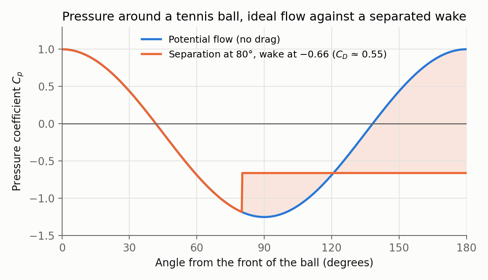

In the post on [the geometry of a tennis serve](/physics/2026/07/08/tennis-serve-geometry.html), I used a drag coefficient of
0.55 and an empirical formula for the lift from topspin, and I treated both as given. I wanted to go back and ask what
theory says those numbers should be. The natural place to start is the classical theory of an ideal fluid, which turns the
problem into Laplace's equation around a sphere and can be solved exactly. The trouble is that it predicts a ball moving
through air feels no drag at all, and that spin produces no sideways force. That result is known as d'Alembert's paradox, and
working out exactly why it fails shows where drag and the Magnus force on a real ball come from.

Start with the equations. Air at serve speeds is described by the incompressible Navier-Stokes equations,

\\[\rho \left( \frac{\partial \mathbf{u}}{\partial t} + (\mathbf{u} \cdot \nabla) \mathbf{u} \right) = -\nabla p + \mu \nabla^2 \mathbf{u}, \qquad \nabla \cdot \mathbf{u} = 0\\]

Treating the air as incompressible is safe here. At 50 m/s the Mach number is \\(50 / 340 \approx 0.15\\), and density changes in a
flow scale like \\(M^2 / 2\\), about 1%. The relative size of the viscous term is measured by the Reynolds number,

\\[\text{Re} = \frac{U d}{\nu} = \frac{50 \times 0.067}{1.5 \times 10^{-5}} \approx 223{,}000\\]

for a ball of diameter \\(d = 6.7\\) cm in air with kinematic viscosity \\(\nu = 1.5 \times 10^{-5}\\) m²/s. With inertia beating viscosity
by five orders of magnitude, the obvious move is to drop the viscous term, which leaves the Euler equations for an ideal fluid.

An ideal fluid has another property that simplifies everything. Kelvin's circulation theorem says that in an inviscid flow the
circulation around any loop moving with the fluid stays constant, and the air approaching the ball is moving uniformly with no
rotation, so it stays irrotational, \\(\nabla \times \mathbf{u} = 0\\). Any irrotational field is the gradient of a potential,
\\(\mathbf{u} = \nabla \phi\\), and substituting that into the incompressibility condition gives

\\[\nabla \cdot \nabla \phi = \nabla^2 \phi = 0\\]

So in this approximation the entire flow around the ball is a solution of Laplace's equation, the same equation as the electrostatics
in my coax posts, with the velocity playing the role of the electric field.

Put the ball at rest at the origin, with the air coming from far away at speed \\(U\\) down the \\(z\\) axis, moving toward negative \\(z\\), so the front of the ball is at \\(\theta = 0\\). I'll use spherical coordinates. The flow is symmetric about the axis, so the general solution is the same expansion I used for the cell on the
electrode,

\\[\phi(r, \theta) = \sum\_{l=0}^{\infty} \left( A\_l r^l + \frac{B\_l}{r^{l+1}} \right) P\_l(\cos \theta)\\]

Far from the ball the flow is uniform, \\(\phi \to -U z = -U r \cos \theta\\), which only involves \\(l = 1\\), so every other \\(A\_l\\) is zero and \\(A\_1 = -U\\). At the ball's surface, air can't flow through it, so the radial velocity \\(\partial \phi / \partial r\\) vanishes at
\\(r = a\\). For the \\(l = 1\\) term,

\\[\frac{\partial \phi}{\partial r} \bigg\rvert\_{r = a} = \left( -U - \frac{2 B\_1}{a^3} \right) \cos \theta = 0 \quad \Longrightarrow \quad B\_1 = -\frac{U a^3}{2}\\]

and the higher \\(B\_l\\) have nothing driving them, so they're zero. The potential is

\\[\phi(r, \theta) = -U \cos \theta \left( r + \frac{a^3}{2 r^2} \right)\\]

which is a uniform flow plus a dipole, the same structure as an insulating sphere in a uniform electric field. The velocity components
are

\\[u\_r = \frac{\partial \phi}{\partial r} = -U \cos \theta \left( 1 - \frac{a^3}{r^3} \right), \qquad u\_\theta = \frac{1}{r} \frac{\partial \phi}{\partial \theta} = U \sin \theta \left( 1 + \frac{a^3}{2 r^3} \right)\\]

and on the surface the flow is purely tangential with speed \\(q = \frac{3}{2} U \sin \theta\\). The air is stopped at the front and back
of the ball, \\(\theta = 0\\) and \\(\pi\\), and moves fastest around the sides, at one and a half times the free-stream speed.

For steady irrotational flow, Bernoulli's equation holds between any two points in the flow, which is stronger than the usual version along a single streamline, so the pressure on the
surface follows from the speed:

\\[p + \frac{1}{2} \rho q^2 = p\_\infty + \frac{1}{2} \rho U^2 \quad \Longrightarrow \quad C\_p \equiv \frac{p - p\_\infty}{\frac{1}{2} \rho U^2} = 1 - \frac{9}{4} \sin^2 \theta\\]

At 50 m/s the dynamic pressure \\(\frac{1}{2} \rho U^2\\) is about 1,510 Pa, so the pressure at the front of the ball is 1,510 Pa above
ambient and the pressure around its sides is \\(1.25 \times 1510 \approx 1{,}890\\) Pa below.

The drag is the net pressure force along the flow direction. A patch of surface \\(dA\\) at angle \\(\theta\\) gets pushed inward by \\(p \, dA\\), and since the outward normal there has \\(z\\) component \\(\cos \theta\\), the part of that push along the flow, toward negative \\(z\\), is \\(p \cos \theta \, dA\\). So the force on the ball in the direction of the flow is

\\[D = \oint (p - p\_\infty) \cos \theta \, dA = \frac{1}{2} \rho U^2 \cdot 2 \pi a^2 \int\_0^\pi \left( 1 - \frac{9}{4} \sin^2 \theta \right) \cos \theta \sin \theta \, d\theta\\]

where subtracting \\(p\_\infty\\) changes nothing because a uniform pressure exerts no net force on a closed surface. Substituting
\\(\mu = \cos \theta\\),

\\[\int\_0^\pi \left( 1 - \frac{9}{4} \sin^2 \theta \right) \cos \theta \sin \theta \, d\theta = \int\_{-1}^{1} \left( 1 - \frac{9}{4} (1 - \mu^2) \right) \mu \, d\mu = 0\\]

since the integrand is odd in \\(\mu\\). The pressure on the back half of the ball is a mirror image of the pressure on the front half, so
the push from the front is exactly canceled by the push from the back, and the drag is zero. The lift is zero too, since the flow is
symmetric about the axis.

That cancellation isn't special to the sphere. A momentum argument shows it holds for any body in steady potential flow. Draw a large
sphere of radius \\(R\\) around the ball and apply conservation of momentum to the air between them. The force on the ball equals the
momentum flowing in through the outer surface plus the pressure force on it. Far away the disturbance is a dipole, whose velocity falls
off like \\(1 / R^3\\), and since the pressure disturbance comes from Bernoulli it's at most linear in that velocity, so it falls off the
same way. The surface of the large sphere only grows like \\(R^2\\), so the net momentum and pressure flux through it vanishes as
\\(R \to \infty\\), and the force on the ball must be zero. There's also an energy version. If the ball felt a drag \\(D\\) while moving at
speed \\(U\\), it would be doing work on the air at rate \\(D U\\). An ideal fluid can't dissipate that energy, and in a steady potential flow
the disturbance just travels along with the ball, so the air's kinetic energy doesn't grow either. There's nowhere for the work to go, so
\\(D U = 0\\).

Potential flow does produce one real force. If the ball speeds up, the air around it has to speed up too, and the ball has to supply that
momentum. In the frame where the air far away is at rest and the ball moves at \\(U\\), the disturbance potential is just the dipole, \\(\phi = U a^3 \cos \theta / (2 r^2)\\) up to sign, and the kinetic energy of the air is

\\[T = \frac{\rho}{2} \int \lvert \nabla \phi \rvert^2 \, dV = \frac{\rho}{2} \int\_a^\infty \int\_0^\pi \frac{U^2 a^6}{4 r^6} \left( 4 \cos^2 \theta + \sin^2 \theta \right) 2 \pi r^2 \sin \theta \, d\theta \, dr\\]

The angular integral is \\(\int\_{-1}^{1} (1 + 3 \mu^2) \, d\mu = 4\\) and the radial one is \\(\int\_a^\infty r^{-4} \, dr = 1 / (3 a^3)\\), so

\\[T = \frac{\rho}{2} \cdot \frac{U^2 a^6}{4} \cdot 2 \pi \cdot 4 \cdot \frac{1}{3 a^3} = \frac{1}{2} \left( \frac{1}{2} \rho \cdot \frac{4}{3} \pi a^3 \right) U^2\\]

The air behaves like extra mass carried along with the ball, equal to half the mass of the air the ball displaces. For a tennis ball that's
\\(\frac{1}{2} \times 1.21 \times 1.57 \times 10^{-4} \approx 9.5 \times 10^{-5}\\) kg, about 0.17% of the ball's 57.7 g, which is far too small to
matter for a serve and isn't a force along the flow in steady motion anyway.

Spin doesn't help either, and the reason is a little more interesting. In an ideal fluid, the only boundary condition at a solid surface is
that air can't flow through it. There's no condition on the tangential velocity, because without viscosity nothing ties the air to the
surface. A spinning ball has a surface moving tangentially, which the potential flow simply doesn't see, so it's the same potential, the same
symmetric pressure, and no sideways force. You might expect a fix through circulation, since in two dimensions the flow around a cylinder can
include a swirling term \\(\phi = \Gamma \theta\' / (2 \pi)\\), where \\(\theta\'\\) is the angle around the cylinder's axis, and that does produce a lift
\\(L = \rho U \Gamma\\) per unit length, the Kutta-Joukowski result. That works because the region outside a cylinder has a hole running through it,
so a loop around the cylinder can't be shrunk to a point, and the circulation \\(\oint \mathbf{u} \cdot d\mathbf{l}\\) around it doesn't have to be zero.
The region outside a sphere has no such hole. Any closed loop in it can be shrunk to a point without crossing the ball, and by Stokes' theorem the
circulation around it equals the integral of \\(\nabla \times \mathbf{u}\\) over a surface it bounds, which is zero in irrotational flow. So in three
dimensions potential flow can't have circulation around a ball, and there's no lift from spin at all.

So the drag and the Magnus force on a real tennis ball both come from viscosity, even though the Reynolds number says viscosity is tiny. Prandtl's
answer to the puzzle was that viscosity is negligible almost everywhere but not at the surface. Real air does stick to the ball, so the velocity has
to drop from about \\(\frac{3}{2} U \sin \theta\\) to zero across a thin layer. Inside that layer the velocity changes over a short distance \\(\delta\\), so
the viscous term is no longer small. Balancing the inertial term against the viscous one,

\\[u \frac{\partial u}{\partial x} \sim \nu \frac{\partial^2 u}{\partial y^2} \quad \Longrightarrow \quad \frac{U^2}{a} \sim \frac{\nu U}{\delta^2} \quad \Longrightarrow \quad \delta \sim \sqrt{\frac{\nu a}{U}} = \frac{a}{\sqrt{\text{Re}\_a}}\\]

where \\(\text{Re}\_a = U a / \nu\\) is the Reynolds number based on the radius. For the tennis ball that's \\(3.35 / \sqrt{111{,}700} \approx 0.01\\) cm, and with
the usual factor of about 5 from the full boundary-layer solution, the layer is around half a millimeter thick. That's comparable to the felt on a
tennis ball, which sticks out on the order of a millimeter, so the fuzz sits right in the region where the drag is decided.

What makes the boundary layer important is the pressure gradient along the surface. Over the front half of the ball, the potential-flow pressure falls from
\\(C\_p = 1\\) at the front to \\(C\_p = -1.25\\) at the sides, so the pressure pushes the air in the boundary layer along. Over the back half it rises again,
from \\(-1.25\\) back to \\(+1\\), and the air in the boundary layer, already slowed by friction with the surface, has to climb that pressure hill. Eventually
it can't, the flow next to the surface reverses, and the boundary layer lifts off the ball. That's separation, and behind the separation point the flow breaks into a wake and never closes smoothly around the back.

There's a standard approximate way to find where a laminar boundary layer separates, Thwaites' method, which uses the momentum thickness \\(\theta\_m\\) of the
layer. For a body of revolution, the version due to Rott and Crabtree is

\\[\theta\_m^2(x) = \frac{0.45 \, \nu}{U\_e^6 \, r\_0^2} \int\_0^x U\_e^5 \, r\_0^2 \, dx\', \qquad \lambda = \frac{\theta\_m^2}{\nu} \frac{d U\_e}{dx}\\]

where \\(x = a \theta\\) is the distance along the surface from the front, \\(U\_e = \frac{3}{2} U \sin \theta\\) is the speed just outside the layer, and
\\(r\_0 = a \sin \theta\\) is the distance from the axis. The layer separates when \\(\lambda\\) falls to about \\(-0.09\\). Integrating this numerically with the
potential-flow \\(U\_e\\), I got separation at \\(\theta \approx 103.6°\\), a little past the widest point of the ball (the same calculation for a cylinder gives
103.1°). Measured separation on a smooth sphere at these Reynolds numbers happens earlier, around 80°, and the reason is that once a wake forms, the outer
flow is no longer the potential flow I assumed. The low-pressure wake changes the pressure distribution over the whole back of the ball, which moves the
adverse gradient forward. So Thwaites' method with the ideal-flow pressure explains why separation happens without quite predicting where.

What separation does to the drag is easy to estimate. Behind the separation point the pressure doesn't recover to the high value at the back of the ideal
flow. It stays roughly constant across the wake, at some base pressure \\(C\_{p,b}\\). Take the potential-flow pressure on the front up to separation at \\(\theta\_s\\)
and the constant base pressure behind it. Dividing the drag by \\(\frac{1}{2} \rho U^2 \pi a^2\\), the area the ball presents to the flow,

\\[C\_D = 2 \int\_0^{\theta\_s} \left( 1 - \frac{9}{4} \sin^2 \theta \right) \cos \theta \sin \theta \, d\theta + 2 \, C\_{p,b} \int\_{\theta\_s}^{\pi} \cos \theta \sin \theta \, d\theta\\]

Both integrals are elementary. With \\(s = \sin^2 \theta\_s\\), the first is \\(\frac{s}{2} - \frac{9}{16} s^2\\) and the second is \\(-\frac{s}{2}\\), so

\\[C\_D = s - \frac{9}{8} s^2 - C\_{p,b} \, s\\]

For separation at 80°, \\(s \approx 0.970\\), and a drag coefficient of 0.55 requires

\\[C\_{p,b} = \frac{s - \frac{9}{8} s^2 - 0.55}{s} \approx -0.66\\]

and separating at 90° instead gives almost the same answer, \\(-0.68\\). So the 0.55 I used in the serve post corresponds to a wake where the pressure stays about
two thirds of a dynamic pressure below ambient. The friction on the surface contributes very little by comparison. A laminar skin friction coefficient of
\\(1.328 / \sqrt{\text{Re}} \approx 0.003\\) spread over the front of the ball adds something like 0.006 to \\(C\_D\\), about 1% of the total. Almost all of the drag on a
tennis ball is pressure drag from the wake, and viscosity matters mostly because it causes the separation that makes the wake. At 50 m/s a drag coefficient of 0.55
is a force of about 2.9 N, which decelerates the 57.7 g ball at around 51 m/s², a bit over five times gravity.

The Magnus force comes from the same place. With topspin, the top of the ball moves against the oncoming air and the bottom moves with it. The boundary
layer on the bottom gets dragged along toward the back and stays attached longer, while the one on the top is slowed further and separates earlier. The
wake ends up deflected upward, which means the ball has pushed air upward, and by Newton's third law the air pushes the ball down. That downward force is
what bends a topspin serve into the box, and there's no way to get it from the potential flow, since it depends entirely on where the boundary layer
separates. It's why the lift coefficient in the serve post had to be an empirical fit to measurements, growing roughly in proportion to the spin parameter
\\(S = r \omega / U\\) for small spin and leveling off for large spin.

I'd like to look next at the drag crisis, the sudden drop in drag that happens when a smooth sphere's boundary
layer turns turbulent and separates further back. That's what dimples on a golf ball are for, and the felt on a tennis ball changes it in a different way.
