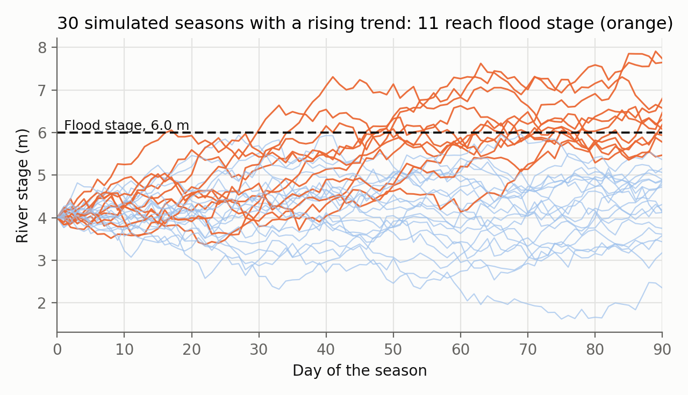

Suppose a river gauge reads 4.0 m on the first day of spring, flood stage is 6.0 m, and the level moves up and down from day to day by an amount that is mostly random, with a small average trend on top. What's the chance that the river reaches 6.0 m at some point in the next 90 days? It's tempting to answer with the chance that the river is above 6.0 m on day 90, since that's a single normal probability, but that answers a different question. A river can go over flood stage in week six and be back down by the end of the season, and the flooding still happened. The question is about the highest point the river reaches during the season, and the distribution of that maximum is what I want to work out here, along with when the river first gets there and how much a gauge that's only read once a day misses.

I'll set up the model first and state every assumption it uses. Let \\(X(t)\\) be the river's stage in meters at time \\(t\\), measured in days from the start of the season. The assumptions are:

1. \\(X(t) = x\_0 + \mu t + \sigma B(t)\\) for \\(0 \leq t \leq T\\), where \\(x\_0\\) is the starting stage, \\(\mu\\) is the average trend in meters per day, \\(\sigma\\) sets the size of the random part in meters per square root of a day, and \\(B\\) is a standard Brownian motion.
2. \\(\mu\\) and \\(\sigma\\) are constant over the whole season.
3. The standard Brownian motion \\(B\\) has \\(B(0) = 0\\), continuous paths, and independent increments with \\(B(t) - B(s) \sim N(0, t - s)\\) for \\(s < t\\).
4. Brownian motion has the strong Markov property: if \\(\tau\\) is the first time the path reaches some level, then \\(B(\tau + s) - B(\tau)\\) for \\(s \geq 0\\) is again a standard Brownian motion and is independent of everything before \\(\tau\\).

Assumption 3 means the change in the river from one day to the next is normal with mean \\(\mu\\) and standard deviation \\(\sigma\\), and the change over \\(t\\) days is normal with mean \\(\mu t\\) and standard deviation \\(\sigma \sqrt{t}\\). For the numbers I'll use \\(x\_0 = 4.0\\) m, flood stage \\(h = 6.0\\) m, \\(\sigma = 0.15\\) m per \\(\sqrt{\text{day}}\\), and a season of \\(T = 90\\) days, with three trends: rising at \\(\mu = +0.01\\) m per day, flat at \\(\mu = 0\\), and falling at \\(\mu = -0.01\\) m per day. These are round values I picked to make the three cases differ, and they don't describe any particular river. Figure 1 shows 30 simulated seasons for the rising case. Eleven of them reach flood stage, and three of those eleven end the season back below it.

*Figure 1. Thirty simulated seasons with a rising trend of 0.01 m per day and \\(\sigma = 0.15\\) m per \\(\sqrt{\text{day}}\\). The 11 orange paths reach flood stage at some point, and 3 of them finish the season below it.*

The first step is to remove the units. Divide the distance to flood stage and the trend by \\(\sigma\\):

\\[X(t) \geq h \iff \frac{\mu}{\sigma} t + B(t) \geq \frac{h - x\_0}{\sigma}\\]

so with \\(\alpha = \mu / \sigma\\) and \\(m = (h - x\_0) / \sigma\\), the river reaches flood stage by time \\(T\\) exactly when the process \\(W(t) = \alpha t + B(t)\\) reaches the level \\(m\\) by time \\(T\\). For my numbers \\(m = 2.0 / 0.15 = 13.33\\), and \\(\alpha = \pm 0.01 / 0.15 = \pm 0.0667\\) per day for the rising and falling cases. Let \\(M(T) = \max\_{0 \leq t \leq T} W(t)\\). The question is to find \\(P(M(T) \geq m)\\).

I'll do the case with no drift first, \\(\alpha = 0\\), so \\(W = B\\). The tool is the reflection argument shown in Figure 2. Fix \\(m \geq 0\\) and \\(w \leq m\\), and let \\(\tau\_m\\) be the first time the path reaches \\(m\\). On the event \\(M(T) \geq m\\), \\(\tau\_m \leq T\\). Build a second path by leaving the original alone up to \\(\tau\_m\\) and flipping it about the level \\(m\\) after that:

\\[\tilde{B}(t) = \begin{cases} B(t) & t \leq \tau\_m \\\\ 2m - B(t) & t > \tau\_m \end{cases}\\]

By assumption 4, the part of the path after \\(\tau\_m\\), measured from \\(m\\), is a Brownian motion independent of what came before, and a Brownian motion and its negative have the same distribution, so \\(\tilde{B}\\) is also a standard Brownian motion. If the original path reaches \\(m\\) and ends at or below \\(w\\), the flipped path ends at or above \\(2m - w\\), and the reverse is true too. Any path that ends at or above \\(2m - w \geq m\\) has to have reached \\(m\\) along the way, so the reverse direction doesn't need the condition on the maximum. That gives

\\[P\big(M(T) \geq m, \; B(T) \leq w\big) = P\big(B(T) \geq 2m - w\big) = 1 - N\\!\left( \frac{2m - w}{\sqrt{T}} \right)\\]

where \\(N\\) is the standard normal distribution function and I used \\(B(T) \sim N(0, T)\\).

*Figure 2. The reflection argument. A path that reaches \\(m\\) and ends at \\(w\\) is matched with the path that follows it up to \\(\tau\_m\\) and is mirrored about \\(m\\) after, which ends at \\(2m - w\\).*

From this the chance of reaching \\(m\\) with no drift takes two lines. Put \\(w = m\\) to get \\(P(M(T) \geq m, B(T) \leq m) = P(B(T) \geq m)\\). Paths that end above \\(m\\) have certainly reached \\(m\\), so

\\[P\big(M(T) \geq m\big) = P\big(M(T) \geq m, B(T) \leq m\big) + P\big(B(T) > m\big) = 2 \, P\big(B(T) \geq m\big) = 2 \left[ 1 - N\\!\left( \frac{m}{\sqrt{T}} \right) \right]\\]

For the flat river, \\(m / \sqrt{T} = 13.33 / 9.487 = 1.405\\), \\(N(1.405) = 0.9201\\), and the chance of reaching flood stage within the season is \\(2 \times 0.0799 = 0.160\\). The chance of being above flood stage on day 90 is \\(0.080\\), exactly half of that.

To handle drift I need the joint density of \\(M(T)\\) and \\(B(T)\\), which comes from differentiating the reflection formula. Write \\(G(m, w) = P(M(T) \geq m, B(T) \leq w) = 1 - N(z)\\) with \\(z = (2m - w) / \sqrt{T}\\), and let \\(\varphi(z) = e^{-z^2 / 2} / \sqrt{2 \pi}\\) be the standard normal density, so that \\(N\' = \varphi\\) and \\(\varphi\'(z) = -z \varphi(z)\\). Since \\(\partial z / \partial w = -1 / \sqrt{T}\\) and \\(\partial z / \partial m = 2 / \sqrt{T}\\),

\\[\frac{\partial G}{\partial w} = -\varphi(z) \cdot \left( -\frac{1}{\sqrt{T}} \right) = \frac{\varphi(z)}{\sqrt{T}}, \qquad \frac{\partial^2 G}{\partial m \, \partial w} = \frac{\varphi\'(z)}{\sqrt{T}} \cdot \frac{2}{\sqrt{T}} = -\frac{2 z \varphi(z)}{T}\\]

The probability that \\(M(T)\\) is near \\(m\\) and \\(B(T)\\) is near \\(w\\) is minus this mixed derivative, because \\(G\\) counts maxima above \\(m\\) and so decreases as \\(m\\) increases. Substituting \\(z\\) back in, the joint density with no drift is

\\[f\_0(m, w) = \frac{2 (2m - w)}{T \sqrt{2 \pi T}} \exp\\!\left( -\frac{(2m - w)^2}{2T} \right), \qquad w \leq m, \; m \geq 0\\]

and zero elsewhere, since the maximum is at least the starting value 0 and at least the final value \\(w\\).

Adding the drift changes the probability of each path in a simple way. I'll derive the factor on a grid of times first. Take \\(0 = t\_0 < t\_1 < \cdots < t\_k = T\\) and write \\(\delta\_i\\) for the increment over \\([t\_{i-1}, t\_i]\\), which has length \\(\Delta\_i = t\_i - t\_{i-1}\\). Under assumption 3, without drift the increments are independent with \\(\delta\_i \sim N(0, \Delta\_i)\\), and with drift \\(\alpha\\) they're independent with \\(\delta\_i \sim N(\alpha \Delta\_i, \Delta\_i)\\). The ratio of the two joint densities at the same increments is

\\[\prod\_{i=1}^k \frac{\exp\big( -(\delta\_i - \alpha \Delta\_i)^2 / (2 \Delta\_i) \big)}{\exp\big( -\delta\_i^2 / (2 \Delta\_i) \big)} = \prod\_{i=1}^k \exp\\!\left( \alpha \delta\_i - \frac{\alpha^2 \Delta\_i}{2} \right) = \exp\\!\left( \alpha \sum\_i \delta\_i - \frac{\alpha^2}{2} \sum\_i \Delta\_i \right) = e^{\alpha w - \alpha^2 T / 2}\\]

where \\(w = \sum\_i \delta\_i\\) is the endpoint. The constant factors \\(1 / \sqrt{2 \pi \Delta\_i}\\) cancel, and inside each exponent, expanding \\((\delta\_i - \alpha \Delta\_i)^2 = \delta\_i^2 - 2 \alpha \Delta\_i \delta\_i + \alpha^2 \Delta\_i^2\\) and dividing by \\(2 \Delta\_i\\) leaves \\(\alpha \delta\_i - \alpha^2 \Delta\_i / 2\\). The ratio depends only on where the path ends, and not on the grid, so for any event \\(A\\) that depends on the path's values at the grid times,

\\[P\_\alpha(A) = E\_0\\!\left[ \mathbf{1}\_A \, e^{\alpha W(T) - \alpha^2 T / 2} \right]\\]

where \\(P\_\alpha\\) and \\(E\_0\\) mean probability with drift \\(\alpha\\) and expectation with no drift. Paths are continuous, so as the grid gets finer, the largest value at the grid times increases to \\(M(T)\\), and the events \\(\\{\max\_i W(t\_i) \leq m\\}\\) decrease to \\(\\{M(T) \leq m\\}\\). The indicator times the factor is never larger than the factor \\(e^{\alpha W(T) - \alpha^2 T / 2}\\), which has expectation 1 under \\(E\_0\\), so by dominated convergence the formula passes to the limit and holds for events involving \\(M(T)\\). This is the change of measure argument, and the result is that the joint density with drift is the no-drift density times the factor at the endpoint:

\\[f\_\alpha(m, w) = e^{\alpha w - \alpha^2 T / 2} f\_0(m, w) = \frac{2 (2m - w)}{T \sqrt{2 \pi T}} \exp\\!\left( \alpha w - \frac{\alpha^2 T}{2} - \frac{(2m - w)^2}{2T} \right), \qquad w \leq m, \; m \geq 0\\]

Now integrate. A path reaches \\(m\\) either by ending above it or by reaching it and coming back down, so

\\[P\_\alpha\big(M(T) \geq m\big) = P\_\alpha\big(W(T) \geq m\big) + P\_\alpha\big(M(T) \geq m, \, W(T) < m\big)\\]

With drift, \\(W(T) \sim N(\alpha T, T)\\), so the first term is \\(1 - N\big((m - \alpha T) / \sqrt{T}\big)\\). For the second term, integrate the density over \\(w < m\\) and over maxima \\(\mu\' \geq m\\). The inner integral over \\(\mu\'\\) is exact, since \\(2(2\mu\' - w) / T\\) is the derivative of \\((2\mu\' - w)^2 / (2T)\\) with respect to \\(\mu\'\\):

\\[\int\_m^\infty \frac{2 (2\mu\' - w)}{T \sqrt{2 \pi T}} e^{-(2\mu\' - w)^2 / (2T)} \, d\mu\' = \left[ -\frac{1}{\sqrt{2 \pi T}} e^{-(2\mu\' - w)^2 / (2T)} \right]\_{\mu\' = m}^{\infty} = \frac{1}{\sqrt{2 \pi T}} e^{-(2m - w)^2 / (2T)}\\]

That leaves

\\[P\_\alpha\big(M(T) \geq m, \, W(T) < m\big) = \int\_{-\infty}^m \frac{1}{\sqrt{2 \pi T}} \exp\\!\left( \alpha w - \frac{\alpha^2 T}{2} - \frac{(2m - w)^2}{2T} \right) dw\\]

and the exponent can be rearranged into a single square. Expanding,

\\[-\frac{(w - 2m - \alpha T)^2}{2T} = -\frac{(w - 2m)^2 - 2 \alpha T (w - 2m) + \alpha^2 T^2}{2T} = -\frac{(2m - w)^2}{2T} + \alpha w - 2 \alpha m - \frac{\alpha^2 T}{2}\\]

so the exponent in the integral equals \\(-(w - 2m - \alpha T)^2 / (2T) + 2 \alpha m\\). The integral is then \\(e^{2 \alpha m}\\) times the probability that a \\(N(2m + \alpha T, T)\\) variable is below \\(m\\), which is \\(e^{2 \alpha m} N\big((m - 2m - \alpha T) / \sqrt{T}\big)\\). Putting the two terms together,

\\[P\_\alpha\big(M(T) \geq m\big) = 1 - N\\!\left( \frac{m - \alpha T}{\sqrt{T}} \right) + e^{2 \alpha m} \, N\\!\left( \frac{-m - \alpha T}{\sqrt{T}} \right)\\]

Setting \\(\alpha = 0\\) gives back \\(2[1 - N(m / \sqrt{T})]\\), which is a check on the algebra.

For the rising river, \\(\alpha T = 0.0667 \times 90 = 6.0\\), so

\\[\frac{m - \alpha T}{\sqrt{T}} = \frac{13.33 - 6.0}{9.487} = 0.773, \qquad \frac{-m - \alpha T}{\sqrt{T}} = \frac{-19.33}{9.487} = -2.038, \qquad e^{2 \alpha m} = e^{1.778} = 5.917\\]

and the chance is \\(1 - 0.7802 + 5.917 \times 0.02078 = 0.2198 + 0.1229 = 0.343\\). For the falling river, the signs of \\(\alpha T\\) and \\(2 \alpha m\\) flip, giving \\(1 - N(2.038) + e^{-1.778} N(-0.773) = 0.0208 + 0.1690 \times 0.2198 = 0.058\\). So over a 90-day season the river reaches flood stage with probability about 34% if it's rising, 16% if it's flat, and 6% if it's falling, against 22%, 8% and 2% for being above flood stage on the last day. Figure 3 shows how both probabilities grow with the length of the season. The gap between them is largest, in relative terms, for the falling river, where crests in the middle of the season are the main way to flood at all.

*Figure 3. The chance of reaching flood stage at some point during a season of length \\(T\\) (solid), against the chance of being above it on the last day (dashed), for the three trends.*

The same formula answers when the river first reaches flood stage. The first time \\(\tau\_m\\) is at most \\(t\\) exactly when \\(M(t) \geq m\\), so the density of \\(\tau\_m\\) is the derivative in \\(t\\) of the formula above. Write \\(a(t) = (m - \alpha t) / \sqrt{t}\\) and \\(b(t) = (-m - \alpha t) / \sqrt{t}\\). Then

\\[a\'(t) = -\frac{\alpha}{\sqrt{t}} - \frac{m - \alpha t}{2 t^{3/2}} = -\frac{m + \alpha t}{2 t^{3/2}}, \qquad b\'(t) = -\frac{\alpha}{\sqrt{t}} + \frac{m + \alpha t}{2 t^{3/2}} = \frac{m - \alpha t}{2 t^{3/2}}\\]

and differentiating each term,

\\[\frac{d}{dt} P\_\alpha\big(M(t) \geq m\big) = -\varphi\big(a(t)\big) a\'(t) + e^{2 \alpha m} \varphi\big(b(t)\big) b\'(t)\\]

The two normal densities are related, since \\(b^2 - a^2 = \big[(m + \alpha t)^2 - (m - \alpha t)^2\big] / t = 4 \alpha m\\), which gives \\(e^{2 \alpha m} \varphi(b) = e^{2 \alpha m} e^{-a^2 / 2 - 2 \alpha m} / \sqrt{2 \pi} = \varphi(a)\\). Factoring out \\(\varphi(a)\\),

\\[f\_{\tau\_m}(t) = \varphi\big(a(t)\big) \left[ \frac{m + \alpha t}{2 t^{3/2}} + \frac{m - \alpha t}{2 t^{3/2}} \right] = \frac{m}{t^{3/2}} \varphi\big(a(t)\big) = \frac{m}{\sqrt{2 \pi t^3}} \exp\\!\left( -\frac{(m - \alpha t)^2}{2t} \right)\\]

Figure 4 plots this density for the three trends, with the area up to day 90 shaded. Integrating it numerically from 0 to 90 gives back 0.343, 0.160 and 0.058, which checks the derivative. The most likely day for the first crest comes from setting the derivative of \\(\log f\_{\tau\_m}(t) = \log m - \tfrac{1}{2} \log 2\pi - \tfrac{3}{2} \log t - (m - \alpha t)^2 / (2t)\\) to zero. Expanding \\((m - \alpha t)^2 / (2t) = m^2 / (2t) - \alpha m + \alpha^2 t / 2\\), the derivative is

\\[-\frac{3}{2t} + \frac{m^2}{2 t^2} - \frac{\alpha^2}{2} = 0 \quad \Longrightarrow \quad \alpha^2 t^2 + 3t - m^2 = 0 \quad \Longrightarrow \quad t = \frac{-3 + \sqrt{9 + 4 \alpha^2 m^2}}{2 \alpha^2}\\]

which for \\(\alpha = 0\\) becomes \\(t = m^2 / 3 = 59.3\\) days, and for \\(\alpha = \pm 0.0667\\) is 54.8 days. The peak only depends on \\(\alpha^2\\), so the rising and falling rivers have their most likely crest on the same day, and what differs is the height of the curve.

*Figure 4. The density of the first day the river reaches flood stage. The shaded area under each curve, up to day 90, is the probability from Figure 3.*

Letting the season run forever shows how the trends differ in the long run. As \\(T \to \infty\\) with \\(\alpha < 0\\), \\((m - \alpha T) / \sqrt{T} = (m + \lvert \alpha \rvert T) / \sqrt{T} \to \infty\\), so the first term goes to 0, and \\((-m - \alpha T) / \sqrt{T} = (\lvert \alpha \rvert T - m) / \sqrt{T} \to \infty\\), so the second goes to \\(e^{2 \alpha m}\\). A falling river reaches flood stage eventually with probability \\(e^{-2 \lvert \alpha \rvert m} = e^{-1.778} = 0.169\\). A flat river gets there eventually with probability 1, since \\(2[1 - N(m / \sqrt{T})] \to 2[1 - N(0)] = 1\\), and so does a rising one. Only about 6 percentage points of the falling river's 17% happen inside the first 90 days.

The formula assumes the river is watched continuously, but a gauge that's read once a day only sees the river at the readings. Between two readings the river can go over flood stage and come back, and nobody records it. To measure how much that matters I simulated the model directly. For each trend and each reading interval \\(\Delta t\\) of 1 day, 12 hours, 6 hours and 2 hours, I generated \\(10^6\\) seasons as sums of independent normal steps with mean \\(\alpha \Delta t\\) and variance \\(\Delta t\\), and counted the seasons in which some reading was at or above \\(m\\). Each season takes \\(T / \Delta t\\) steps, so the whole run takes \\(O(P \cdot T / \Delta t)\\) operations for \\(P\\) seasons, and the standard error of each estimate is \\(\sqrt{p (1 - p) / P}\\), which for \\(p = 0.32\\) and \\(P = 10^6\\) is \\(\sqrt{0.32 \times 0.68 / 10^6} = 0.00047\\). With daily readings, the river was recorded at flood stage in 31.8%, 14.3% and 4.98% of seasons, against 34.3%, 16.0% and 5.8% from the formula.

The size of that gap follows from how Brownian motion scales. Over one interval between readings, the path moves on a scale of \\(\sigma \sqrt{\Delta t}\\), since by assumption 3 the process \\(B(c \, s)\\) has independent normal increments with variance \\(c\\) times as large, the same as \\(\sqrt{c} \, B(s)\\). So the amount by which the true maximum exceeds the largest reading should be about a fixed multiple of \\(\sigma \sqrt{\Delta t}\\). If that's right, a daily gauge should behave like a continuous one with the flood line raised by \\(c \, \sigma \sqrt{\Delta t}\\) for some constant \\(c\\). For each of the twelve simulations I solved for the \\(c\\) that makes the formula, with \\(m\\) replaced by \\(m + c \sqrt{\Delta t}\\), match the simulated probability. The twelve values came out between 0.55 and 0.64, centered near 0.58. The values for the shortest intervals are the least precise, since there the gap is only a few times the simulation error, and they don't show a clear pattern across the three trends. Figure 5 shows the simulated points and the formula with the flood line raised by \\(0.58 \sigma \sqrt{\Delta t}\\). For daily readings the correction is \\(0.58 \times 0.15 \times 1 = 0.087\\) m, so a gauge read once a day acts like a continuous gauge with flood stage set about 9 cm higher.

*Figure 5. Simulated probabilities for readings every 2, 6, 12 and 24 hours (dots) and the continuous formula (open squares at \\(\Delta t = 0\\)). The lines are the formula with the flood line raised by \\(0.58 \sigma \sqrt{\Delta t}\\). The horizontal axis is spaced by \\(\sqrt{\Delta t}\\).*

The two inputs that matter most are the trend and the size of the daily swings, and Figure 6 shows the 90-day probability across both. With no trend, it takes \\(\sigma = 0.18\\) m per \\(\sqrt{\text{day}}\\) to bring the chance to 25%, and \\(\sigma = 0.31\\) to bring it to 50%. With \\(\sigma\\) fixed at 0.15, a trend of 1.68 cm per day gives a 50% chance. The two inputs act on different time scales. The trend moves the river by \\(\mu T\\) over the season, while the random part moves it by about \\(\sigma \sqrt{T}\\), so over 90 days a trend of 1 cm per day moves the river 0.9 m and a spread of \\(\sigma = 0.15\\) moves it by about \\(0.15 \times 9.49 = 1.4\\) m.

*Figure 6. The chance of reaching flood stage within 90 days as a function of the trend \\(\mu\\) and the daily spread \\(\sigma\\), starting 2.0 m below flood stage. The three dots are the cases used above.*

A few of the assumptions are doing a lot of work. A real river doesn't wander without limit. It tends to come back toward a base level, it can't go below its bed, and its trend changes over the season as snow melts and rain comes and goes, which assumptions 1 and 2 ignore. Big storms also move a river much faster than a normal day-to-day change, which assumption 3 can't produce, since all its changes are normal. I'd expect pulling back toward a base level to lower the chances of a high crest, and storms to raise them, but working that out needs a different model.

The next thing I'd like to look at is the version where the river is pulled back toward a base level at a rate proportional to how far above it the river is. That changes the process to one where the reflection argument no longer works, and the chance of reaching a level has to come from solving a differential equation for it instead.
